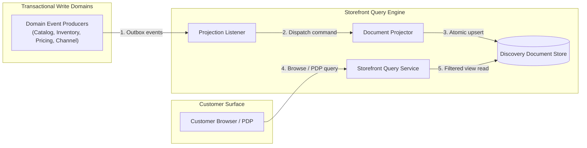
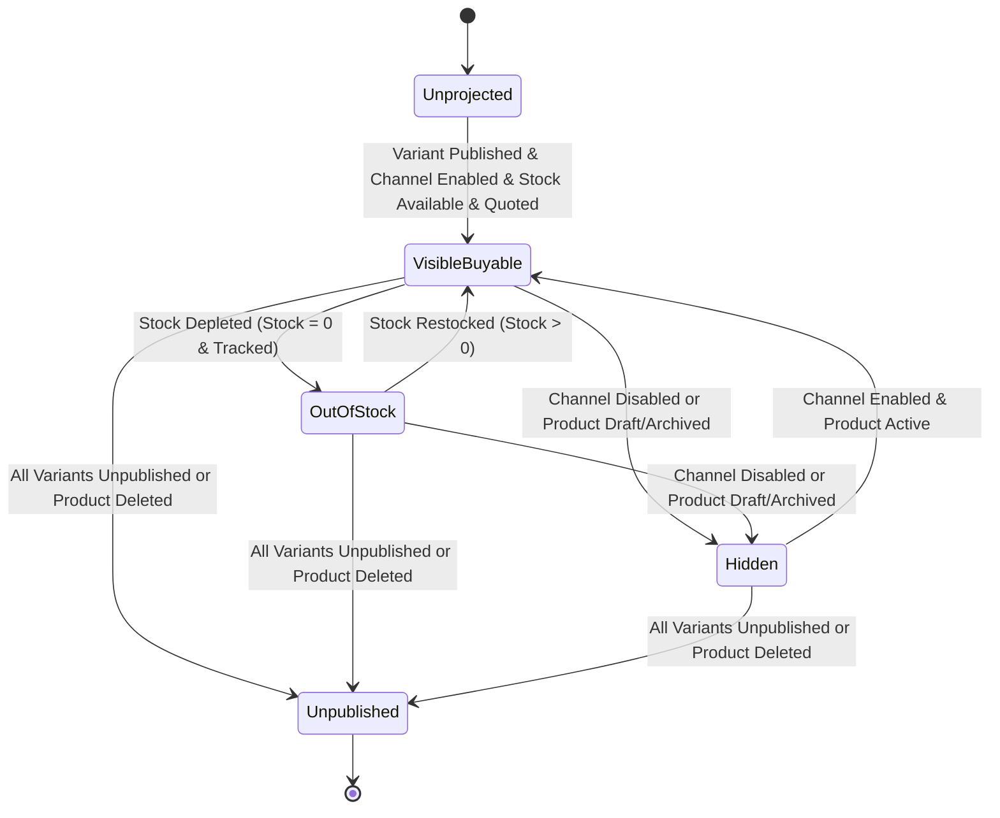
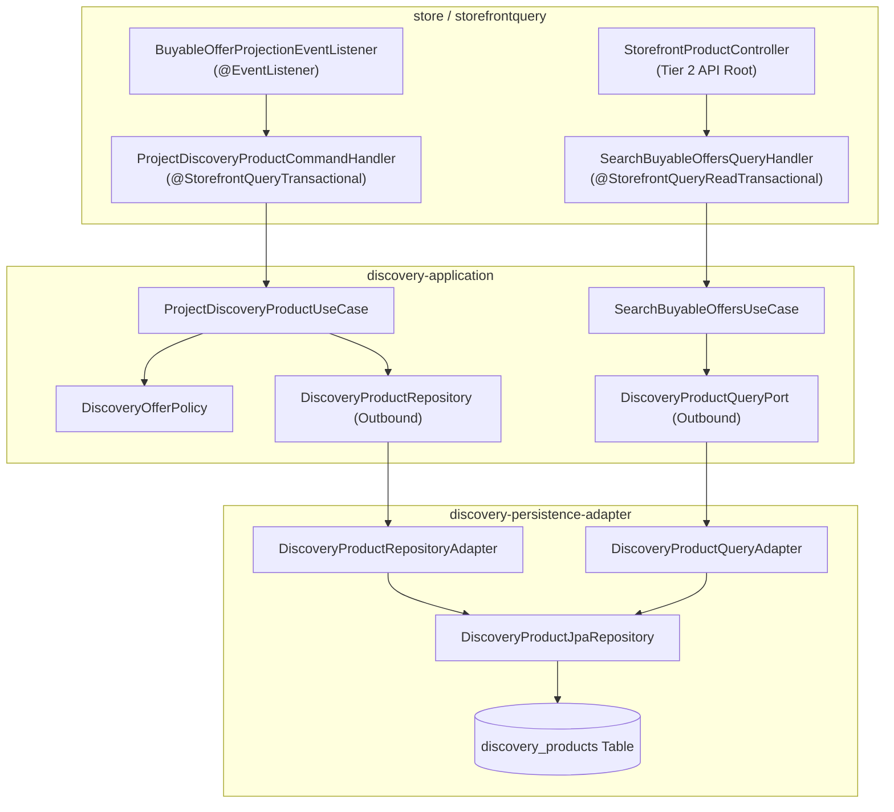
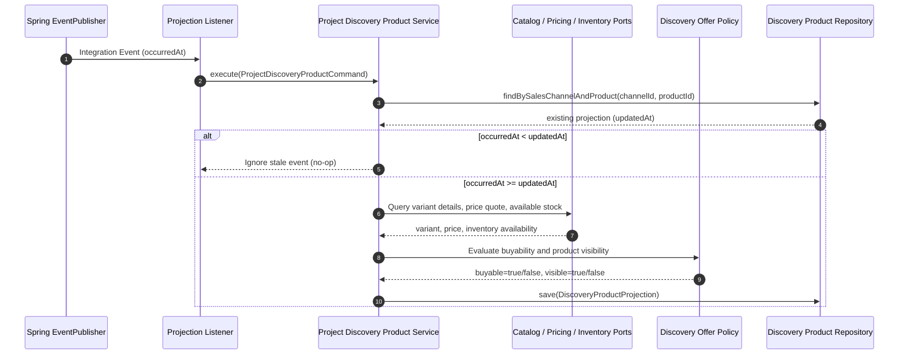
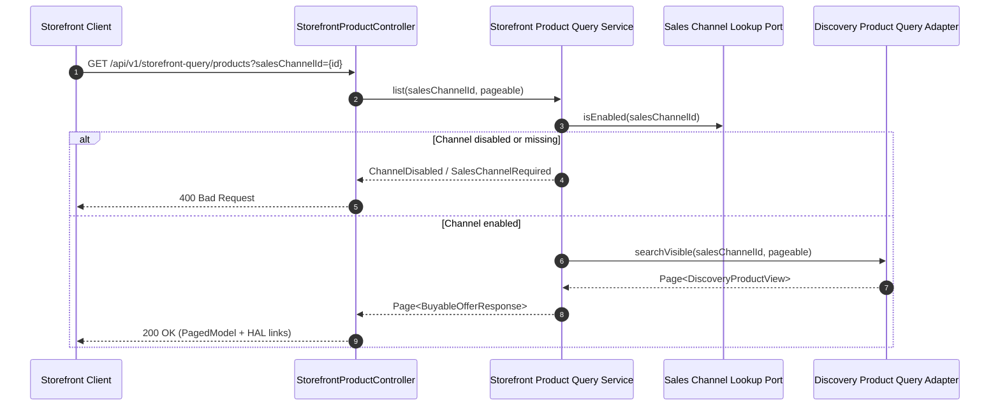

# Tech Specification: Storefront Query & Product Discovery

> **Summary:** Projects denormalized, channel-scoped product discovery documents asynchronously from write-domain events to deliver sub-50ms storefront browsing and PDP lookups.
> **Classification:** Architectural Pattern / CQRS Read Model / Platform Infrastructure
> **Supporting Modules:** `discovery-application` / `discovery-persistence-adapter` / `store/storefrontquery`
> **Related Architecture ADRs:** [ADR-001 System Architecture](../../dev/system/ADR_001-System_architecture.md), [ADR-002 Module-Scoped Outbox](../../dev/system/ADR_002-Module_scoped_outbox_architecture.md)

---

## 1. Why We Need It

### The Problem

High-traffic storefront product listing and PDP queries cannot execute live distributed joins across four transactional write domains (Catalog, Inventory, Pricing, Sales Channel). Direct multi-module queries create severe latency amplification, cascading failures, and database connection exhaustion under burst customer traffic.

### Technology Decision & Alternatives

| Technology Option | Decision | Evaluation Rationale |
| :--- | :--- | :--- |
| **Denormalized Projection Store** | **Adopted** | Delivers sub-50ms customer reads with zero runtime coupling to write databases and bounded contexts. |
| Live Fan-Out / Join-on-Read | Rejected | Introduces cascading failure modes, unbounded read latency, and high read lock contention on write aggregates. |
| External Search Engine (Elasticsearch) | Deferred | High operational complexity for initial deployment scale; can be introduced later by swapping the persistence adapter. |
| Direct DB Views across Module Schemas | Rejected | Violates modular monolith encapsulation boundaries and prevents future independent database extraction. |

### Key Benefits & Trade-offs

**Core Benefits:**
- Delivers predictable low-latency customer browsing decoupled from write database workload.
- Customer browse remains fully operational even during transient outages of upstream pricing or inventory write services.
- Clean separation between seller catalog authoring APIs and customer discovery models.

**Known Trade-offs:**
- Eventual consistency creates a brief window where projected display price or inventory status lags behind write transactions.
- Denormalizes product titles, prices, and stock counts into dedicated projection tables.
- Requires projector idempotency, event timestamp ordering checks, and a background rebuild mechanism.

---

## 2. What It Is

### Core Concept

Storefront Query decouples customer read traffic from transactional write aggregates through an asynchronous event-driven projector. Domain integration events update denormalized channel-scoped documents, which are queried via dedicated read use cases.

### Internal Mechanics & Lifecycle

A discovery product projection transitions through availability states depending on catalog publication, parent product status, sales channel enablement, and inventory availability.

---

## 3. How We Use It in This System

### Project Architecture Stacking

The projection pipeline adheres to hexagonal layering. Inbound events trigger command handlers in `store`, which delegate to application use cases in `discovery-application` backed by `discovery-persistence-adapter`.

### Runtime Flow: Event-Driven Projection Refresh

When upstream domains publish integration events, the projection listener receives the event and executes an idempotent refresh.

### Runtime Flow: Customer Storefront Query

Customer browse and PDP requests query the pre-aggregated projection directly without consulting write modules.

---

## 4. Specification & Contracts

### Normative Requirements

#### 1. Projection Idempotency & Stale Event Protection
- The projection service MUST compare incoming event `occurredAt` timestamps against existing projection `updatedAt` timestamps.
- If `occurredAt` is strictly before `updatedAt`, the service MUST discard the update without writing to the database.
- Projection saves MUST persist `occurredAt` as the document's new `updatedAt` to preserve ordering across event redeliveries.

#### 2. Strict Channel Scoping
- Single-channel events (`Published`, `Unpublished`) MUST project only for the targeted channel ID.
- Multi-channel variant and product events MUST resolve distinct product-channel pairs before recalculating.
- Handlers MUST deduplicate SKU matches and product IDs to ensure linear $O(M)$ projection complexity.

#### 3. Buyability & Visibility Evaluation
- An offer MUST be marked `buyable = true` if and only if:
  1. The variant has an active publication to the target sales channel.
  2. The parent product status equals `"ACTIVE"`.
  3. The sales channel status equals `"ENABLED"`.
  4. Pricing quotes a valid price matching the channel's required currency code.
  5. Available routed inventory is greater than 0, or inventory tracking is disabled (`untracked = true`).
- A product document MUST be marked `visible = true` if and only if the sales channel is enabled, parent product status is `"ACTIVE"`, and at least one variant is published to the channel.

#### 4. Fail-Closed Customer Queries
- Direct queries against missing or blank `salesChannelId` MUST throw `StorefrontQueryServiceError.SalesChannelRequired` (HTTP 400).
- Queries targeting a disabled sales channel MUST fail closed with `StorefrontQueryServiceError.ChannelDisabled` (HTTP 400).
- PDP lookups for unprojected, deleted, or invisible products MUST throw `StorefrontQueryServiceError.OfferNotFound` (HTTP 404).

#### 5. Projection Rebuild Capability
- The system MUST provide an asynchronous rebuild command (`RebuildDiscoveryProductsUseCase`) that reads all publications from Catalog and executes full recalculations.
- Rebuild operations MUST be safe to run concurrently with live traffic without causing deadlocks or corrupting valid projection states.

### HTTP & HATEOAS Endpoints

| Endpoint | Method | Response Model | Description |
| :--- | :--- | :--- | :--- |
| `/api/v1/storefront-query` | `GET` | `RepresentationModel<?>` | Tier 2 API Root exposing discovery links. |
| `/api/v1/storefront-query/products` | `GET` | `PagedModel<EntityModel<BuyableOfferResponse>>` | Paged collection of visible products for channel. |
| `/api/v1/storefront-query/products/{slug}` | `GET` | `EntityModel<BuyableOfferResponse>` | Product detail representation with variant offers. |

### Configuration Knobs

| Property / Parameter | Logical Name | Default | Description |
| :--- | :--- | :--- | :--- |
| `fallbackCurrency` | Fallback Channel Currency | `"MMK"` | Default currency code applied when channel currency is unspecified. |
| `defaultPageSize` | Default Browse Page Size | `20` | Default number of product cards returned per page. |
| `maxPageSize` | Maximum Browse Page Size | `100` | Upper limit for client-specified pagination requests. |
