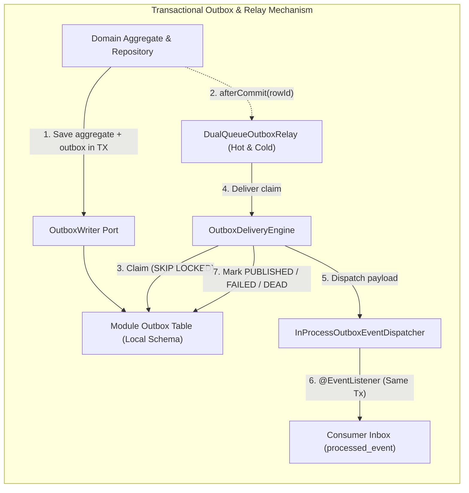
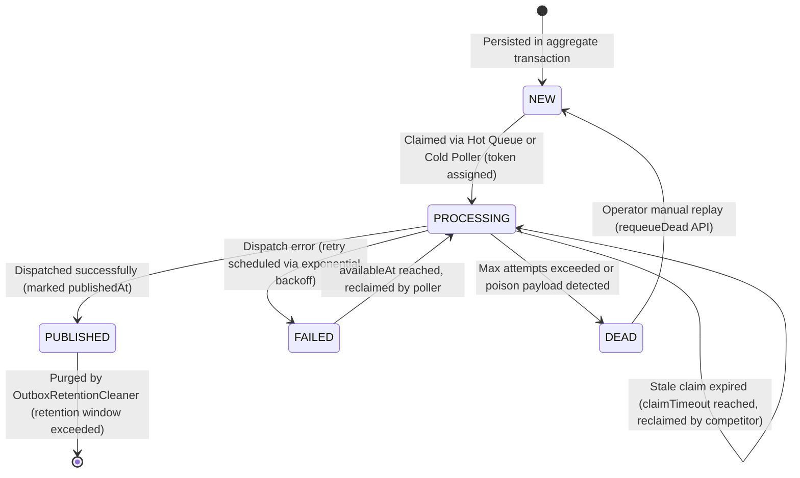
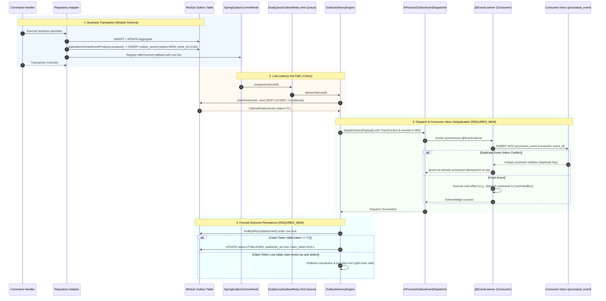
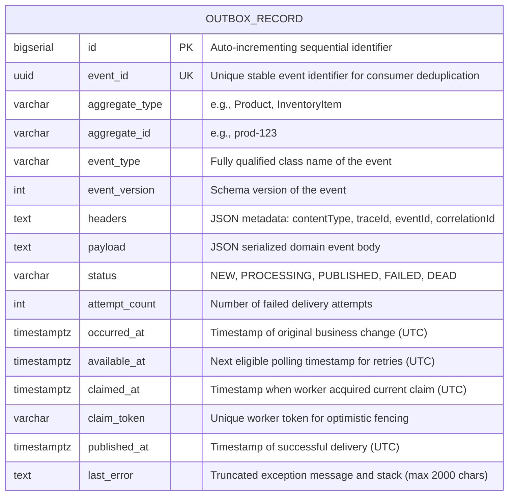
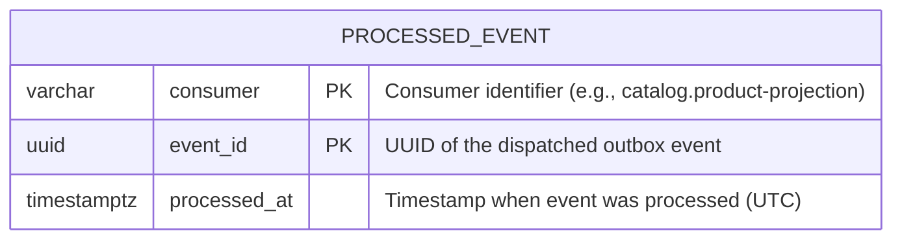

# Tech Specification: Transactional Outbox

> **Summary:** Persists module-owned events with business writes and guarantees reliable, at-least-once asynchronous event delivery with bounded retries, consumer inbox deduplication, and isolated per-module scheduling.
> **Classification:** Architectural Pattern / Platform Infrastructure
> **Supporting Modules:** `framework` / `outbox-infrastructure` / `scheduling-infrastructure`
> **Related Architecture Docs:** [`outbox-refactoring-and-clean-design-plan.md`](../../outbox-refactoring-and-clean-design-plan.md), [`outbox-scheduler-architecture-review.md`](../../outbox-scheduler-architecture-review.md), [`outbox-events-scheduling-plan.md`](../../outbox-events-scheduling-plan.md)

---

## 1. Why We Need It

### The Problem

If a domain event is published directly in-memory or immediately after a business transaction commits, the event is permanently lost if the process crashes before delivery completes. In a modular monolith with database schema isolation, cross-module workflows (e.g., Saga choreography, cross-boundary projections) cannot rely on 2PC/distributed transactions. Without a durable outbox, failures cause silent state desynchronization between bounded contexts.

### Technology Decision & Alternatives

| Technology Option | Decision | Evaluation Rationale |
| :--- | :--- | :--- |
| **Module-Scoped Outbox Tables + Hexagonal Relay** | **Adopted** | Preserves strict multi-schema database isolation. Events are saved in the same local schema transaction as the business aggregate. Decoupled hexagonal core (`DeliverOutboxEventsUseCase`, `OutboxDeliveryEngine`) handles delivery with pluggable claim strategies, retry backoff, and dedicated per-module schedulers (`ModuleJobScheduler`). |
| Global Shared Outbox Table | Rejected | Weakens schema isolation, causes cross-schema coupling, and forces all modules into a shared migration lock. |
| Debezium / CDC (Kafka Connect) | Deferred | Unnecessary operational overhead for a modular monolith. May be revisited if domains are physically extracted to independent microservices. |
| Immediate In-Memory Publication | Rejected | Zero fault tolerance. Process restarts or network timeouts cause unrecoverable event loss. |

### Key Benefits & Trade-offs

**Core Benefits:**
- **Guaranteed At-Least-Once Delivery**: Events committed with business state are durably retained until successfully published.
- **Strict Multi-Schema Isolation**: Dedicated HikariCP pools, separate database schemas, and zero cross-schema foreign keys.
- **Sub-10ms Happy-Path Latency**: In-memory `afterCommit` hot-queue relay bypasses cold polling delays for immediate local dispatch.
- **Concurrency & Re-entrancy Safety**: Replicas compete via non-blocking `FOR UPDATE SKIP LOCKED` claims (or conditional update fallback), with claim token fencing preventing double-dispatch or split-brain overwrites.
- **Bounded Retries & Poison Handling**: Exponential backoff with jitter prevents thundering herd; unrecoverable poison events or exhausted retries transition to terminal `DEAD` state for operator inspection/replay.
- **Clean Hexagonal Architecture**: Core delivery engine is framework-free; store contracts follow the Interface Segregation Principle (`OutboxWriter`, `OutboxClaimStore`, `OutboxMaintenanceStore`).

**Known Trade-offs:**
- **At-Least-Once Semantics**: Network partitions, crashes, or unacknowledged completions may cause duplicate deliveries. Consuming domains must enforce idempotency via the Consumer Inbox pattern (`processed_event`).
- **Storage Housekeeping**: Requires periodic Class B cluster singleton jobs (ShedLock) to purge published rows older than retention.

---

## 2. What It Is

### Core Concept

The Transactional Outbox pattern durably records domain and integration events inside the local schema ACID transaction of the mutating business aggregate. A decoupled, asynchronous delivery engine claims pending rows, binds distributed tracing/MDC headers, dispatches payloads to in-process listeners (or external brokers), and records delivery outcomes under row-lock fencing.

### Event Lifecycle State Machine

Each outbox entry transitions through explicit states guarded by row locks and unique claim tokens:

- **`NEW`**: Durably inserted alongside the aggregate.
- **`PROCESSING`**: Owned by an active worker thread with a unique `claimToken` and `claimedAt` timestamp.
- **`PUBLISHED`**: Successfully delivered to consumer listeners.
- **`FAILED`**: Dispatch exception encountered. `attemptCount` incremented; `availableAt` calculated using exponential backoff with jitter.
- **`DEAD`**: Terminal failure state reached after `maxAttempts` (default 10) or upon `OutboxPoisonEventException`. Excluded from polling; inspected and requeued via `OutboxAdministrationPort`.

---

## 3. Architecture & System Structure

### Layer Stacking & Hexagonal Ports

The outbox implementation strictly follows Hexagonal Architecture (Ports and Adapters) with clean dependency direction pointing inward toward the framework-free core:

```mermaid
flowchart TB
    subgraph PersistenceLayer ["Bounded Context Persistence Adapter (*-adapter-persistence)"]
        Agg["Domain Aggregate"]
        Repo["Repository Adapter"]
        Entity["ModuleOutboxEvent Entity (JPA)"]
    end

    subgraph OutboxInfra ["Outbox Infrastructure (outbox-infrastructure)"]
        subgraph CorePortIn ["core.port.in"]
            DeliverUC["DeliverOutboxEventsUseCase"]
            AdminPort["OutboxAdministrationPort"]
        end

        subgraph CoreService ["core.service (Framework-Free)"]
            Engine["OutboxDeliveryEngine"]
            Recorder["OutboxOutcomeRecorder"]
            Cleaner["OutboxRetentionCleaner"]
            AdminService["OutboxAdministrationService"]
        end

        subgraph CorePortOut ["core.port.out (ISP Segregated SPIs)"]
            OW["OutboxWriter<T>"]
            OCS["OutboxClaimStore<T, ID>"]
            OMS["OutboxMaintenanceStore<T, ID>"]
            OT["OutboxTransactions"]
            OO["OutboxObserver"]
        end

        subgraph Adapters ["Adapters (out / in)"]
            JOS["JpaOutboxStore<T, ID>"]
            JDEP["JpaOutboxDomainEventProducer"]
            DQOR["DualQueueOutboxRelay<ID>"]
            SOT["SpringOutboxTransactions"]
            IPOED["InProcessOutboxEventDispatcher"]
            MOO["MicrometerOutboxObserver"]
            OBG["OutboxBacklogGauges"]
            ClaimStrat["OutboxClaimStrategy\n(SkipLocked / ConditionalUpdate)"]
        end

        subgraph Composition ["module.OutboxModule"]
            OM["OutboxModule (Builder)"]
        end
    end

    subgraph SchedulingInfra ["Scheduling Infrastructure (scheduling-infrastructure)"]
        MJS["ModuleJobScheduler\n(Dedicated Thread Pool: <module>-jobs-)"]
        OSJ["OutboxScheduledJobs"]
        ISJ["InboxScheduledJobs"]
        SJ["ScheduledJob (Sealed)\n- CompetingWorkerTask (Class A: Poll)\n- ClusterSingletonTask (Class B: Cleanup/ShedLock)"]
    end

    subgraph AppConfig ["Application Assembly (app)"]
        Config["*ModuleOutboxConfig"]
    end

    Agg --> Repo
    Repo --> JDEP
    JDEP --> OW
    OW --> JOS
    JOS --> Entity

    DeliverUC --> Engine
    AdminPort --> AdminService
    Engine --> Recorder
    Engine --> Cleaner
    Engine --> OCS
    Cleaner --> OMS
    AdminService --> OMS

    JOS -.-> OCS
    JOS -.-> OMS
    JOS --> ClaimStrat
    Engine --> DQOR
    Engine --> IPOED
    Recorder --> OT
    Cleaner --> OT

    Config --> OM
    OM --> OutboxInfra
    Config --> MJS
    MJS --> OSJ
    MJS --> ISJ
    MJS --> SJ
```

### Component Responsibilities

| Component | Package / Module | Responsibility |
| :--- | :--- | :--- |
| **`OutboxWriter<T>`** | `outbox-infrastructure.core.port.out` | **ISP Port**: Narrow write contract (`saveAll`, `flush`) used strictly by event producers during business transactions. |
| **`OutboxClaimStore<T, ID>`** | `outbox-infrastructure.core.port.out` | **ISP Port**: Claiming contract (`claimBatch`, `claimOne`, `findById`, `findByIdForUpdate`) used strictly by the delivery engine. |
| **`OutboxMaintenanceStore<T, ID>`** | `outbox-infrastructure.core.port.out` | **ISP Port**: Maintenance contract (`deletePublishedOlderThan`, `findDeadForReplay`, `backlog`) for retention, replaying, and telemetry. |
| **`OutboxDeliveryEngine`** | `outbox-infrastructure.core.service` | Pure delivery coordinator. Orchestrates hot/cold claims, payload dispatching, and fences claim tokens against concurrent takeovers. |
| **`OutboxOutcomeRecorder`** | `outbox-infrastructure.core.service` | Evaluates retry backoff, stamps failures or dead-letters, marks successful publications, and releases claims on shutdown. |
| **`OutboxRetentionCleaner`** | `outbox-infrastructure.core.service` | Deletes published records older than retention (`retention-ms`) in bounded batches inside isolated short transactions. |
| **`OutboxAdministrationService`** | `outbox-infrastructure.core.service` | Requeues dead-lettered events (`DEAD -> NEW`) within a specified ID range for operator replay. |
| **`DualQueueOutboxRelay`** | `outbox-infrastructure.adapter.in.relay` | Threaded in-memory dispatcher managing hot queue (after-commit notifications) and cold queue (poller batches) with in-flight deduplication. |
| **`ModuleJobScheduler`** | `scheduling-infrastructure` | Lifecycle-aware scheduler providing dedicated thread pools (`<module>-jobs-`) per module, isolating task scheduling across domains. |
| **`OutboxScheduledJobs`** | `scheduling-infrastructure` | Type-safe factory binding Class A competing pollers and Class B ShedLock-guarded retention cleanups into sealed `ScheduledJob` tasks. |
| **`OutboxModule`** | `outbox-infrastructure.module` | Centralized composition builder that wires the module's store, relay, engine, outcome recorder, cleaner, and metrics from properties. |

---

## 4. Runtime Delivery Sequence

---

## 5. Technical Specifications & Normative Rules

### Normative Rules

- **R-01 (Atomic Persistence):** Outbox event records **MUST** be persisted atomically within the exact same database transaction as the business aggregate state changes.
- **R-02 (Schema Isolation):** Producing modules **MUST NOT** share outbox tables, datasources, or transaction managers. Each service group must maintain its own outbox table within its dedicated PostgreSQL schema.
- **R-03 (Bounded Retries & Terminal DEAD State):** Failed deliveries **MUST** be retried using exponential backoff with jitter up to `maxAttempts` (default 10). When retries are exhausted or upon `OutboxPoisonEventException`, the entry **MUST** transition to `DEAD` status and raise an alert.
- **R-04 (Consumer Inbox Idempotency):** Consuming modules **MUST** record incoming `eventId`s into their local schema `processed_event` table in the same transaction as their side effects, guaranteeing idempotent processing under at-least-once delivery.
- **R-05 (Synchronous Listener Dispatch):** Outbox-dispatched events **MUST** be received via synchronous `@EventListener`. Consuming listeners **MUST NOT** use `@Async` or `@TransactionalEventListener`, which silently break outbox delivery tracking, error propagation, and inbox deduplication.
- **R-06 (Claim Token Fencing):** Every post-dispatch status update (`PUBLISHED`, `FAILED`, `DEAD`) **MUST** re-verify row ownership under `findByIdForUpdate` against the original `claimToken`. If the token does not match, the update **MUST** be discarded as `claim.lost` to prevent split-brain overwrites.
- **R-07 (Non-Blocking Hot Path):** The hot queue **MUST NOT** delay the business caller's HTTP thread; handoff occurs asynchronously after commit via `DualQueueOutboxRelay`. The cold database poller serves as the resilient recovery backstop.
- **R-08 (Scheduling Isolation):** Background outbox polling and cleanup **MUST** run on dedicated, module-scoped thread pools managed by `ModuleJobScheduler` (`<module>-jobs-`). Schedulers **MUST NOT** share thread pools across bounded contexts.
- **R-09 (Cluster Singleton Locking):** Retention cleanup jobs (`<module>.outbox.cleanup`) **MUST** be annotated with `@ClusterSingletonJob` and executed via ShedLock (`JdbcTemplateLockProvider` with DB time) across replicas.
- **R-10 (Framework-Free Core):** Classes in `outbox-infrastructure.core` **MUST NOT** import Spring Framework, Jakarta Persistence, Hibernate, or Micrometer. All infrastructure interactions must route through outbound ports.

---

## 6. Storage & Data Contracts

### Module Outbox Table (`outbox_record`)

Each bounded context owns an identical schema-isolated table (e.g., `catalog.outbox_record`, `inventory.outbox_record`, `workflows.workflow_outbox_events`):

**Indexes Required per Schema:**
- `idx_{module}_outbox_status_available`: `(status, available_at)`
- `idx_{module}_outbox_claimed_at`: `(claimed_at)`
- `idx_{module}_outbox_aggregate`: `(aggregate_type, aggregate_id)`
- `idx_{module}_outbox_published_at`: `(published_at)`
- `idx_{module}_outbox_dead`: `(id) WHERE status = 'DEAD'`
- `uq_{module}_outbox_event_id`: UNIQUE `(event_id)`

---

### Consumer Inbox Table (`processed_event`)

Each consuming domain maintains an inbox table within its schema to guarantee deduplication:

---

## 7. Configuration Knobs & Operational Defaults

All settings are bound per module under `<module>.outbox.*` (with fallback to global defaults):

| Property Key | Code Fallback | Dev Default | Unit / Type | Description |
| :--- | :--- | :--- | :--- | :--- |
| `<module>.outbox.batch-size` | `20` | `20` | Integer (rows) | Maximum rows claimed per cold poll batch. |
| `<module>.outbox.fixed-delay-ms` | `5000` | `5000` | Milliseconds | Polling interval for cold backlog recovery. |
| `<module>.outbox.retry-delay-ms` | `30000` | `30000` | Milliseconds | Base retry backoff for failed events. |
| `<module>.outbox.max-backoff-ms` | `900000` | `900000` (15 min) | Milliseconds | Maximum backoff cap for exponential retry delay. |
| `<module>.outbox.max-attempts` | `10` | `10` | Integer | Maximum retry attempts before marking row `DEAD`. |
| `<module>.outbox.claim-timeout-ms` | `120000` | `120000` (2 min) | Milliseconds | Duration after which a `PROCESSING` claim is considered stale and reclaimable. |
| `<module>.outbox.claim-strategy` | `skip-locked` | `skip-locked` | String | Locking strategy: `skip-locked` (Postgres/MySQL 8+) or `conditional-update` (H2/Generic). |
| `<module>.outbox.retention-ms` | `604800000` | `604800000` (7 days)| Milliseconds | Age after which `PUBLISHED` rows are deleted by cleanup. |
| `<module>.outbox.cleanup-fixed-delay-ms`| `300000` | `300000` (5 min) | Milliseconds | Interval between Class B retention cleanup runs. |
| `<module>.outbox.cleanup-batch-size` | `5000` | `5000` | Integer (rows) | Maximum rows deleted in a single retention transaction. |
| `<module>.outbox.cleanup-lock-at-most-for-ms` | `600000` | `600000` (10 min) | Milliseconds | ShedLock maximum cluster lock hold duration. |
| `<module>.outbox.cleanup-lock-at-least-for-ms`| `240000` | `240000` (4 min) | Milliseconds | ShedLock minimum cluster lock hold duration. |
| `<module>.outbox.hot-queue.enabled` | `true` | `true` | Boolean | Enables low-latency in-memory post-commit relay. |
| `<module>.outbox.hot-queue.workers` | `2` | `2` | Integer (threads) | Dedicated worker threads per module hot queue. |
| `<module>.outbox.hot-queue.capacity` | `1000` | `1000` | Integer (events) | Maximum capacity for in-memory queue. |
| `<module>.outbox.hot-queue.drain-timeout-ms` | `5000` | `5000` | Milliseconds | Maximum shutdown wait to drain pending hot work. |
| `<module>.scheduling.pool-size` | `2` | `2` | Integer (threads) | Dedicated thread pool size for `ModuleJobScheduler`. |
| `<module>.inbox.retention-ms` | `1209600000`| `1209600000` (14 days)| Milliseconds | Age after which consumer inbox rows are purged. |

---

## 8. Observability & Telemetry

The outbox emits standard Micrometer metrics under the `outbox.*` prefix tagged with `module` and `event_type`:

| Metric Name | Type | Tags | Description |
| :--- | :--- | :--- | :--- |
| `outbox.published` | Counter & Timer | `module`, `event_type` | Count of published events and delivery lag duration. |
| `outbox.failed` | Counter | `module`, `event_type`, `attempt` | Count of delivery failures by attempt number. |
| `outbox.dead` | Counter | `module`, `event_type` | Count of events dead-lettered due to exhaustion or poison. |
| `outbox.claims.lost` | Counter | `module` | Claims lost to competitors during fenced outcome updates. |
| `outbox.claims.released` | Counter | `module` | Undispatched claims released back to available on shutdown. |
| `outbox.cleanup.deleted` | Counter | `module` | Published rows purged by retention cleaner. |
| `outbox.pending` | Gauge | `module` | Current undelivered backlog (`NEW`, `FAILED`, `PROCESSING`). |
| `outbox.oldest_pending_age_seconds` | Gauge | `module` | Age of the oldest uncompleted row in the backlog. |
| `outbox.hot_queue.dropped` | Counter | `module` | Hot-queue offers dropped due to full capacity (recovered by cold poller). |

---

## 9. Code Implementation References

- **Core Use Cases & Ports:**
  - Inbound Ports: `outbox-infrastructure/src/main/java/com/grab/outbox/infrastructure/core/port/in/DeliverOutboxEventsUseCase.java`
  - Inbound Administration: `outbox-infrastructure/src/main/java/com/grab/outbox/infrastructure/core/port/in/OutboxAdministrationPort.java`
  - Outbound Store Ports: `outbox-infrastructure/src/main/java/com/grab/outbox/infrastructure/core/port/out/OutboxWriter.java`, `OutboxClaimStore.java`, `OutboxMaintenanceStore.java`
- **Core Services:**
  - Delivery Engine: `outbox-infrastructure/src/main/java/com/grab/outbox/infrastructure/core/service/OutboxDeliveryEngine.java`
  - Outcome Recorder: `outbox-infrastructure/src/main/java/com/grab/outbox/infrastructure/core/service/OutboxOutcomeRecorder.java`
  - Retention Cleaner: `outbox-infrastructure/src/main/java/com/grab/outbox/infrastructure/core/service/OutboxRetentionCleaner.java`
  - Administration Service: `outbox-infrastructure/src/main/java/com/grab/outbox/infrastructure/core/service/OutboxAdministrationService.java`
- **Adapters & Composition:**
  - JPA Store & Producer: `outbox-infrastructure/src/main/java/com/grab/outbox/infrastructure/adapter/out/jpa/JpaOutboxStore.java`, `JpaOutboxDomainEventProducer.java`
  - Module Composition: `outbox-infrastructure/src/main/java/com/grab/outbox/infrastructure/module/OutboxModule.java`
  - Schedulers: `scheduling-infrastructure/src/main/java/com/grab/scheduling/infrastructure/ModuleJobScheduler.java`, `OutboxScheduledJobs.java`
