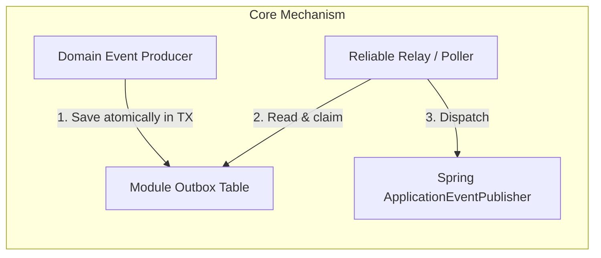
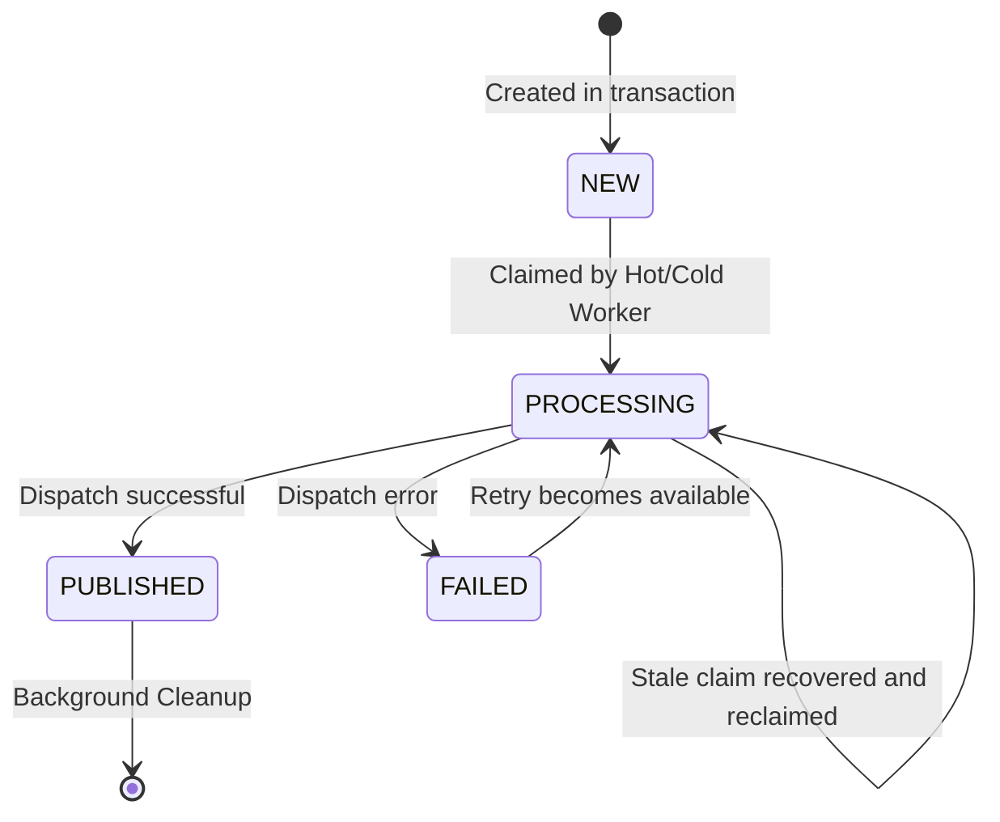
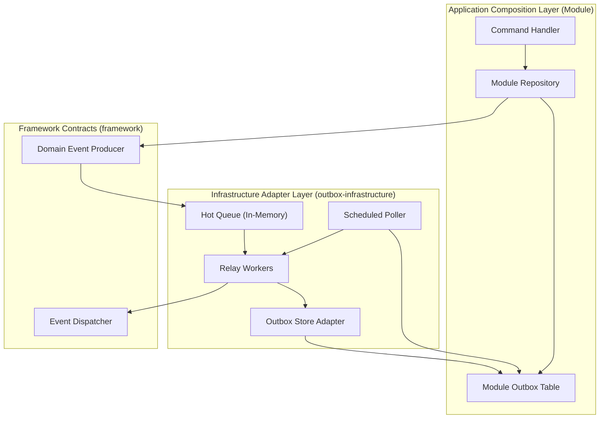
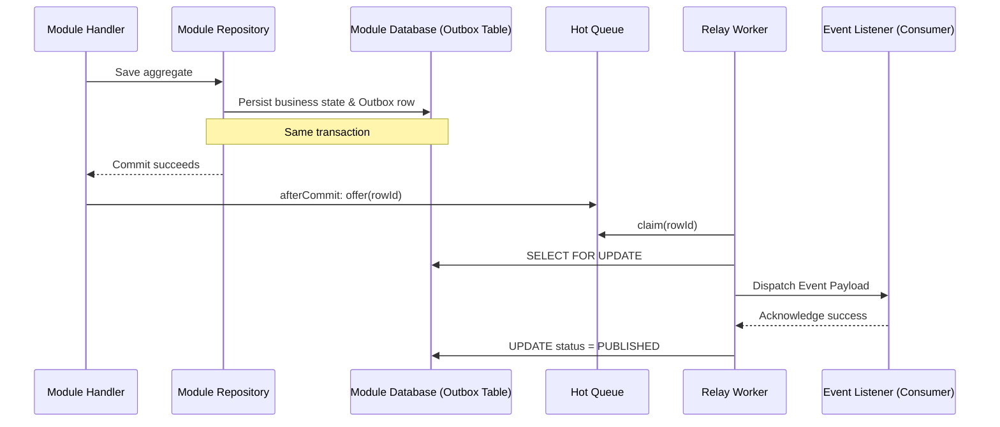
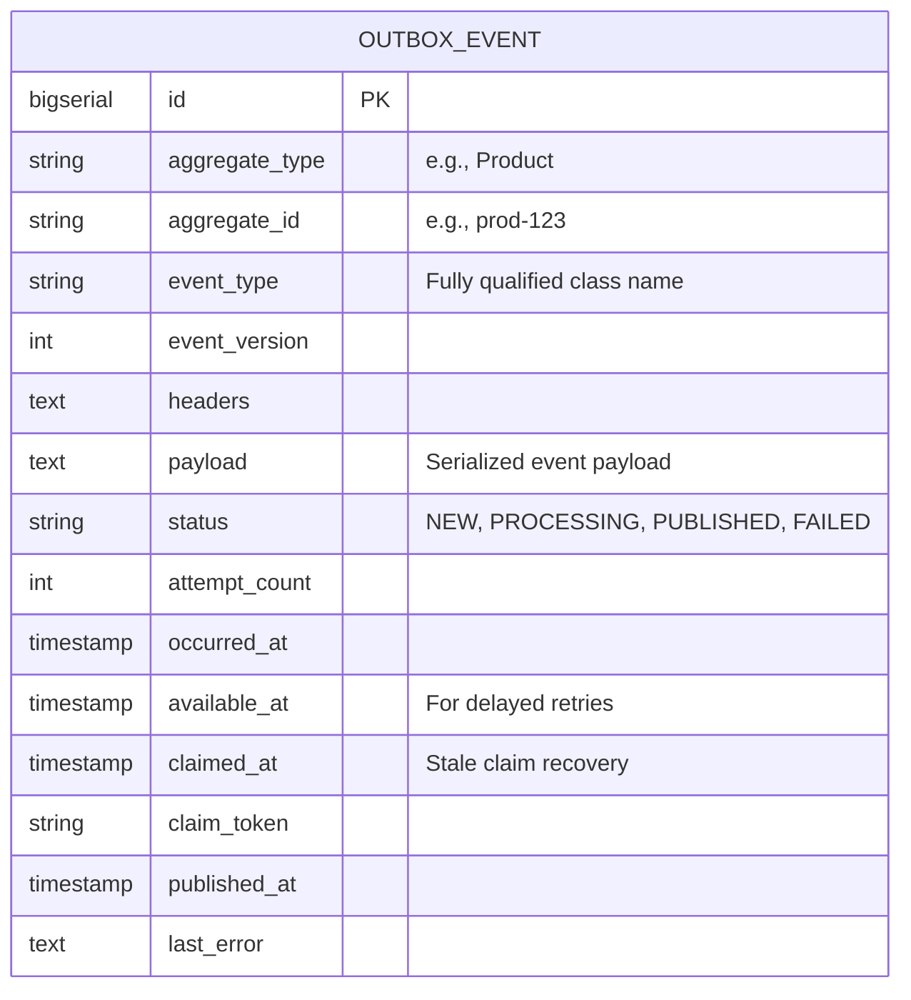

# Tech Specification: Transactional Outbox

> **Summary:** Persists module-owned events with business writes and retries asynchronous dispatch from the outbox.
> **Classification:** Architectural Pattern / Platform Infrastructure
> **Supporting Modules:** `framework` / `outbox-infrastructure`
> **Related Architecture ADRs:** [ADR-002](../../dev/system/ADR_002-Module_scoped_outbox_architecture.md), [ADR-011](../../dev/system/ADR_011-Outbox_hot_queue.md)

---

## 1. Why We Need It

### The Problem

If a domain event is published immediately after a business transaction commits, the event is permanently lost if the process crashes before delivery completes. This prevents cross-module workflows (e.g., Saga orchestration) from making reliable progress and leaves systems in an inconsistent state.

### Technology Decision & Alternatives

| Technology Option | Decision | Evaluation Rationale |
| :--- | :--- | :--- |
| **Module-Scoped Outbox Tables** | **Adopted** | Preserves strict module boundaries. Events are saved in the same transaction as the business aggregate and remain available for retry after process or delivery failures. |
| Global Shared Outbox Table | Rejected | Weakens module ownership and forces all modules to depend on a single database schema migration path. |
| Debezium / CDC | Deferred | Overkill for a single-database modular monolith. May be reconsidered if modules are physically extracted to microservices. |
| Immediate Publication (No DB) | Rejected | High risk of data loss on application crash; cannot guarantee eventual consistency for sagas. |

### Key Benefits & Trade-offs

**Core Benefits:**
- A committed event remains available for recovery after process restarts or delivery failures.
- Module encapsulation is preserved (each module owns its events).
- Hot queue relay ensures near-instantaneous processing (single-digit milliseconds) on the happy path.

**Known Trade-offs:**
- Requires background poller management and database storage space.
- Retry and crash-recovery paths can dispatch the same event more than once, so consumers must be idempotent.
- Hot queue worker races with the DB poller; DB claim dictates ownership.

---

## 2. What It Is

### Core Concept

The Transactional Outbox pattern durably records a message inside the same ACID transaction as the business state change. A background processor or queue relay retries dispatch and marks successful deliveries complete; permanent consumer failures can still prevent successful delivery.

### Internal Mechanics & Lifecycle

> Visual lifecycle for stateful outbox entries.

---

## 3. How We Use It in This System

### Architecture & Layer Stacking

### Component Responsibilities

| Architectural Role | Layer Location | Responsibility |
| :--- | :--- | :--- |
| `Domain Event Producer` | `framework` | Captures events from aggregates and serializes them to the outbox via the `OutboxStore`. |
| `Hot Queue Relay` | `outbox-infrastructure` | An in-memory hook triggered `afterCommit` that bypasses polling delays for near-instant dispatch. |
| `Scheduled Poller (Cold)` | `outbox-infrastructure` | Sweeps the outbox table for missed events, crashes, and retries. Acts as the safety net. |
| `Module Outbox Table` | Module persistence adapter | The durable source of truth. Each module owns its outbox table. |

### Runtime Flow

---

## 4. Technical Specification & Contracts

Normative specification. An implementation is compliant only when all MUST / MUST NOT statements are satisfied.

### Normative Rules

- **R-01:** Outbox event records **MUST** be persisted atomically within the exact same database transaction as the business aggregate state changes.
- **R-02:** Producing modules **MUST NOT** share outbox tables. Each module must own a distinct table or schema.
- **R-03:** The dispatching mechanism **MUST** retain failed rows and retry them after the configured delay without an attempt cutoff. Successful dispatch may be observed more than once; the implementation does not guarantee eventual success when a consumer fails permanently.
- **R-04:** Event consumers **MUST** be strictly idempotent, as crash recovery or poller overlap may result in duplicate event delivery.
- **R-05:** The hot queue mechanism **MUST NOT** delay or block the caller's HTTP request thread; dispatching MUST happen asynchronously on worker threads.
- **R-06:** The hot queue **MUST NOT** be trusted as the source of truth. The durable database row remains the authoritative record.

### Current Recovery Behavior

The implemented status values are `NEW`, `PROCESSING`, `PUBLISHED`, and `FAILED`. A delivery failure records the error and a future availability time; the next eligible poll can claim the `FAILED` row again. There is no attempt limit, dead-letter status, or automatic terminal cutoff. A row left `PROCESSING` beyond its claim timeout is eligible for reclaim by the poller. These retries provide recovery attempts but do not guarantee successful delivery when a consumer fails permanently.

Outbox settings are module-scoped under `<module>.outbox.*` (for example, `catalog.outbox.*` and `workflows.outbox.*`). Code fallbacks and the environment-backed development-profile fallbacks are 5,000 ms polling, 300,000 ms published-row cleanup cadence, batch size 20, retry delay 30,000 ms, claim timeout 120,000 ms, and retention 604,800,000 ms. The profile permits per-module environment overrides. Hot queue settings are separately scoped under `<module>.outbox.hot-queue.*`; their defaults and profile fallbacks are listed below.

### Storage & Data Contract

### Configuration Knobs

| Binding | Code fallback | Development-profile default | Unit / format | Description |
| :--- | :--- | :--- | :--- | :--- |
| `<module>.outbox.fixed-delay-ms` | `5000` | `5000` ms, environment-overridable | Milliseconds | Delay between cold polling runs. |
| `<module>.outbox.cleanup-fixed-delay-ms` | `300000` | `300000` ms, environment-overridable | Milliseconds | Delay between published-row cleanup runs. |
| `<module>.outbox.batch-size` | `20` | `20`, environment-overridable | Rows | Maximum rows claimed per poll run. |
| `<module>.outbox.retry-delay-ms` | `30000` | `30000` ms, environment-overridable | Milliseconds | Delay before retrying a failed delivery. |
| `<module>.outbox.claim-timeout-ms` | `120000` | `120000` ms, environment-overridable | Milliseconds | Age after which a `PROCESSING` claim can be recovered. |
| `<module>.outbox.retention-ms` | `604800000` | `604800000` ms, environment-overridable | Milliseconds | Age after which published rows may be deleted. |
| `<module>.outbox.hot-queue.enabled` | `true` | `true`, environment-overridable | Boolean | Enables the in-memory post-commit relay; the database poller remains recovery path. |
| `<module>.outbox.hot-queue.workers` | `2` | `2`, environment-overridable | Worker threads | Relay worker count. |
| `<module>.outbox.hot-queue.capacity` | `1000` | `1000`, environment-overridable | Queued events | Capacity for each in-memory queue. |
| `<module>.outbox.hot-queue.drain-timeout-ms` | `5000` | `5000` ms, environment-overridable | Milliseconds | Maximum wait when stopping relay workers. |

Implementation references: `outbox-infrastructure/src/main/java/com/grab/outbox/infrastructure/AbstractOutboxProcessor.java`, `outbox-infrastructure/src/main/java/com/grab/outbox/infrastructure/jpa/JpaOutboxStore.java`, `framework/src/main/java/com/grab/framework/outbox/OutboxStatus.java`, and `store/src/main/resources/application-dev.yml`.
