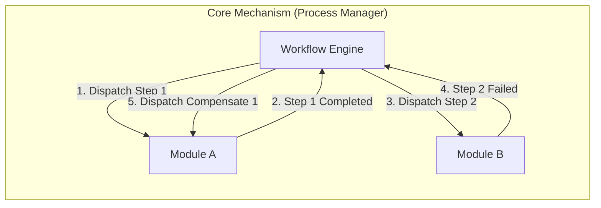
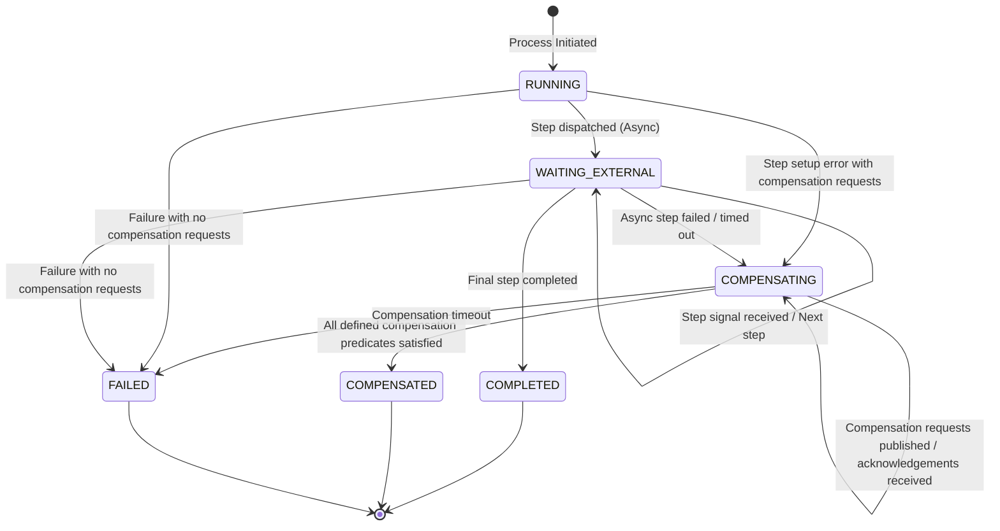
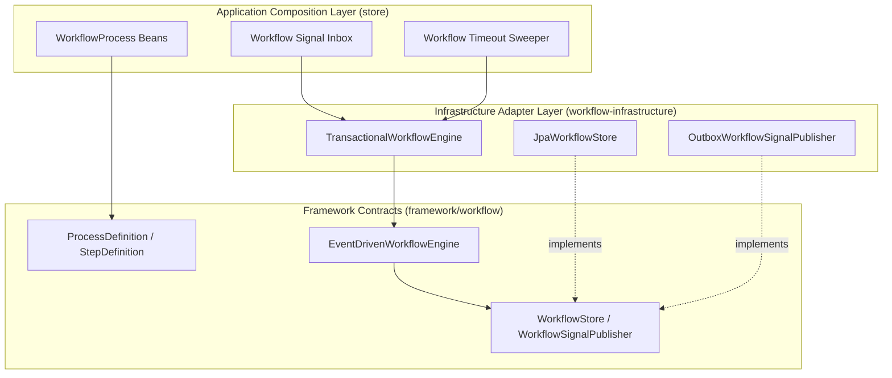
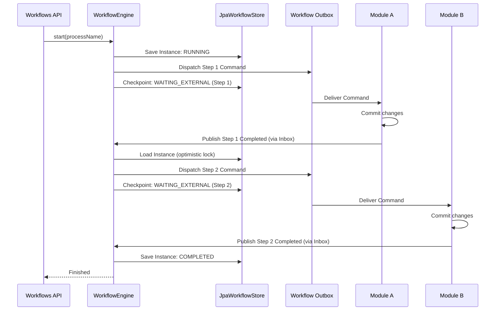
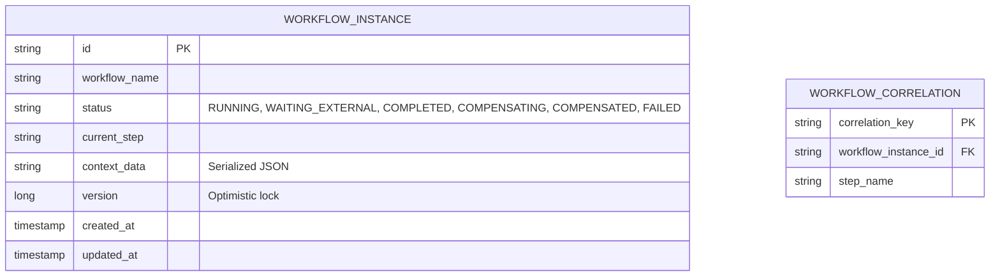

# Tech Specification: Workflow Engine & Orchestrated Saga

> **Summary:** A durable, event-driven process manager that coordinates cross-module workflows, checkpoints progress, handles timeouts, and requests defined compensations.
> **Classification:** Architectural Pattern / Platform Infrastructure
> **Supporting Modules:** `framework/workflow` / `workflow-infrastructure` / `store/workflows`
> **Related Architecture ADRs:** [ADR-006](../../dev/system/ADR_006-Orchestrated_saga_architecture.md), [ADR-007](../../dev/system/ADR_007-Workflow_framework_internal_design.md)

---

## 1. Why We Need It

### The Problem

Cross-module business operations (like creating a product, syncing inventory, and updating search indexes) require multiple independent database writes. If coordinated via synchronous HTTP or injected beans, a failure in step 3 leaves steps 1 and 2 committed, leading to data inconsistency and partial state. We need a way to reliably orchestrate multi-step flows and reverse (compensate) them if a downstream step fails.

### Technology Decision & Alternatives

| Technology Option | Decision | Evaluation Rationale |
| :--- | :--- | :--- |
| **Durable Process Manager (Saga)** | **Adopted** | Centralizes sequence logic and compensation order. Keeps bounded contexts completely decoupled (they only consume/emit events). |
| Event Choreography (Pure Pub/Sub) | Rejected | Hard to track the overall status of a complex flow; difficult to orchestrate ordered rollbacks across many independent listeners. |
| Two-Phase Commit (2PC) / XA | Rejected | Blocks database resources, doesn't scale in distributed/modular systems, and isn't supported across microservice boundaries. |
| Temporal / Cadence | Deferred | Extremely powerful, but introduces significant infrastructure overhead for a modular monolith. May adopt if moving to microservices. |

### Key Benefits & Trade-offs

**Core Benefits:**
- Bounded contexts remain completely ignorant of the orchestrator; they just listen to commands and emit completion events.
- Crash resilience: If the app crashes midway, the workflow safely resumes from the last checkpoint.
- Defined compensations are collected and dispatched after a failure; the engine records whether they complete.

**Known Trade-offs:**
- Requires maintaining a central workflow database (instances, correlations, signal dedup).
- Eventual consistency latency instead of immediate delivery (processes communicate via the Transactional Outbox).

---

## 2. What It Is

### Core Concept

The Workflow Engine implements the **Process Manager (Orchestrated Saga)** pattern. It evaluates a workflow definition, dispatches a request to a module, waits for a completion signal, and then advances. On failure, it collects compensation requests by walking the defined steps in reverse order and publishes the collected batch. The requests are not gated on sequential acknowledgements; acknowledgement signals update context, and the workflow becomes `COMPENSATED` only when every compensation predicate is satisfied.

### Internal Mechanics & Lifecycle

> Visual lifecycle of a `WorkflowInstance` managed by the engine.

---

## 3. How We Use It in This System

### Architecture & Layer Stacking

### Component Responsibilities

| Architectural Role | Layer Location | Responsibility |
| :--- | :--- | :--- |
| `ProcessDefinition` | `store/workflows` | Declarative configuration defining the sequence of steps and their compensation rules. |
| `EventDrivenWorkflowEngine` | `framework/workflow` | The pure domain logic of the engine: evaluates definitions, tracks state, and coordinates retries/rollbacks. |
| `TransactionalWorkflowEngine` | `workflow-infrastructure` | Wraps engine calls in a `REQUIRES_NEW` transaction and handles optimistic locking retries. |
| `JpaWorkflowStore` | `workflow-infrastructure` | Persists `WorkflowInstance` state, step checkpoints, and correlation IDs. |
| `WorkflowSignalInbox` | `store/workflows` | Consumes `WorkflowSignalEvent`s published by modules and routes them into the engine via `onSignal`. |

### Runtime Flow

---

## 4. Technical Specification & Contracts

Normative specification. An implementation is compliant only when all MUST / MUST NOT statements are satisfied.

### Normative Rules

- **R-01:** The workflow engine **MUST NOT** share a database transaction with the participating business modules (e.g., Catalog, Inventory).
- **R-02:** The workflow engine **MUST NOT** directly invoke `@Service` beans from other bounded contexts. All cross-module communication MUST occur via dispatched outbox events.
- **R-03:** Each `WorkflowInstance` mutation **MUST** use optimistic locking (`version` field) to prevent concurrent signal processing from corrupting state.
- **R-04:** Every step uses its declared `timeout()` or the fixed 10-minute default. The workflow sweeper starts compensation for an expired external step and fails a workflow whose compensation remains pending beyond its timeout.
- **R-05:** Compensation logic **MUST** be idempotent. A compensation action may be dispatched multiple times if the network or process crashes.

### Current Outcome and Compensation Behavior

The engine marks a workflow `FAILED` immediately when a failure yields no compensation requests. When requests exist, it marks the instance `COMPENSATING` and publishes the collected requests together, in reverse step-definition order. It marks the instance `COMPENSATED` only after all compensation predicates are satisfied. If compensation remains pending until the step timeout, the engine terminates `FAILED`; a failure event received while compensating does not itself establish a compensated outcome. Thus `COMPENSATED` means all defined compensations completed, while `FAILED` can retain partially applied business state.

### Storage & Data Contract

### Configuration Knobs

| Binding / constant | Value | Unit / format | Description |
| :--- | :--- | :--- | :--- |
| `workflows.sweeper.fixed-delay-ms` | `30000` ms fallback; same value in development profile | Milliseconds | Delay between timeout sweeps. |
| `StepDefinition.DEFAULT_TIMEOUT` | 10 | Minutes | Fixed default timeout when a workflow step does not override it. |
| `EventDrivenWorkflowEngine.SWEEP_BATCH` | 50 | Instances | Fixed maximum candidate count per workflow definition and sweep. |
| `TransactionalWorkflowEngine.SIGNAL_ATTEMPTS` | 3 | Attempts | Fixed optimistic-lock retry count for signal processing and resume; not configurable. |

Implementation references: `framework/src/main/java/com/grab/framework/workflow/impl/EventDrivenWorkflowEngine.java`, `framework/src/main/java/com/grab/framework/workflow/StepDefinition.java`, `workflow-infrastructure/src/main/java/com/grab/workflow/infrastructure/service/TransactionalWorkflowEngine.java`, and `store/src/main/java/com/grab/store/workflows/internal/service/WorkflowSweeper.java`.
