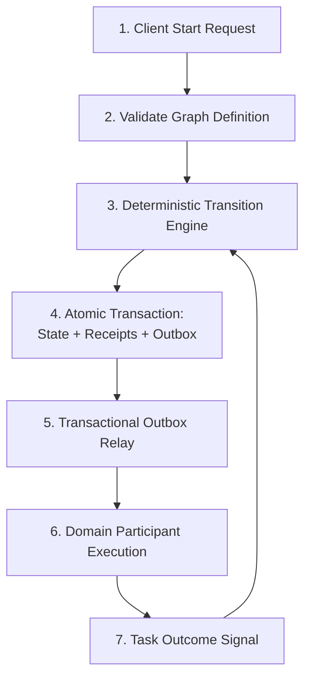
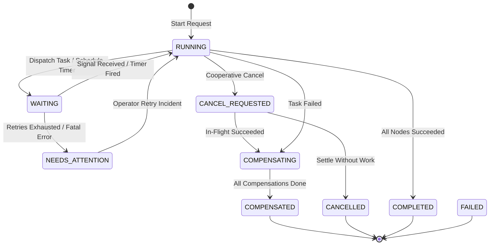
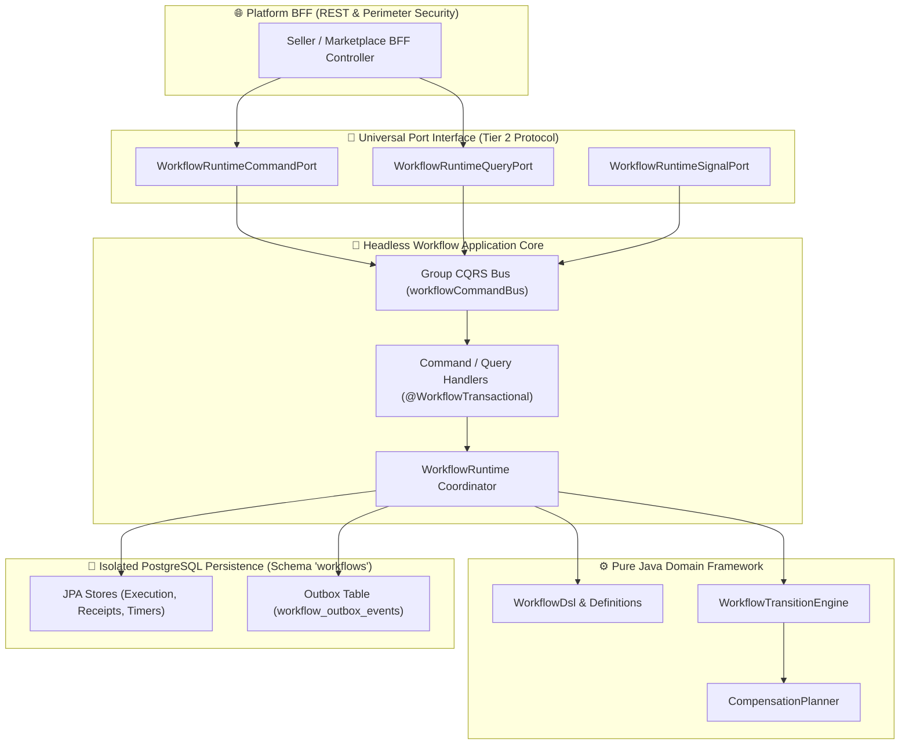
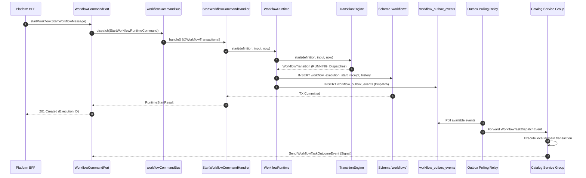

# Tech Spec: Custom Ecommerce Workflow Orchestration Framework

- **Summary:** A durable, typed, event-driven workflow and saga runtime for coordinating multi-step ecommerce operations across isolated service-group transactions without distributed locking.
- **Type:** Architecture Pattern / Infrastructure
- **Feature Spec:** [Durable Workflow Orchestration & Saga Runtime](../../features/feat_012-durable-workflow-orchestration-and-saga-runtime.md)

---

## 1. Problem & Decision

### What breaks without this?

Ecommerce workflows like product publishing, order placement, and inventory reservation span multiple isolated service schemas (`catalog`, `"order"`, `account`, `channel`). Because distributed 2-phase commit (2PC) is prohibited, partial failures leave inconsistent, orphaned records across services. Synchronous HTTP orchestration deadlocks connection pools during load spikes. Without a durable, versioned workflow runtime, retries cause duplicate charges or duplicate inventory reservations, failed operations lack automated compensation, and operators cannot inspect or retry stuck steps.

### Decision

| Option | Decision | Why |
|:-------|:---------|:----|
| **Custom Durable Workflow Runtime** | **Adopted** | Integrates seamlessly with the modular monolith's PostgreSQL isolated schemas and Transactional Outbox. Guarantees zero external network dependencies, compile-time Java type safety, and strict compliance with repository layering invariants. |
| **External Engine (Temporal / Cadence)** | **Deferred** | Requires running external server clusters, separate databases, and specialized client SDKs. Adds significant operational overhead that is unnecessary for in-process modular monolith workloads. |
| **BPMN Engine (Camunda)** | **Deferred** | Introduces heavy database schemas and complex XML/BPMN modelers geared towards human approvals rather than low-latency, code-first distributed ecommerce sagas. |
| **Pure Event Choreography** | **Rejected** | Scatters multi-step logic across isolated event listeners. Lacks centralized operational visibility, makes backward compensation ordering brittle, and prevents dead-letter triage. |
| **Distributed 2PC / XA Transactions** | **Rejected** | Violates schema isolation boundaries, creates blocking cross-database locks, and causes cascading HikariCP connection pool starvation. |

### Trade-offs

| Benefits | Trade-offs |
|:-----------|:-------------|
| **Centralized Saga Visibility:** Single source of truth for execution state, node progression, and audit logs. | **Eventual Consistency:** Intermediate states are visible across services until the saga reaches a terminal state. |
| **Automated Dependency Compensation:** Rollbacks follow strict reverse topological order without manual intervention. | **Idempotent Participants Required:** Participating domain services must handle at-least-once task and compensation invocations. |
| **Zero Operational Bloat:** Reuses existing PostgreSQL infrastructure, HikariCP pools, and Outbox relays without new daemons. | **Polled Timer Execution:** Requires periodic pessimistic lease polling for delay and retry timers instead of real-time queues. |
| **Compile-Time Type Safety:** Pure Java DSL validates graph connectivity, payload types, and compensation cycles during build. | **Static Definitions:** Dynamic graph mutations or ad-hoc runtime loop modifications are strictly prohibited. |

---

## 2. How It Works

### Core Concept

The workflow engine defines distributed sagas as immutable directed graphs composed of typed nodes (`task`, `sequence`, `choice`, `parallel`, `delay`, `waitForSignal`, and `compensate`). A pure, deterministic state machine (`WorkflowTransitionEngine`) advances execution when triggered by start requests, external participant signals, or timer expirations. All state changes, idempotency receipts, and outbox dispatch intents are committed atomically in a single local database transaction.



### How It Works Step by Step

| Step | What Happens | Why |
|:-----|:-------------|:----|
| **1. Definition Validation** | `WorkflowDsl` builds an immutable `WorkflowDefinition`. Graph validation checks for unreachable nodes, duplicate IDs, missing compensation targets, and cycles. | Prevents broken or malformed sagas from being registered or executed in production. |
| **2. Idempotent Start** | `WorkflowRuntime.start()` hashes the input using SHA-256 and checks `workflow_start_receipt`. If duplicate, it returns existing state; if input mismatches, it throws `WorkflowIdempotencyConflictException`. | Guarantees exactly-once saga instantiation and prevents duplicate operations under network retries. |
| **3. Atomic Outbox Dispatch** | The engine determines the initial node dispatches and commits execution state and `WorkflowTaskDispatchEvent` into `workflow_outbox_events` in the same database transaction. | Eliminates the dual-write problem, ensuring no task is dispatched unless state is safely persisted. |
| **4. Asynchronous Task Execution** | The outbox relay delivers the dispatch event to the target domain group (`catalog`, `inventory`, etc.). The domain executes its local transaction. | Decouples domains and prevents cross-domain database connection holding. |
| **5. Signal Reception & Deduplication** | On completion, the domain emits `WorkflowTaskOutcomeEvent`. The workflow listener verifies the SHA-256 payload digest in `workflow_signal_receipt`. | Ensures at-most-once processing of incoming signals and rejects payload tampering or stale retries. |
| **6. Deterministic State Progression** | `WorkflowTransitionEngine.accept()` advances node execution, evaluates parallel joins in declaration order, and schedules next steps or timers. | Guarantees reproducible, testable transitions governed by an explicit clock timestamp. |
| **7. Reverse Dependency Compensation** | If a step fails and retries are exhausted, `CompensationPlanner` computes reverse topological order of completed tasks and dispatches compensation actions. | Restores system consistency by rolling back completed operations in the exact reverse sequence. |

### Lifecycle



---

## 3. How We Use It

### Where It Fits in Our System / Architecture & Layer Stacking



### Component Responsibilities

| Component | Role | What It Does |
|:----------|:-----|:-------------|
| **`WorkflowDsl & Definition`** | Domain Contract | Provides typed, immutable node builders (`task`, `choice`, `parallel`, `delay`, `compensate`) and validates acyclic graph structure. |
| **`WorkflowTransitionEngine`** | Pure State Machine | Computes deterministic state transitions, node progressions, parallel joins, and dispatch intents given an explicit `Instant` clock. |
| **`CompensationPlanner`** | Rollback Planner | Computes a reverse topological DAG of completed tasks to execute compensation actions without race conditions. |
| **`WorkflowRuntime`** | Transaction Orchestrator | Manages the end-to-end transaction boundary, checks idempotency receipts, updates snapshots, and invokes outbox and timer schedulers. |
| **`JpaWorkflowExecutionStore`** | Persistence Adapter | Persists execution states, node attempts, history events, and incident views to the `workflows` PostgreSQL schema using derived queries. |
| **`JpaWorkflowTimerScheduler`** | Timer Coordinator | Schedules retry and delay timers, claims due timers using pessimistic row-level leases, and reclaims expired worker leases. |
| **`OutboxWorkflowDispatchPublisher`** | Outbox Producer | Serializes `WorkflowTaskDispatchEvent` into `workflow_outbox_events` in the workflow transaction for reliable asynchronous relay. |
| **`WorkflowRuntimeCommandPortAdapter`** | Inbound Write Adapter | Implements `WorkflowRuntimeCommandPort`, mapping incoming port records to `workflowCommandBus` commands. |

### Runtime Flow



---

## 4. Implementation Rules

> These are **non-negotiable architectural contracts**. An implementation is compliant only when **all** rules are satisfied.

| Rule | Requirement |
|:-----|:------------|
| **R-01** | Classes in `com.grab.framework.workflow` **MUST NOT** import Spring Framework (`org.springframework.*`), Jakarta Persistence (`jakarta.persistence.*`), Jackson (`com.fasterxml.jackson.*`), or platform classes. The domain framework must remain pure Java. |
| **R-02** | The Workflow Core module (`com.grab.app.workflow`) is strictly headless and **MUST NOT** contain any Spring WebMvc annotations (`@RestController`, `@RequestMapping`, `@PathVariable`, `@RequestParam`). REST ingress resides exclusively in Platform BFFs. |
| **R-03** | Cross-module callers **MUST** invoke workflow operations exclusively through public Java port interfaces (`com.grab.app.workflow.port.message.*Port`) using immutable Java `record` types. Direct bean calls to internal services or repositories are prohibited. |
| **R-04** | Workflow services and handlers **MUST** adhere to strict CQRS isolation. Write components **MUST NOT** inject `workflowQueryBus` or query views; read components **MUST NOT** inject `workflowCommandBus` or mutate state. |
| **R-05** | Transaction demarcation annotations (`@WorkflowTransactional` and `@WorkflowReadTransactional`) **MUST** be placed on CQRS handlers (`CommandHandler`, `QueryHandler`) and port adapters only. They **MUST NOT** be placed on controllers, services, mappers, or pure domain policies. |
| **R-06** | Outgoing task dispatches (`WorkflowTaskDispatchEvent`) **MUST** be persisted into `workflow_outbox_events` in the exact same database transaction as the workflow execution state change. |
| **R-07** | Spring Data JPA repositories in `com.grab.workflow.infrastructure` **MUST NOT** use native SQL queries (`@Query(nativeQuery = true)`). Only Spring Data derived queries or JPQL are permitted. |
| **R-08** | All workflow start requests and participant signals **MUST** compute and record deterministic SHA-256 fingerprints to identify duplicates and reject conflicting content. Dispatch and outcome delivery remain at least once. |
| **R-09** | When a workflow fails, compensation actions **MUST** be dispatched in strict reverse topological dependency order. Dependent steps **MUST NOT** begin compensation until their successor steps have confirmed completion. |
| **R-10** | Due timers **MUST** be claimed using pessimistic row-level locks with explicit claim tokens and lease expirations (`lease_expires_at`), preventing duplicate timer execution across concurrent scheduler instances. |
| **R-11** | In-flight workflow executions **MUST** remain pinned to their initial definition version and payload version throughout their entire lifecycle. Definition upgrades apply to newly started executions only. |
| **R-12** | `WorkflowTransitionEngine` **MUST** be pure and deterministic. It **MUST NOT** invoke `Instant.now()`, generate random UUIDs, perform I/O, or mutate external state. The current timestamp must be passed as an explicit argument. |
| **R-13** | Database operations **MUST** target the dedicated `workflows` PostgreSQL schema using HikariCP pools isolated from other domain groups. Cross-schema foreign keys and joins are strictly prohibited. |

## 5. Authoring typed definitions

A definition provider supplies an immutable graph and a typed start policy. The application registers providers discovered as beans. Registration checks the pinned definition and payload versions, codec support, exact forward and reverse routes, and the request type, result type, and effect declared by each typed route. The original sellable-product routes retain their version-one compatibility registration.

Use an owner-published operation descriptor for each participant call. A definition maps its own input to the request and combines the participant result with its original input. The owner receives only its request record and the existing correlation envelope. The owner uses its scoped bus and commits successful writes, receipt, and outcome together.

The sample below starts from a SKU, optionally asks an owner to verify it, and returns a local result. A Spring configuration can supply the resulting graph from a `WorkflowDefinitionProvider<StockRequest, StockResult>` bean with its own `validateStart` policy.

```java
record StockRequest(String sku, boolean verify) {}
record VerifySku(String sku) {}
record StockStage(String sku, boolean verify, boolean verified) {}
record StockResult(String sku, boolean verified) {}

WorkflowIdentity identity = new WorkflowIdentity("verify-stock", 1, 2);
WorkflowOperation<VerifySku, Boolean> verify =
        WorkflowOperation.assertion("inventory.verify-sku", VerifySku.class, Boolean.class);
WorkflowStep<StockRequest, StockStage> initial = map(
        "initial", StockRequest.class, StockStage.class,
        request -> new StockStage(request.sku(), request.verify(), false));
WorkflowStep<StockStage, StockStage> check = bind(
        "verify-sku", StockStage.class, StockStage.class, verify,
        stage -> new VerifySku(stage.sku()),
        (stage, verified) -> new StockStage(stage.sku(), stage.verify(), verified));
WorkflowStep<StockStage, StockStage> optionalCheck = when("check-choice", StockStage::verify, check);
WorkflowStep<StockStage, StockResult> result = map(
        "result", StockStage.class, StockResult.class,
        stage -> new StockResult(stage.sku(), stage.verified()));
WorkflowFlow<StockRequest, StockRequest> start = flow(StockRequest.class);
WorkflowFlow<StockRequest, StockResult> steps = start.then(initial).then(optionalCheck).then(result);
WorkflowDefinition<StockRequest, StockResult> definition = steps.build(identity, "verify-stock-root");
```

The owner registers an exact route for `inventory.verify-sku` using the shared descriptor. A typed choice returns a common result type across branches. A typed two-branch join receives each branch result in declaration order.

Mappers, selectors, and joins **MUST** be pure. A completed local value is persisted and restored using its declared type. A retry reuses the persisted child request. A rolled-back transition may evaluate its callbacks again. Use `WorkflowMappingException` for an expected mapping failure. If a participant has already succeeded, the incident retains its successful child and any reverse action declared for it.

Step IDs are persistent identities. A bound participant child uses `<step-id>.task`, and the pass-through in an optional step uses `<step-id>.skip`. Compensation dependencies refer to actual task node IDs. A read-only operation cannot have compensation. Local maps and joins have no dispatch, timer, or compensation obligation.

Graph or wire changes require explicit versions. The original three graphs and their queued messages still resolve to definition/payload 1. The typed graphs resolve to definition/payload 2. Both use the existing Jackson encoding configuration with exact compatibility determined by the pinned definition identity. Node kind is derived from the definition, so the existing node table and status constraint support these graph additions without a schema migration.

## 6. Verification and original implementation status

| Review finding | Regression coverage |
|---|---|
| Erased composition and ad hoc optional steps | `WorkflowAuthoringTypesTest` checks incompatible links, choices, joins, and bindings. `WorkflowAuthoringTest` checks persisted choices and local joins. |
| Participant payload contains orchestration state | `SellableProductWorkflowEndToEndTest` exercises owner request and result contracts for definition versions 1 and 2. |
| Projection requires an outbox round trip | `WorkflowAuthoringTest` verifies local completion without dispatch or timers. |
| Retry and restoration could recompute requests or join outputs | `WorkflowAuthoringTest` and `JpaWorkflowExecutionStoreTest` cover retry reuse and typed PostgreSQL restoration. |
| Central registration and missing reverse-route checks | `WorkflowProviderRegistrationTest` checks independent registration, exact codecs, route uniqueness, payload types, and required reverse routes. |
| Read-only conversion discards compensation | `WorkflowAuthoringTest` checks both declaration orders and retention of a successful effect when mapping fails. `WorkflowRuntimePostgresTest` exercises rollback and redelivery after a combiner exception. |

| Original step | Current scope |
|---|---|
| 1. Architecture specification | Framework and three product workflow specs describe the current authoring and runtime contracts. |
| 2. Compatibility boundary | The canonical runtime supports exact definition versions. The old runtime remains historical. |
| 3. Pure Java DSL | Typed composition, mapped operations, local projection, optional steps, and typed joins are implemented. |
| 4. Transition engine | Pure transitions, durable decisions, and local callback checkpointing are implemented. |
| 5. PostgreSQL persistence | Execution, receipts, history, timers, and typed snapshot restoration are implemented. |
| 6. Durable dispatch | The app relays dispatch and outcome through the existing owner outboxes. |
| 7. Timers and retries | The runtime supports persisted deadlines, retry timing, and leases. |
| 8. Parallel execution | Ordered static branch execution and typed local joins are implemented. |
| 9. Compensation and cancellation | The runtime supports both. The migrated product participants still treat mutations without a supported reverse action as irreversible. |
| 10. Incidents and visibility | Execution queries, history, and incident status are available. Production operator tooling remains separate. |
| 11. Versioning | Both product definition versions are registered with explicit payload versions and compatibility routes. |
| 12. Examples and adoption | The three definitions are runnable examples through the Java ports. Production seller ingress and rollout remain separate. |
