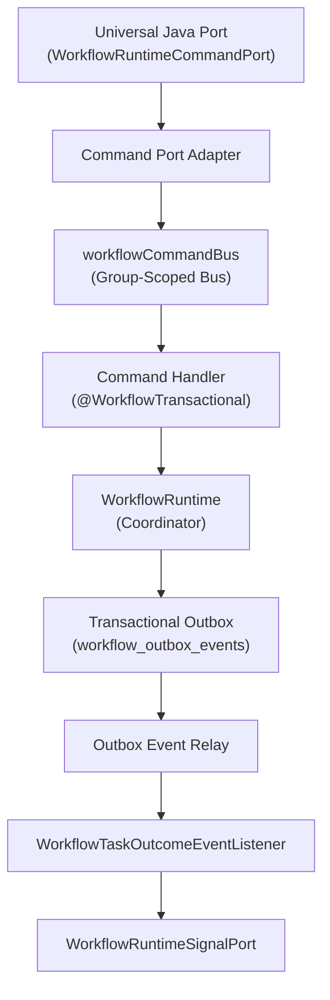
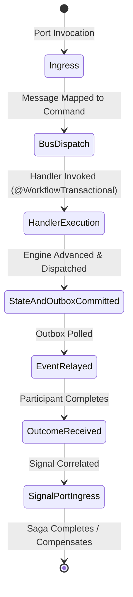
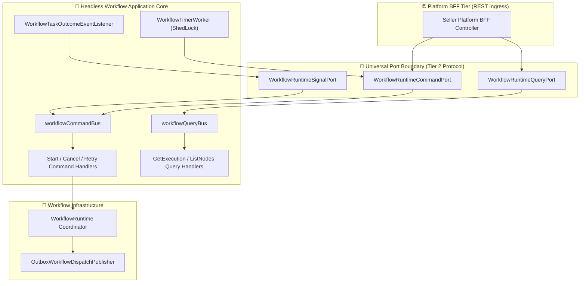
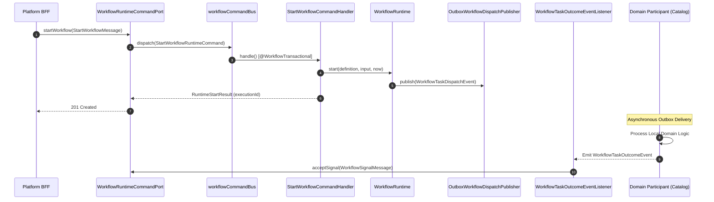

# Tech Spec: Workflow Headless Runtime & Universal Port Protocol

- **Summary:** Headless CQRS application core exposing Universal Java Port Interfaces, group-scoped bus isolation, and Transactional Outbox task dispatch for workflow orchestration.
- **Type:** Architecture Pattern
- **Feature Spec:** [Headless CQRS Runtime & Universal Port Protocol](../../features/feat_014-headless-workflow-runtime-and-port-protocol.md)

---

## 1. Problem & Decision

### What breaks without this?

If REST controllers are co-located directly in workflow packages, web presentation logic, Jackson annotations, and HTTP status codes pollute core saga execution. Callers bypass formal port boundaries, creating tight synchronous coupling and blocking future extraction of the workflow engine into a standalone microservice. Without group-scoped CQRS buses and explicit transaction boundaries, commands leak across domains, transactions span multiple schemas, and concurrent event consumption triggers race conditions.

### Decision

| Option | Decision | Why |
|:-------|:---------|:----|
| **Universal Java Port Protocol & Headless Core** | **Adopted** | Establishes the platform's Tier-2 communication protocol. Delivers high-speed, zero-latency in-process execution with immutable Java records today, while providing a drop-in 1:1 replacement for gRPC stubs in future microservices. |
| **Direct REST Controllers in Workflow Core** | **Rejected** | Violates hexagonal layering and headless architecture invariants. Entangles Spring WebMvc with domain orchestration and scatters perimeter security. |
| **Direct Cross-Module Bean Injection** | **Rejected** | Bypasses CQRS buses and use cases, violating bounded context autonomy and creating circular Spring bean dependency cycles. |
| **Shared Global Command/Query Bus** | **Rejected** | Risks handler collisions, prevents schema-specific transaction manager binding, and permits uncontrolled cross-domain execution paths. |

### Trade-offs

| Benefits | Trade-offs |
|:-----------|:-------------|
| **Zero Web Coupling:** The workflow core contains zero HTTP annotations, allowing standalone testing and embedding into background workers. | **Layer Indirection:** Calls from Platform BFFs pass through port interfaces, port adapters, bus dispatchers, and command handlers. |
| **Zero-Downtime Microservice Migration:** Interface contracts remain identical whether executed in-process via Java records or remotely via gRPC stubs. | **Record Duplication:** BFF request DTOs and workflow message records are maintained as distinct decoupled types. |
| **Strict Bus Isolation:** Handlers register only with their group bus (`workflowCommandBus`), preventing cross-domain execution leaks. | **Explicit Wiring:** Requires dedicated configuration beans and qualifiers for every bus and transaction manager. |

---

## 2. How It Works

### Core Concept

The headless workflow runtime exposes four public port interfaces (`WorkflowRuntimeCommandPort`, `WorkflowRuntimeQueryPort`, `WorkflowRuntimeSignalPort`, `WorkflowTimerProcessingPort`) under `com.grab.app.workflow.port.message`. Inbound message adapters translate port invocations into CQRS commands and queries, routing them to isolated group buses (`workflowCommandBus` / `workflowQueryBus`). Handlers execute business operations under `@WorkflowTransactional`, interact with the transition engine and persistence store, write outgoing task dispatches into `workflow_outbox_events`, and receive domain outcomes through `WorkflowTaskOutcomeEventListener`.

### How It Works Step by Step

| Step | What Happens | Why |
|:-----|:-------------|:----|
| **1. Port Ingress** | Platform BFF or caller invokes `WorkflowRuntimeCommandPort.startWorkflow(StartWorkflowMessage)`. | Enforces capability contract using immutable records with zero web annotations. |
| **2. Adapter Mapping** | `WorkflowRuntimeCommandPortAdapter` translates message record to `StartWorkflowRuntimeCommand`. | Decouples external message protocol types from internal CQRS command records. |
| **3. CQRS Bus Dispatch** | Command is dispatched to `workflowCommandBus` and resolved to `StartWorkflowRuntimeCommandHandler`. | Enforces single-responsibility command routing within group-scoped boundaries. |
| **4. Transaction Demarcation** | Handler executes under `@WorkflowTransactional(transactionManager = "workflowsTransactionManager")`. | Guarantees atomic commit across execution state, start receipt, history, and outbox tables. |
| **5. Runtime Coordination** | Handler invokes `WorkflowRuntime.start()`, advancing the state machine and persisting the initial execution snapshot. | Drives deterministic state transitions and produces task dispatch events. |
| **6. Atomic Outbox Event** | `OutboxWorkflowDispatchPublisher` writes `WorkflowTaskDispatchEvent` into `workflow_outbox_events` in the same transaction. | Guarantees at-least-once task delivery without dual-write inconsistency. |
| **7. Outcome Event Ingress** | Domain participant completes task and emits `WorkflowTaskOutcomeEvent`. `WorkflowTaskOutcomeEventListener` receives it and invokes `WorkflowRuntimeSignalPort`. | Completes asynchronous event loop without direct bean coupling between domain groups. |

### Lifecycle

---

## 3. How We Use It

### Where It Fits in Our System / Architecture & Layer Stacking

### Component Responsibilities

| Component | Role | What It Does |
|:----------|:-----|:-------------|
| **`WorkflowRuntimeCommandPort`** | Public Write Contract | Exposes start, cancel, and incident retry capabilities using immutable records. |
| **`WorkflowRuntimeQueryPort`** | Public Read Contract | Exposes execution status, node view, incident list, and history querying operations. |
| **`WorkflowRuntimeSignalPort`** | Public Signal Contract | Exposes participant task outcome and external signal submission operations. |
| **`WorkflowRuntimeCommandPortAdapter`** | Inbound Write Adapter | Bridges command port calls to `workflowCommandBus` using single-operation mappers. |
| **`WorkflowRuntimeQueryPortAdapter`** | Inbound Read Adapter | Bridges query port calls to `workflowQueryBus` returning application view records. |
| **`StartWorkflowRuntimeCommandHandler`**| CQRS Command Handler | Executes workflow start logic under `@WorkflowTransactional` and invokes `WorkflowRuntime`. |
| **`WorkflowTaskOutcomeEventListener`** | Inbound Event Listener | Listens for `WorkflowTaskOutcomeEvent` from participants and submits signals via `WorkflowRuntimeSignalPort`. |
| **`WorkflowTimerWorker`** | Background Poller | Periodically polls and fires due timers via `WorkflowTimerProcessingPort` under ShedLock coordination. |

### Runtime Flow

---

## 4. Implementation Rules

> These are **non-negotiable architectural contracts**. An implementation is compliant only when **all** rules are satisfied.

| Rule | Requirement |
|:-----|:------------|
| **R-01** | The Workflow Core package (`com.grab.app.workflow`) **MUST NOT** import or use Spring WebMvc annotations (`@RestController`, `@RequestMapping`, `@PathVariable`, `@RequestParam`). All HTTP ingress resides in Platform BFFs. |
| **R-02** | All external communications with the workflow service **MUST** pass through public Java port interfaces in `com.grab.app.workflow.port.message` using immutable `record` types. Direct calls to internal handlers, services, or repositories are prohibited. |
| **R-03** | Workflow services and handlers **MUST** maintain strict CQRS separation. `CommandService` and write handlers **MUST NOT** inject `workflowQueryBus`; `QueryService` and read handlers **MUST NOT** inject `workflowCommandBus`. |
| **R-04** | Group CQRS buses **MUST** be explicitly scoped using `@Qualifier("workflowCommandBus")` and `@Qualifier("workflowQueryBus")` to prevent handler collisions. |
| **R-05** | Transaction demarcation annotations (`@WorkflowTransactional` and `@WorkflowReadTransactional`) **MUST** be placed on CQRS handlers and port adapters only. They **MUST NOT** be placed on controllers, services, mappers, or assemblers. |
| **R-06** | Outgoing task dispatches **MUST** be written to `workflow_outbox_events` by `OutboxWorkflowDispatchPublisher` inside the workflow transaction. |
| **R-07** | `WorkflowTaskOutcomeEventListener` **MUST** process participant outcome events asynchronously and submit signals via `WorkflowRuntimeSignalPort` without directly modifying domain entities or injecting domain repositories. |
| **R-08** | Inbound port adapters **MUST** use MapStruct mappers configured with `CentralMapperConfig.class` and single-operation methods (`toCommand` / `toQuery` / `toResponse`). |
| **R-09** | Scheduled timer polling by `WorkflowTimerWorker` **MUST** be guarded by ShedLock (`@SchedulerLock`) to prevent concurrent execution across cluster nodes. |
