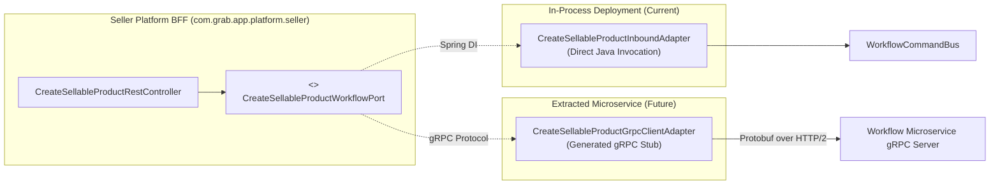

# Tech Spec: Workflow Core Hexagonal Packaging

- **Summary:** Defines the hexagonal package topology, inbound capability ports, internal saga orchestration engine, persistence adapters, and Seller Platform BFF REST controller separation for the dedicated `com.grab.app.workflow` module.
- **Type:** Architecture Pattern / Process Orchestration
- **Feature Spec:** [Modular Hexagonal Package Structure](../../features/feat_009-modular-hexagonal-package-structure.md)

---

## 1. Problem & Decision

### What breaks without this?

When multi-step, cross-domain workflows (such as sellable product creation, catalog-to-channel publication, and inventory reconciliation) are mixed directly with REST controllers inside `store/workflows`, the core orchestration engine becomes tightly coupled to HTTP serialization, Spring WebMvc annotations, and web security filters. Bounded contexts cannot invoke workflows programmatically without mimicking HTTP requests, and the workflow engine cannot be deployed headlessly, tested in isolation, or extracted into an independent orchestration microservice.

Furthermore, without strict hexagonal port-and-adapter boundaries, workflow definitions bypass domain service contracts by directly accessing database entities or mutating cross-domain state outside of isolated transactional boundaries.

### Decision

| Option | Decision | Why |
|:-------|:---------|:----|
| **Dedicated `com.grab.app.workflow` with Hexagonal Packaging & Seller BFF Ingress** | Adopted | Isolates the core workflow engine and saga definitions into a headless, framework-pure core (`com.grab.app.workflow`), exposing capabilities solely via public Java port interfaces (`port/message/`). All REST controllers sit exclusively in the Seller Platform BFF (`com.grab.app.platform.seller.workflow`), enforcing clean ingress separation and gRPC-ready service extraction. |
| Co-located REST Controllers within Workflow Engine | Rejected | Leaks Spring WebMvc, HTTP request/response DTOs, and web security concerns directly into the core workflow orchestration engine. |
| Direct Synchronous Bean Injection from Domain Modules | Rejected | Introduces bidirectional circular dependencies between domain modules and workflow definitions, preventing independent module compilation. |

### Trade-offs

| Benefits | Trade-offs |
|:---------|:-----------|
| Headless workflow core can be invoked in-process today, via background schedulers, or via gRPC stubs in future microservices. | Requires explicit port interfaces and inbound adapter classes for each workflow entry point. |
| Web security, authorization, and HTTP routing are centralized in the Seller Platform BFF. | DTOs must be mapped at the Seller BFF boundary to domain workflow command records. |
| Durable saga execution, step checkpointing, and compensation rollback order are fully encapsulated within `com.grab.app.workflow`. | Requires separate persistence and outbox event publishing adapters for workflow checkpointing. |

---

## 2. How It Works

### Core Concept

The workflow architecture enforces strict hexagonal boundaries:
1. **Public Inbound Ports (`com.grab.app.workflow.port`)**: Exposes capability interfaces for starting, signaling, and querying workflows (`port/message/`), and listener interfaces for step completion signals (`port/event/`).
2. **Encapsulated Workflow Engine & Sagas (`com.grab.app.workflow.internal`)**: Houses the state machine engine, saga step definitions, checkpoint contexts, command/query handlers, and outbound adapters.

---

## 3. How We Use It

### Complete Package Topology

```text
com.grab.app.workflow
├── port/                                           # Public Inbound Ports (Public API)
│   ├── message/                                    # Inbound capability / saga execution interfaces
│   └── event/                                      # Inbound event listener port interfaces
└── internal/                                       # Encapsulated implementation details (Strictly Internal)
    ├── config/                                     # Spring configuration, bus setup, datasources
    ├── definitions/                                # Concrete saga process definitions & contexts
    │   └── {workflowDefinitions}/
    └── adapter/
        ├── inbound/                                # Inbound Port Implementations (Ingress)
        │   ├── message/                            # Implements port.message & dispatches to CQRS bus
        │   └── event/                              # Implements port.event integration listener
        └── outbound/                               # Outbound Port Implementations (Egress)
            ├── event/                              # Step execution commands via Transactional Outbox
            └── message/                            # Outbound capability adapters invoking other domain ports
```

---

### Seller Platform BFF REST Controller Topology

REST controllers related to workflows reside exclusively in the Seller Platform BFF under `com.grab.app.platform.seller`.

---

### Component Responsibilities

| Package / Component | Role | What It Does |
|:---|:---|:---|
| `port.message` | Public Capability Inbound Ports | Defines typed interfaces for starting, pausing, canceling, and inspecting workflow executions. Used by Seller BFF and schedulers. |
| `port.event` | Public Event Inbound Ports | Defines typed listener interfaces for receiving asynchronous domain completion signals and timeout notifications. |
| `internal.engine` | Core Orchestrator Engine | Executes state machine transitions, records step checkpoints, evaluates compensation trees, and handles retries. |
| `internal.definitions` | Concrete Saga Blueprints | Declares step execution sequences, compensation handlers, and failure predicates for each specific business workflow. |
| `internal.command` | Workflow CQRS Commands | Translates inbound port calls into transactional workflow starts, manual overrides, and cancellations. |
| `internal.adapter.inbound.message` | Inbound Adapter | Implements `port.message`, validates payloads, maps to commands, and dispatches to `WorkflowCommandBus`. |
| `internal.adapter.outbound.persistence` | State Store Adapter | Persists saga instances, correlations, and signal logs to PostgreSQL tables via Spring Data JPA. |
| `internal.adapter.outbound.event` | Step Dispatcher | Emits step execution requests and compensation commands via the Transactional Outbox pattern. |
| `internal.adapter.outbound.message` | Outbound Domain Clients | Invokes target domain capability ports (`CatalogPort`, `InventoryPort`, `PricingPort`) directly in-process or via gRPC. |
| `com.grab.app.platform.seller.workflow` | Seller Platform Ingress | Hosts public REST controllers, applies JWT security rules (`SellerSecurityConfig`), maps JSON to port records, and builds HATEOAS responses. |

---

### Future gRPC Migration Protocol

When `com.grab.app.workflow` is extracted into an independent orchestration microservice, the architecture transitions with zero modifications to the Seller Platform BFF controllers:



---

## 4. Implementation Rules

> These are **non-negotiable contracts**. An implementation is compliant only when **all** rules are satisfied.

- **RULE-WF-01: Zero Spring MVC Annotations in Workflow Core**
  The `com.grab.app.workflow` package and all its subpackages MUST NOT declare `@RestController`, `@Controller`, `@RequestMapping`, `@PathVariable`, `@RequestBody`, or import `org.springframework.web.*`.

- **RULE-WF-02: Public Inbound Port Encapsulation**
  External callers (including Platform BFFs and schedulers) MUST interact with workflows exclusively through interfaces defined in `com.grab.app.workflow.port.message` or `com.grab.app.workflow.port.event`. Direct imports of `com.grab.app.workflow.internal.*` from external packages are strictly forbidden.

- **RULE-WF-03: Seller Platform BFF Exclusivity for Web Ingress**
  All HTTP REST endpoints for workflows MUST reside under `com.grab.app.platform.seller.workflow.controller`. Controllers MUST inject the Java port interfaces (`port.message.*`), enforce web security via `SellerSecurityConfig` and `@PreAuthorize`, and return HATEOAS `EntityModel` responses.

- **RULE-WF-04: Isolated Workflow Bus & Handlers**
  The workflow engine MUST maintain its own dedicated `WorkflowCommandBus` and `WorkflowQueryBus`. Workflow command handlers MUST NOT be registered on domain group buses (`CatalogCommandBus`, `OrderCommandBus`), and domain handlers MUST NOT be registered on the workflow bus.

- **RULE-WF-05: Outbox-Driven Step & Compensation Dispatch**
  All step execution requests and compensation commands MUST be written to `workflow.outbox_record` within the local `@WorkflowsTransactional` boundary. Direct synchronous state mutations across domain boundaries without an outbox event are prohibited.

- **RULE-WF-06: Strict Outbound Port Delegation for Domain Invocations**
  When a workflow step requires synchronous capability execution from another domain, it MUST invoke the target domain's public outbound port interface (`CatalogPort`, `InventoryPort`, `PricingPort`). Direct cross-context repository injection or direct table access is strictly prohibited.

- **RULE-WF-07: Transaction Demarcation on Workflow Handlers**
  Database transactions MUST be demarcated using `@WorkflowsTransactional` on CQRS Handlers or Provider Adapters. Transactions MUST NOT be placed on controllers, services, mappers, assemblers, or outbound remote clients.

