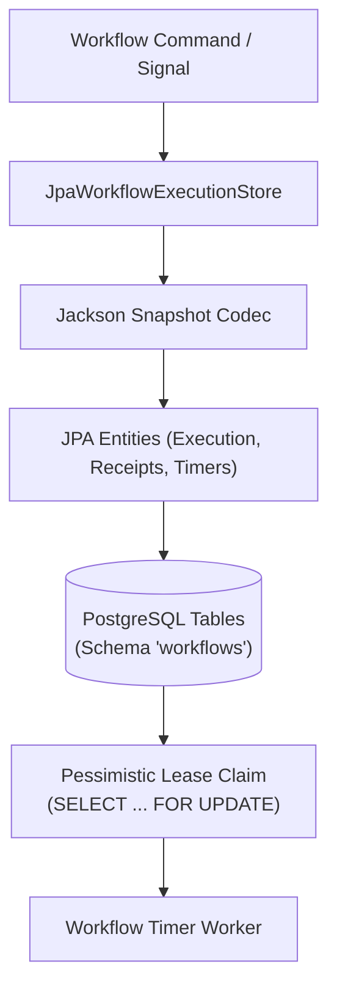
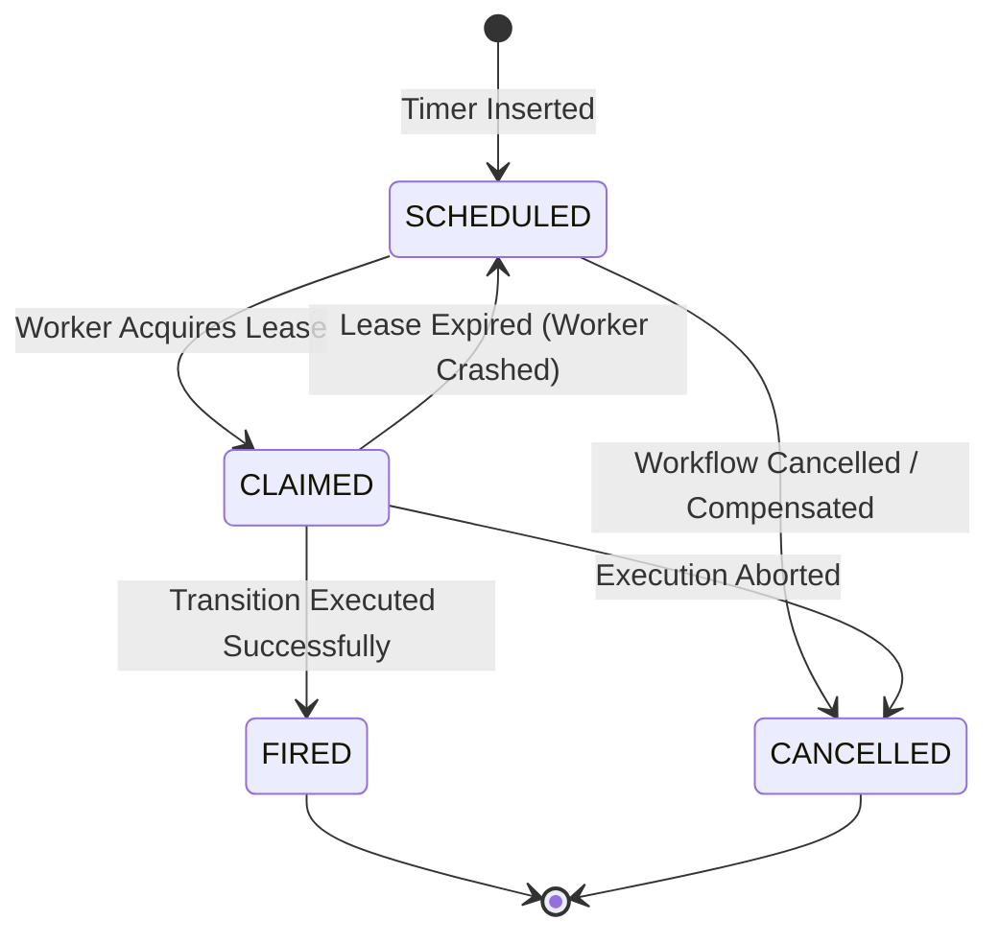
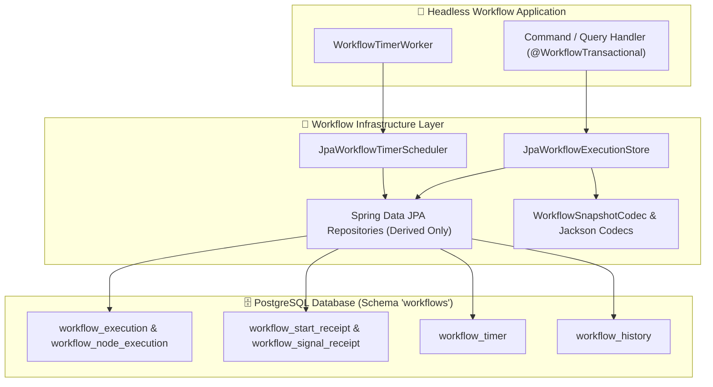
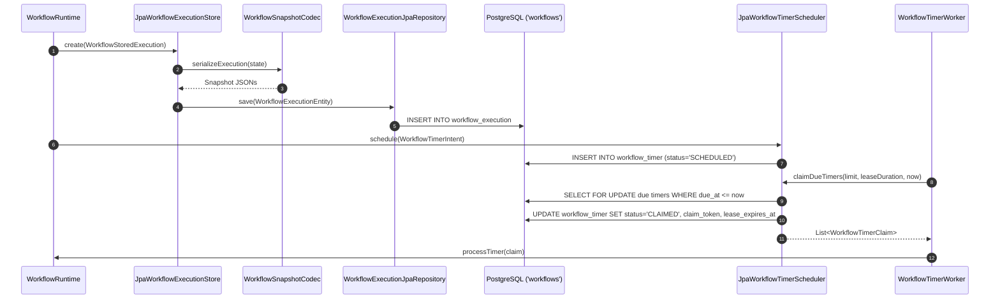

# Tech Spec: Workflow Multi-Schema Persistence & Timer Leases

- **Summary:** Dedicated PostgreSQL schema persistence, typed JSON snapshot serialization, cryptographic idempotency receipts, and pessimistic lease-based timer scheduling for workflow saga execution.
- **Type:** Infrastructure
- **Feature Spec:** [Multi-Schema Persistence, Receipts & Timer Leases](../../features/feat_013-workflow-persistence-receipts-and-timer-leases.md)

---

## 1. Problem & Decision

### What breaks without this?

Without durable persistence, workflow state vanishes during service restarts or crashes, abandoning in-flight multi-step sagas. Without start and signal receipts, network retries trigger duplicate operations like double-billing or redundant inventory reservations. Using native SQL queries for timer or signal claiming creates concurrency deadlocks and violates repository invariants. Furthermore, uncoordinated timer execution across clustered app nodes leads to duplicate step triggers or race conditions.

### Decision

| Option | Decision | Why |
|:-------|:---------|:----|
| **PostgreSQL Dedicated Schema with Pessimistic Leases** | **Adopted** | Conforms to multi-schema database isolation, reuses existing PostgreSQL infrastructure and Flyway migrations, and provides race-free timer execution via `SELECT ... FOR UPDATE` row-level leases with expiration timestamps. |
| **Distributed Cache / Locking (Redis / Redlock)** | **Rejected** | Introduces an external infrastructure dependency, potential split-brain failure modes, and operational complexity without providing ACID consistency with workflow state. |
| **Native SQL Queries (`nativeQuery = true`)** | **Rejected** | Violates repository architectural invariants (R11/R20), prevents database engine portability, and bypasses Spring Data query abstraction. |
| **Unversioned Untyped JSON Documents** | **Rejected** | Leads to deserialization errors when definitions evolve; requires typed snapshot codecs and version pinning to guarantee backward compatibility. |

### Trade-offs

| Benefits | Trade-offs |
|:-----------|:-------------|
| **Transactional Atomicity:** State mutations, receipts, history, and outbox dispatches commit in a single ACID database transaction. | **Polling Latency:** Due timers are picked up on polling intervals rather than real-time sub-millisecond push triggers. |
| **Strict Schema Isolation:** Zero cross-schema foreign keys or joins, protecting other domain connection pools from contention. | **Relational Payload Storage:** Complex execution graphs are stored as JSON text snapshots rather than normalized individual relational tables. |
| **Pessimistic Lease Safety:** Dead workers automatically release leases upon expiration (`lease_expires_at`), preventing permanently stuck timers. | **Lock Contention:** Heavy concurrent timer claiming on hot rows requires efficient index design and short-lived lock durations. |

---

## 2. How It Works

### Core Concept

The persistence architecture stores workflow execution state, node attempts, history events, and scheduling intents in the dedicated `workflows` PostgreSQL schema. Idempotency is enforced by computing SHA-256 digests of input and signal payloads, storing them in dedicated receipt tables. Delay and retry timers are persisted in `workflow_timer` with unique constraints and claimed via short-lived pessimistic row leases (`claim_token` and `lease_expires_at`), allowing surviving nodes to seamlessly reclaim tasks if a worker crashes.

### How It Works Step by Step

| Step | What Happens | Why |
|:-----|:-------------|:----|
| **1. Idempotency Verification** | `WorkflowRuntime` computes SHA-256 fingerprint and checks `workflow_start_receipt`. If duplicate input, existing execution is returned; if mismatched, conflict is thrown. | Guarantees that client retries cannot spawn duplicate executions or mutate existing workflows. |
| **2. Snapshot Serialization** | `WorkflowSnapshotCodec` serializes node states, resolved inputs, branch outputs, choice history, and accepted signals into typed JSON strings. | Preserves polymorphic execution data without requiring hundreds of normalized tables. |
| **3. Atomic Entity Persistence** | `JpaWorkflowExecutionStore` persists `WorkflowExecutionEntity`, `WorkflowNodeExecutionEntity`, `WorkflowStartReceiptEntity`, and `WorkflowHistoryEntity` in one transaction. | Ensures consistent all-or-nothing persistence across all execution metadata. |
| **4. Timer Scheduling** | Delayed nodes or failed retryable tasks insert rows into `workflow_timer` with `status = 'SCHEDULED'`, `due_at`, and a unique generation constraint. | Prevents duplicate timer entries across execution attempts and generations. |
| **5. Pessimistic Lease Claiming** | `JpaWorkflowTimerScheduler` queries due timers (`due_at <= now` and status `SCHEDULED` or expired lease) using `findDueTimersForClaim` and sets `claim_token` and `lease_expires_at`. | Prevents multiple cluster nodes from claiming and firing the same timer concurrently. |
| **6. Timer Execution & State Advance** | The claiming worker fires the timer, invokes the transition engine to advance the node, and marks the timer status as `FIRED` in the same transaction. | Completes the scheduled delay or retry and transitions the saga forward. |

### Lifecycle

---

## 3. How We Use It

### Where It Fits in Our System / Architecture & Layer Stacking

### Component Responsibilities

| Component | Role | What It Does |
|:----------|:-----|:-------------|
| **`JpaWorkflowExecutionStore`** | Execution Adapter | Implements `WorkflowExecutionStore`, converting domain states to JPA entities and serializing snapshots. |
| **`JpaWorkflowStartReceiptStore`** | Idempotency Store | Implements `WorkflowStartReceiptStore`, persisting start fingerprints and detecting replay conflicts. |
| **`JpaWorkflowSignalReceiptStore`** | Signal Deduplicator | Implements `WorkflowSignalReceiptStore`, tracking message IDs, payload fingerprints, and signal dispositions. |
| **`JpaWorkflowTimerScheduler`** | Timer Coordinator | Implements `WorkflowTimerScheduler` and `WorkflowTimerClaimPort`, scheduling and leasing timers using pessimistic locks. |
| **`WorkflowSnapshotCodec`** | State Serializer | Serializes/deserializes execution outputs, choice maps, and signal receipts using Jackson ObjectMapper. |
| **`JacksonWorkflowFingerprint`** | Digest Producer | Generates canonical SHA-256 hashes of start inputs, signals, and transport envelopes for tamper detection. |

### Runtime Flow

---

## 4. Implementation Rules

> These are **non-negotiable architectural contracts**. An implementation is compliant only when **all** rules are satisfied.

| Rule | Requirement |
|:-----|:------------|
| **R-01** | All persistence entities and repositories **MUST** reside strictly within the `com.grab.workflow.infrastructure` module and operate against the dedicated `workflows` schema. |
| **R-02** | Repositories in `workflow-infrastructure` **MUST NOT** use native queries (`@Query(nativeQuery = true)`). Derived query methods, JPQL, or Spring Data specifications must be used exclusively. |
| **R-03** | `workflow_start_receipt` **MUST** enforce a unique constraint on `(caller_scope, idempotency_key)` to guarantee exactly-once saga instantiation. |
| **R-04** | `workflow_signal_receipt` **MUST** enforce primary key on `transport_message_id` and unique constraint on `(execution_id, logical_operation_id, payload_fingerprint)`. |
| **R-05** | Timer claiming **MUST** use row-level pessimistic locking and record a non-null `claim_token` and `lease_expires_at` timestamp. Expired leases **MUST** be reclaimable by active workers. |
| **R-06** | All writes to `workflow_execution`, node executions, receipts, history, and outbox **MUST** occur inside the `@WorkflowTransactional` boundary using `workflowsTransactionManager`. |
| **R-07** | Snapshot serialization **MUST** be deterministic and type-safe, validating schema version compatibility during deserialization. |
| **R-08** | In-flight execution entities **MUST** include an `@Version` column (`version bigint not null`) to enforce optimistic concurrency control during concurrent signal or timer processing. |
