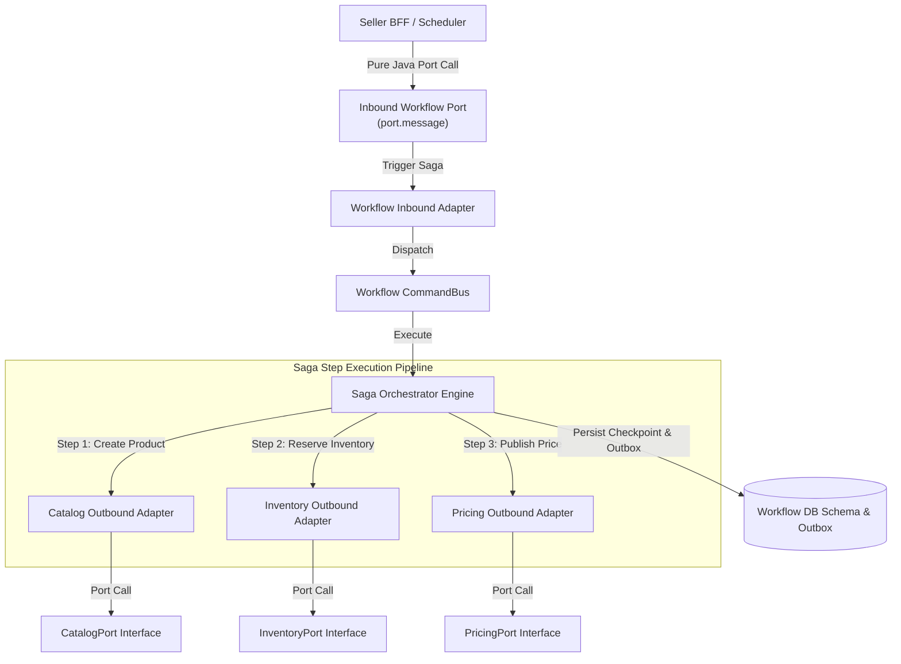
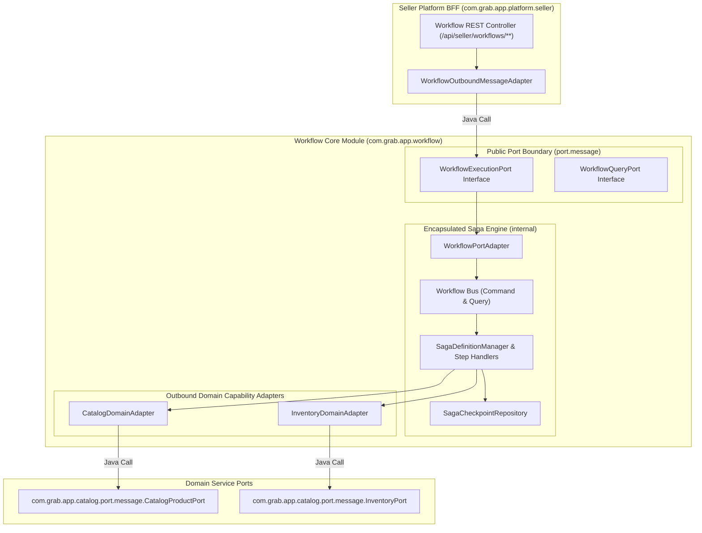
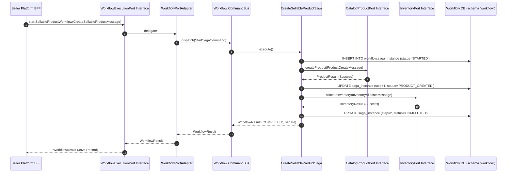

# Tech Spec: Workflow Service Communication Protocol & Contracts

- **Summary:** Defines the headless saga execution port contracts, step orchestration protocol, outbox-driven compensation checkpointing, and shared integration event contracts for the Workflow Core engine (`com.grab.app.workflow`).
- **Type:** Architecture Pattern / Process Orchestration Protocol
- **Feature Spec:** [BFF-to-Domain Communication Protocol & Controller Contract Migration](../../features/feat_011-decoupled-service-communication-cqrs-pipeline.md)

---

## 1. Problem & Decision

### What breaks without this?

When multi-step, cross-domain workflows (such as sellable product creation, inventory allocation, and order fulfillment sagas) embed REST controllers directly in the workflow package, the orchestration engine becomes tightly coupled to HTTP serialization and web security filters. Sagas cannot be executed programmatically by background schedulers or external services without simulating fake HTTP requests. Moreover, when workflows mutate cross-domain state via direct database joins or raw entity beans, transactions lack fault isolation, leading to orphaned database records and impossible rollback scenarios when downstream steps fail.

### Decision

| Option | Decision | Why |
|:-------|:---------|:----|
| **Headless Workflow Engine with Inbound Saga Ports and Outbound Domain Adapters** | Adopted | Isolates saga orchestration into a framework-pure core (`com.grab.app.workflow`). Exposes saga execution solely via public Java port interfaces (`port.message`), delegating HTTP ingress to the Seller BFF and calling domain groups through typed capability ports. |
| Workflow REST Controllers Hosted Directly in `store/workflows` | Rejected | Leaks Spring WebMvc annotations, presentation DTOs, and HTTP routing directly into the saga state machine, preventing headless microservice extraction. |
| Distributed Two-Phase Commit (2PC) Transactions | Rejected | Introduces fragile cross-database locking, high latency, and single-point-of-failure contention across service databases. |

### Trade-offs

| Benefits | Trade-offs |
|:---------|:-----------|
| Headless saga engine can be triggered via in-process Java calls, scheduled tasks, or event listeners with zero web framework overhead. | Requires explicit port interfaces and inbound/outbound adapter mappings for each workflow definition. |
| Each saga step runs in an isolated local transaction with durable state checkpointing and deterministic compensation rollbacks. | Requires managing saga step state machines and compensation logic instead of relying on simple database rollbacks. |

---

## 2. How It Works

### Core Concept

The Workflow Core engine (`com.grab.app.workflow`) operates as an autonomous, headless process manager. It provides public inbound ports (`port.message`) for starting, resuming, or inspecting sagas. Internally, a state machine coordinates sequential saga steps. Each step invokes downstream domain capability ports (`port.message`) through outbound adapters. Step checkpoints and compensation logs are persisted atomically in the workflow schema with corresponding outbox status events.



### How It Works Step by Step

| Step | What Happens | Why |
|:-----|:-------------|:----|
| 1 | Caller (e.g., Seller BFF) triggers a saga by calling `WorkflowExecutionPort.startWorkflow(StartSagaMessage)`. | Initiates orchestration via an explicit, typed Java interface contract. |
| 2 | Inbound adapter translates the message into a `StartWorkflowCommand` and dispatches to the Workflow `CommandBus`. | Decouples the caller from internal saga state machine mechanics. |
| 3 | The Saga Orchestrator initializes the saga instance, persists the `STARTED` checkpoint state, and executes Step 1. | Guarantees durable execution tracking before initiating external mutations. |
| 4 | Step 1 executes by calling the target domain's outbound port adapter (e.g., `CatalogMessageAdapter` calling `CatalogProductPort`). | Domain logic executes inside the domain's own isolated transaction and schema. |
| 5 | Upon successful step completion, the orchestrator records the step checkpoint in `workflow.saga_instance` and proceeds to Step 2. | Guarantees deterministic state recovery if the system restarts mid-process. |
| 6 | If any step encounters an unrecoverable domain error, the orchestrator triggers backward compensation in reverse order. | Undoes completed partial mutations to maintain eventual consistency without 2PC. |
| 7 | Upon completion or failure, the orchestrator writes a `WorkflowCompletedEvent` or `WorkflowFailedEvent` to `{schema}.outbox_record`. | Emits asynchronous notifications to subscribers across the enterprise. |

---

## 3. How We Use It

### Where It Fits in Our System / Architecture & Layer Stacking



### Component Responsibilities

| Component | Role | What It Does |
|:----------|:-----|:-------------|
| `WorkflowExecutionPort` | Public Ingress Port | Defines Java capability methods for starting, resuming, and aborting saga workflows. |
| `WorkflowQueryPort` | Public Query Port | Provides read-only inspection methods to query saga execution status, history, and checkpoint logs. |
| `WorkflowPortAdapter` | Inbound Adapter | Translates external port messages to internal workflow commands/queries routed through the workflow bus. |
| `SagaDefinitionManager` | Orchestration Engine | Manages saga lifecycle transitions, executes step pipelines, and triggers backward compensation on errors. |
| `SagaCheckpointRepository` | Persistence Adapter | Records step execution states and checkpoint payloads in the `workflow.saga_instance` table. |
| `Outbound Domain Adapters` | Cross-Domain Bridge | Calls domain group public port interfaces (`port.message`) to perform individual step actions. |

### Runtime Flow



### Contracts & Protocol Specifications

#### 1. Inbound Workflow Port Interface Contract
```java
// Located in com.grab.app.workflow.port.message
public interface WorkflowExecutionPort {
    WorkflowResult startWorkflow(StartWorkflowMessage message);
    WorkflowResult signalWorkflow(String sagaId, SignalWorkflowMessage message);
    WorkflowResult abortWorkflow(String sagaId, String reason);
}

public interface WorkflowQueryPort {
    Optional<WorkflowStatusResult> getWorkflowStatus(String sagaId);
    List<WorkflowStepLogResult> getWorkflowExecutionHistory(String sagaId);
}

// Inbound Message Contract
public record StartWorkflowMessage(
    String workflowName,
    String correlationId,
    String initiatorId,
    Map<String, Object> payload
) {}

// Outbound Result Contract
public record WorkflowResult(
    String sagaId,
    String workflowName,
    String status, // STARTED, COMPLETED, FAILED, COMPENSATING
    Instant initiatedAt,
    Map<String, Object> outputPayload
) {}
```

#### 2. Shared Workflow Integration Event Contract (`WorkflowCompletedEvent.java`)
```java
// Located in com.grab.store.shared.events.workflow
public record WorkflowCompletedEvent(
    String eventId,
    String sagaId,
    String workflowName,
    String correlationId,
    Instant completedAt
) {}
```

---

## 4. Implementation Rules

| Rule | Requirement |
|:-----|:------------|
| **R-01** | The Workflow Core module (`com.grab.app.workflow`) **MUST NOT** import or use Spring WebMvc annotations (`@RestController`, `@RequestMapping`, `@PathVariable`, etc.). |
| **R-02** | All HTTP endpoints for triggering or querying workflows **MUST** be hosted in the Seller Platform BFF (`com.grab.app.platform.seller.workflow`) under `/api/seller/workflows/**`. |
| **R-03** | External callers **MUST** invoke workflow operations exclusively through `WorkflowExecutionPort` and `WorkflowQueryPort` using immutable `record` types. |
| **R-04** | Saga step handlers **MUST NOT** perform direct database joins or access tables of other domain groups; all cross-domain operations must invoke domain port interfaces. |
| **R-05** | Every saga step execution **MUST** record its state and checkpoint data in `workflow.saga_instance` before proceeding to subsequent steps. |
| **R-06** | Upon any step failure, the workflow engine **MUST** execute compensating actions in strictly reverse order for all previously completed steps. |
| **R-07** | Every workflow port interface **MUST** use immutable Java `record` types for messages and results, strictly avoiding web DTOs or entity models. |

