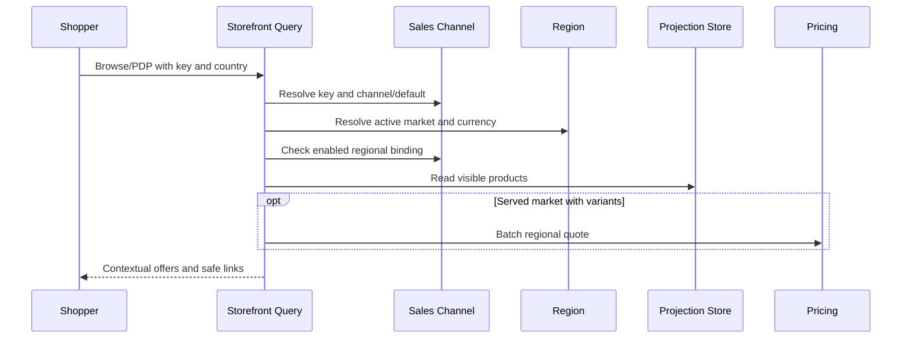

# Workflow: Browse, Project, and Rebuild Discovery Products

> **Purpose:** Deliver stable market-specific browse/PDP offers from independently maintained catalog facts and live regional quotes.
> **Starts When:** A storefront product read, a source integration event, or an authorized projection rebuild is requested.
> **Successful Result:** A contextual read response or a converged channel/product projection without changing source business aggregates.
> **Participating Domains:** Storefront Query · Sales Channel · Region · Catalog · Inventory · Pricing
> **Status:** Planned completion workflow; existing discovery use cases are stubs.
> **Related Features:** [Discovery Wiring & Projection Reconciliation](../../features/feat_006-discovery-wiring-projection-reconciliation.md), [Storefront API Cutover & Response Contract Refactoring](../../features/feat_007-storefront-api-cutover-contract-refactoring.md), [Vectorized Batch Regional Pricing](../../features/feat_005-vectorized-batch-regional-pricing.md), [Automated Verification & Zero-Downtime Rollout](../../features/feat_008-automated-verification-zero-downtime-rollout.md)
> **Related Domain Specs:** [Product](../domain/catalog/architecture/product-domain-spec.md), [Publication](../domain/catalog/architecture/product-publication-domain-spec.md), [Inventory](../domain/inventory/architecture/inventory-item-domain-spec.md), [Sales Channel](../domain/sales-channel/architecture/sales-channel-domain-spec.md), [Publishable Key](../domain/sales-channel/architecture/publishable-key-domain-spec.md), [Region](../domain/region/architecture/region-domain-spec.md), [Pricing](../domain/pricing/architecture/pricing-domain-spec.md)
> **Related Tech:** [Discovery](../system/storefront-query-tech-spec.md), [Context Resolution](../system/shopping-context-resolution-tech-spec.md), [Batch Pricing](../system/batch-regional-pricing-tech-spec.md), [Rollout](../system/contextual-discovery-rollout-tech-spec.md)

## 1. Step-by-Step Execution Path

### Customer Read Path

| ID | Step | Owner | Business action | Starts when | Complete when |
| :--- | :--- | :--- | :--- | :--- | :--- |
| **Q-01** | Validate public selector | Storefront Query / Sales Channel | Reject raw channel parameters and resolve an active key to an enabled channel. | Browse/PDP request arrives. | Key/channel is valid or a typed problem stops the read. |
| **Q-02** | Resolve market | Region / Sales Channel | Resolve explicit country or enabled default and record served-region eligibility. | Q-01 succeeds. | Immutable context and eligibility are available. |
| **Q-03** | Read visible products | Storefront Query | Read a channel-scoped page or visible PDP from Tier 1. | Q-02 succeeds. | Facts are available or absent PDP returns 404. |
| **Q-04** | Quote regional prices | Pricing | Quote all distinct projected variants under one context in one batch. | Served market and nonempty result. | Every requested variant has priced/unpriced outcome. |
| **Q-05** | Form contextual offers | Storefront Query | Evaluate availability precedence, price ranges, and safe contextual links. | Q-03 and any required Q-04 complete. | HAL response is returned with no-store caching. |

An unserved active market skips Q-04 and produces NOT_AVAILABLE_IN_REGION for otherwise visible variants. An empty collection returns a valid empty page without pricing calls; reads do not emit workflow events or mutate aggregates.

### Projection Refresh Path

| ID | Step | Owner | Business action | Starts when | Complete when |
| :--- | :--- | :--- | :--- | :--- | :--- |
| **D-01** | Identify affected documents | Storefront Query | Deduplicate product/channel pairs, respecting channel-targeted publication/route events. | Committed source event is delivered by outbox. | Affected targets are resolved, including existing rows for removed variants. |
| **D-02** | Refresh current source facts | Catalog / Inventory / Sales Channel | Read presentation, publication, status, and routed-stock facts through public interfaces. | D-01 produces targets. | Current projection inputs are available without Pricing calls. |
| **D-03** | Guarded upsert or invalidate | Storefront Query | Compare event watermark and persist a currency-free document or invalidate an ineligible one. | D-02 completes. | Atomic update converges or a stale event is ignored. |

SKU events deduplicate products and channels before refresh; a channel-specific unpublish cannot invalidate another channel. Product deletion or last-variant removal also visits existing rows so no orphaned PDP survives.

### Rebuild Path

| ID | Step | Owner | Business action | Complete when |
| :--- | :--- | :--- | :--- | :--- |
| **B-01** | Enumerate source and projection identities | Catalog / Storefront Query | Traverse publications and existing projection keys in bounded resumable batches. | Active and obsolete product/channel targets are identified. |
| **B-02** | Reconcile facts | Storefront Query | Reuse fact refresh and guarded writes while live events continue. | Missing/drifted rows are repaired without replacing newer updates. |
| **B-03** | Verify convergence | Storefront Query | Reconcile orphan invalidation and report progress/failures. | Repeated rebuild is safe and no known drift remains. |

## 2. Events & Signals

### Source Integration Signals

| Existing signal family | Producer | Consumer action |
| :--- | :--- | :--- |
| ProductPublishedToChannel / ProductUnpublishedFromChannel | Catalog | Refresh targeted publication context. |
| ProductVariantAdded / ProductVariantUpdated / ProductStatusChanged | Catalog | Refresh affected product/channel pairs and invalidate removed facts. |
| StockReceived / StockAdjusted / StockReserved / StockShipped | Inventory | Refresh deduplicated SKU matches. |
| LocationLinkedToChannel / LocationUnlinkedFromChannel | Inventory | Refresh routing-dependent stock facts in targeted channels. |
| SalesChannelEnabled / SalesChannelDisabled | Sales Channel | Refresh channel eligibility while query-time status still fails closed. |

Names above abbreviate the existing `IntegrationEvent` records. Affected records must be published under shared event packages per R17; price-set signals must cease triggering Tier 1 refresh in the target architecture.

### Request, Completion and Failure Signals

The existing projection listener dispatches `ProjectDiscoveryProductCommand`; the rebuild entry dispatches `RebuildDiscoveryProductsCommand`. These are local commands, not cross-domain saga request events, and there are no dedicated completion/failure event records for the read or rebuild flow.

A successful listener return permits the source outbox to acknowledge delivery. An exception propagates to outbox handling; no new acknowledgement or dead-letter guarantee is invented by this specification.

## 3. Compensation & Failure Recovery

| Reverse step order | Completed action | Recovery action | Signal |
| :--- | :--- | :--- | :--- |
| D-03 / B-02 | Projection transaction | Roll back only the failed local transaction and retry guarded reconciliation. | Exception to caller/outbox. |
| D-02 | Source read | No compensation because no source mutation occurred. | None. |
| Source commit | Catalog/inventory/channel business mutation | Retain committed state because discovery is a derived read model. | Normal durable delivery retry. |
| Q-01–Q-05 | Customer read | Return a typed problem on failure without fabricated prices or persisted changes. | HTTP problem response. |

Rebuild failure retains already committed batches and resumes/repeats safely; it does not reverse valid source writes. There is no distributed rollback, saga timeout, or compensation event lifecycle.

## 4. Aggregate Cross-Lifecycle Matrix

| Stage | Source aggregates | Key and Region | Discovery projection | Regional quote |
| :--- | :--- | :--- | :--- | :--- |
| Source event committed | Already changed and committed | Unchanged | May lag | Not stored. |
| Projection refresh succeeds | Unchanged | Read-only | Updated or invalidated | Not requested. |
| Projection refresh fails | Remain committed | Unchanged | Failed local change rolled back | Not requested. |
| Customer read succeeds | Unchanged | Validated read-only | Read-only | Evaluated for this request. |
| Customer read fails | Unchanged | Unchanged | Unchanged | No synthetic result. |
| Rebuild resumes | Unchanged | Read-only | Completed batches retained and reconciled | Not requested. |
