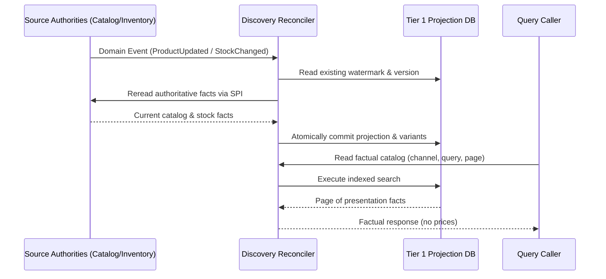
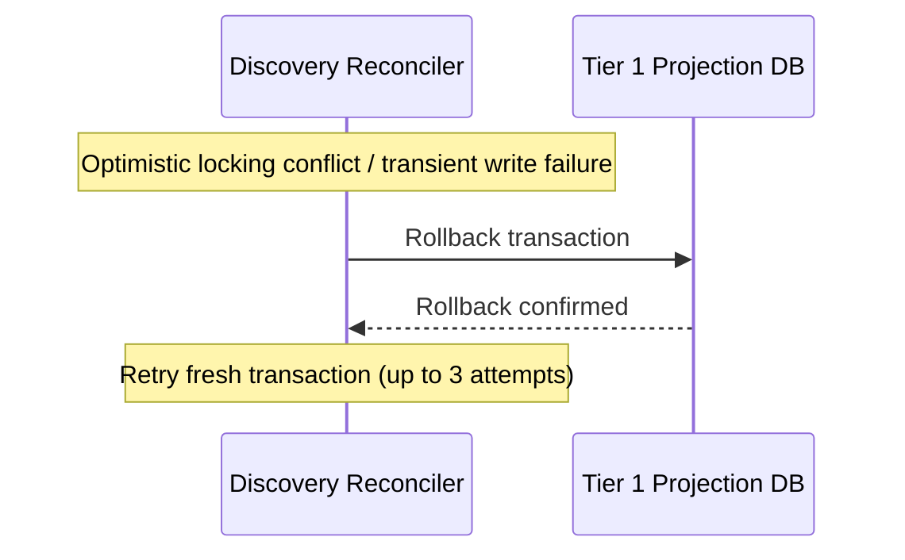

# Workflow: Browse, Project, and Rebuild Discovery Facts

- **Purpose:** Maintain currency-agnostic catalog and inventory presentation facts and serve factual storefront queries without price dependencies.
- **Trigger:** Upstream domain integration event (Catalog/Inventory/SalesChannel), manual rebuild trigger, or customer factual query.
- **Success Result:** Denormalized projection updated with latest presentation facts or factual catalog response served to caller.
- **Feature Spec:** [Discovery Wiring & Projection Reconciliation](../../features/feat_006-discovery-wiring-projection-reconciliation.md)
- **Domains Involved:** Discovery · Catalog · Inventory · Sales Channel

---

## 1. Step-by-Step Flow

### Steps

| # | Step | Domain | What Happens | Starts When | Done When |
|:--|:-----|:-------|:-------------|:------------|:----------|
| 1 | `ReceiveRefreshSignal` | Discovery | Ingests domain event from Catalog, Inventory, or Sales Channel. | Integration event delivered | Affected targets identified |
| 2 | `ResolveAffectedPairs` | Discovery | Deduplicates current publications and stored memberships into channel/product pairs. | Step 1 completes | Target pairs resolved |
| 3 | `RereadSourceFacts` | Catalog / Inventory | Rereads authoritative presentation facts, active variants, and routed stock levels via SPI. | Watermark verified | Facts collected |
| 4 | `CommitReconciliation` | Discovery | Atomically replaces version-checked facts and variants in the projection table. | Step 3 completes | Local transaction commits |
| 5 | `RebuildPublications` | Discovery | Keyset-pages through current publications and reconciles projection documents in batches. | Rebuild run started | All publications reconciled |
| 6 | `RebuildExistingProjections` | Discovery | Scans existing projection records to identify and tombstone deleted or unmapped publications. | Step 5 completes | Checkpoint commits run completion |
| 7 | `ReadVisibleFacts` | Discovery | Queries Tier 1 projection applying channel visibility, keyword filters, and pagination. | Storefront query requested | Factual results returned |

### Flow Diagram

### Edge Cases

- **Parallel steps:** Distinct channel/product pairs are reconciled independently; multiple events for different products execute concurrently.
- **Skipped steps:** Incoming integration events with timestamps strictly older than the stored watermark are discarded without database writes.

---

## 2. Events & Signals

### Events Sent (Workflow → Domain)

| Event | Step | Sent To | What It Requests |
|:------|:-----|:--------|:-----------------|
| `FetchAuthoritativeFactsQuery` | Step 3 | Catalog / Inventory | Requests current presentation facts, titles, media, and routed stock for a product ID. |

### Events Received (Domain → Workflow)

| Event | Step | Sent By | What It Means |
|:------|:-----|:--------|:--------------|
| `ProductUpdatedIntegrationEvent` | Step 1 | Catalog | Catalog taxonomy, title, media, or variant structure modified. |
| `InventoryStockAdjustedIntegrationEvent` | Step 1 | Inventory | On-hand quantity or stock tracking state modified for SKU. |
| `SalesChannelStatusChangedIntegrationEvent` | Step 1 | Sales Channel | Channel enabled or disabled, affecting storefront visibility. |

---

## 3. Failure Recovery *(optional — include only when the workflow needs to undo completed steps)*

### When Does Failure Handling Start?

When a source read fails, an optimistic locking conflict is detected, or a batch database transaction fails during projection commit.

### What Gets Undone?

| Reverse # | Completed Action | Undo Action | Undo Event | Why / Notes |
|:----------|:-----------------|:------------|:-----------|:------------|
| 2 | Projection replacement | Database rollback of uncommitted batch | Local rollback | Prevents partial or corrupted variant membership writes. |
| 1 | Source reads | None | None | Read operations are idempotent and stateless. |

### Failure Flow Diagram

---

## 4. State Matrix *(optional — include only for complex multi-domain workflows)*

| Workflow Stage | Catalog Entity State | Inventory Item State | Discovery Projection State |
|:---------------|:---------------------|:---------------------|:---------------------------|
| **Event Published** | `ACTIVE` | `IN_STOCK` | `STALE` |
| **Facts Reread** | `ACTIVE` | `IN_STOCK` | `RECONCILING` |
| **Committed** | `ACTIVE` | `IN_STOCK` | `CURRENT` |
| **Unpublished** | `UNPUBLISHED` | `—` | `TOMBSTONE` |
