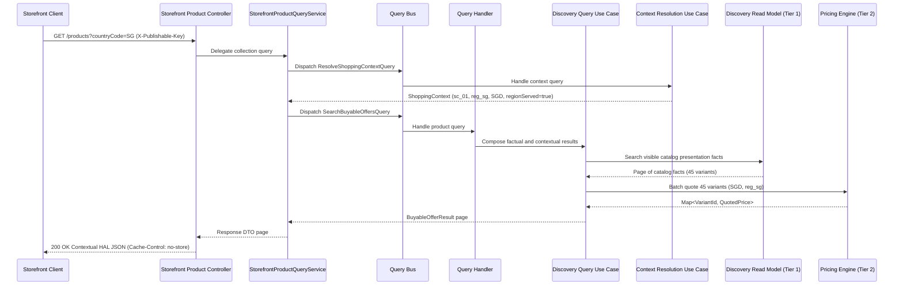
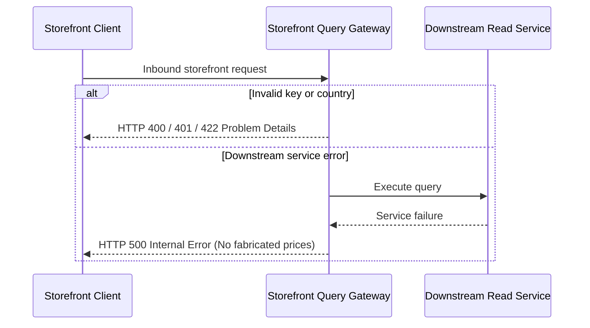

# Workflow: Browse Contextual Storefront Offers

- **Purpose:** Serve visible products with authoritative market context, request-time batch regional quotes, and explicit availability states without storing regional offers.
- **Trigger:** Customer storefront GET request to product collection, slug endpoint, or `/api/v1/storefront-query/products/context` with `X-Publishable-Key` header.
- **Success Result:** Contextual HAL response returned with dynamic price ranges, variant availability codes, and `Cache-Control: no-store`.
- **Feature Spec:** [Storefront API Cutover & Contract Refactoring](../../features/feat_007-storefront-api-cutover-contract-refactoring.md)
- **Domains Involved:** Storefront Query · Sales Channel · Region · Discovery · Pricing

---

## 1. Step-by-Step Flow

### Steps

| # | Step | Domain | What Happens | Starts When | Done When |
|:--|:-----|:-------|:-------------|:------------|:----------|
| 1 | `ValidateRequest` | Storefront Query | MVC interceptor applies `Cache-Control: no-store`, validates one `X-Publishable-Key` header, and rejects any `salesChannelId` or `publishableKey` query parameters with 400. | Product or context GET arrives | Transport validated |
| 2 | `DispatchStorefrontQuery` | Storefront Query | Controller delegates to `StorefrontProductQueryService`, which maps and dispatches the context and product query through `QueryBus`. | Step 1 passes | Query handler invoked |
| 3 | `ResolveShoppingContext` | Sales Channel / Region | The context query handler delegates to the context use case, which validates the key, maps country to Region, and establishes currency and eligibility. | Step 2 dispatches context query | Immutable `ShoppingContext` resolved |
| 4 | `ReadVisibleFacts` | Discovery | The product query handler delegates to the discovery use case, which queries the Tier 1 projection for channel-scoped visible products and active variants. | Step 3 completes | Presentation facts returned |
| 5 | `QuoteVariantBatch` | Pricing | The discovery use case makes one vectorized batch quote for all distinct visible variant IDs in the resolved currency and region. | Step 4 returns variants in served market | Quoted price matrix returned |
| 6 | `ComposeContextualOffers` | Discovery | A pure policy evaluates availability and derives `min_price` and `max_price` from valid quoted variants. | Step 5 completes | Immutable offer results produced |
| 7 | `RepresentContextualOffers`| Storefront Query | Query service maps results to response DTOs; the controller invokes the assembler for HAL links, pagination metadata, and `Cache-Control: no-store`. | Step 6 completes | HTTP 200 delivered to client |

### Flow Diagram

### Edge Cases

- **Parallel steps:** None; query orchestration is sequential and bounded to a single incoming request.
- **Skipped steps:** Empty pages and requests in unserved regions (`regionServed=false`) skip Tier 2 pricing calls; variants immediately receive `NOT_AVAILABLE_IN_REGION` with null prices.

---

## 2. Query boundaries

### Synchronous queries (Workflow → Provider)

| Query | Step | Sent To | What It Requests |
|:------|:-----|:--------|:-----------------|
| `ResolveShoppingContextQuery` | Step 2 | Sales Channel / Region | Requests key validation and market/currency resolution. |
| `PricingQuoteQuery` | Step 4 | Pricing | Requests bulk price quote for list of variant IDs in target market. |

### Query results (Provider → Workflow)

| Result | Step | Sent By | What It Means |
|:------|:-----|:--------|:--------------|
| `ResolveShoppingContextResult` | Step 3 | Context Resolution Use Case | Key is valid and market context is established. |
| `BatchQuoteResult` | Step 5 | Pricing Engine | Bulk price outcomes returned for all requested variants. |

No integration event is published by this read-only workflow.

The context endpoint uses steps 1 and 2 only, then returns the resolved context in an `EntityModel` with its self link. It does not query discovery or pricing.

---

## 3. Failure Recovery *(optional — include only when the workflow needs to undo completed steps)*

### When Does Failure Handling Start?

When client input is invalid, an unmapped country is requested, or a downstream dependency fails during read execution.

### What Gets Undone?

| Reverse # | Completed Action | Undo Action | Undo Event | Why / Notes |
|:----------|:-----------------|:------------|:-----------|:------------|
| 1 | In-memory evaluation | Discard request-local calculations | None | Read-only workflow; no persistent mutations occur. |

### Failure Flow Diagram

---

## 4. State Matrix *(optional — include only for complex multi-domain workflows)*

| Workflow Stage | Sales Channel State | Region State | Pricing State | Discovery Projection State |
|:---------------|:--------------------|:-------------|:--------------|:---------------------------|
| **Start** | `ENABLED` | `ACTIVE` | Persisted Rules | Persisted Facts |
| **Context Resolved** | `ENABLED` | `ACTIVE` | Persisted Rules | Persisted Facts |
| **Facts Read** | `ENABLED` | `ACTIVE` | Persisted Rules | Factual Results Read |
| **Pricing Quoted** | `ENABLED` | `ACTIVE` | In-Memory Batch Matrix | Factual Results Read |
| **Completed** | `ENABLED` | `ACTIVE` | Unchanged | Unchanged |
