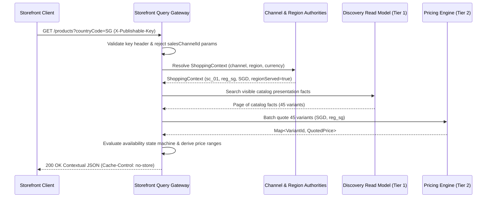
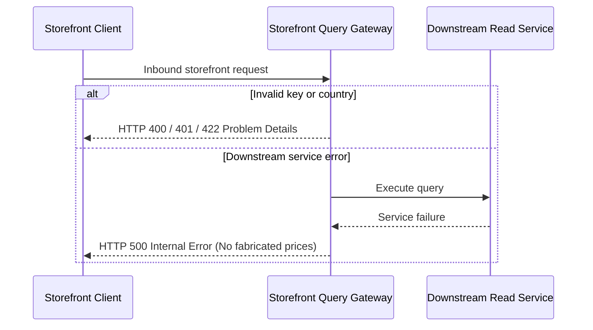

# Workflow: Browse Contextual Storefront Offers

- **Purpose:** Serve visible products with authoritative market context, request-time batch regional quotes, and explicit availability states without storing regional offers.
- **Trigger:** Customer storefront GET request to product collection or slug endpoint with `X-Publishable-Key` header.
- **Success Result:** Contextual HAL response returned with dynamic price ranges, variant availability codes, and `Cache-Control: no-store`.
- **Feature Spec:** [Storefront API Cutover & Contract Refactoring](../../features/feat_007-storefront-api-cutover-contract-refactoring.md)
- **Domains Involved:** Storefront Query · Sales Channel · Region · Discovery · Pricing

---

## 1. Step-by-Step Flow

### Steps

| # | Step | Domain | What Happens | Starts When | Done When |
|:--|:-----|:-------|:-------------|:------------|:----------|
| 1 | `ValidateRequest` | Storefront Query | Validates `X-Publishable-Key` header presence and rejects any `salesChannelId` query parameters with 400. | Product GET arrives | Transport validated |
| 2 | `ResolveShoppingContext` | Sales Channel / Region | Validates token digest, retrieves channel, maps country to Region, and establishes currency and eligibility. | Step 1 passes | Immutable `ShoppingContext` resolved |
| 3 | `ReadVisibleFacts` | Discovery | Queries Tier 1 projection for channel-scoped visible products and active published variants. | Step 2 completes | Presentation facts returned |
| 4 | `QuoteVariantBatch` | Pricing | Vectorized single-trip batch quote of all visible variant IDs in the resolved currency and region. | Step 3 returns variants in served market | Quoted price matrix returned |
| 5 | `EvaluateAvailability` | Storefront Query | Applies 4-state availability precedence (`NOT_AVAILABLE_IN_REGION > PRICE_UNAVAILABLE > SOLD_OUT > AVAILABLE`). | Step 4 completes | Variant statuses evaluated |
| 6 | `DerivePriceRanges` | Storefront Query | Computes `min_price` and `max_price` ranges from valid quoted variants in the settlement currency. | Step 5 completes | Ranges derived |
| 7 | `RepresentContextualOffers`| Storefront Query | Constructs HAL representation with navigation links, pagination metadata, and `Cache-Control: no-store`. | Step 6 completes | HTTP 200 delivered to client |

### Flow Diagram

### Edge Cases

- **Parallel steps:** None; query orchestration is sequential and bounded to a single incoming request.
- **Skipped steps:** Empty pages and requests in unserved regions (`regionServed=false`) skip Tier 2 pricing calls; variants immediately receive `NOT_AVAILABLE_IN_REGION` with null prices.

---

## 2. Events & Signals

### Events Sent (Workflow → Domain)

| Event | Step | Sent To | What It Requests |
|:------|:-----|:--------|:-----------------|
| `ResolveContextQuery` | Step 2 | Sales Channel / Region | Requests key validation and market/currency resolution. |
| `BatchQuotePriceQuery` | Step 4 | Pricing | Requests bulk price quote for list of variant IDs in target market. |

### Events Received (Domain → Workflow)

| Event | Step | Sent By | What It Means |
|:------|:-----|:--------|:--------------|
| `ShoppingContextResolved` | Step 2 | Edge Context Resolver | Key is valid and market context is established. |
| `BatchQuoteEvaluated` | Step 4 | Pricing Engine | Bulk price outcomes returned for all requested variants. |

---

## 3. Failure Recovery *(optional — include only when the workflow needs to undo completed steps)*

### When Does Failure Handling Start?

When client input is invalid, an unmapped country is requested, or a downstream dependency fails during read execution.

### What Gets Undone?

| Reverse # | Completed Action | Undo Action | Undo Event | Why / Notes |
|:----------|:-----------------|:------------|:-----------|:------------|
| 1 | In-memory evaluation | Discard request-local calculations | None | Read-only workflow; no persistent mutations occur. |

### Failure Flow Diagram

---

## 4. State Matrix *(optional — include only for complex multi-domain workflows)*

| Workflow Stage | Sales Channel State | Region State | Pricing State | Discovery Projection State |
|:---------------|:--------------------|:-------------|:--------------|:---------------------------|
| **Start** | `ENABLED` | `ACTIVE` | Persisted Rules | Persisted Facts |
| **Context Resolved** | `ENABLED` | `ACTIVE` | Persisted Rules | Persisted Facts |
| **Facts Read** | `ENABLED` | `ACTIVE` | Persisted Rules | Factual Results Read |
| **Pricing Quoted** | `ENABLED` | `ACTIVE` | In-Memory Batch Matrix | Factual Results Read |
| **Completed** | `ENABLED` | `ACTIVE` | Unchanged | Unchanged |
