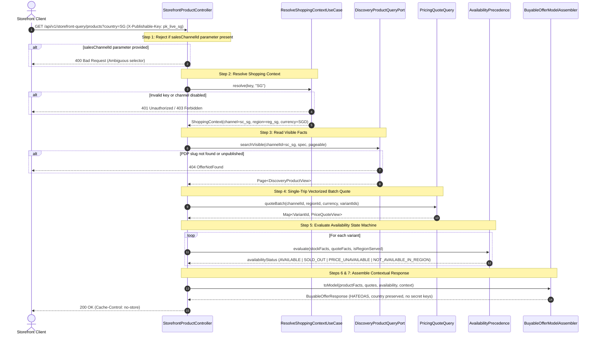

# Workflow: Browse Contextual Storefront Offers

> **Purpose:** Serve multi-regional storefront browse and PDP detail queries with authenticated market context, single-trip batch pricing, and explicit commercial availability codes.
> **Starts When:** A storefront customer or application invokes `GET /api/v1/storefront-query/products` or `GET /api/v1/storefront-query/products/{slug}` with an `X-Publishable-Key` header.
> **Successful Result:** A fully enriched, contextual `BuyableOfferResponse` returning factual product presentation, regional price ranges, and variants with explicit 4-tier availability statuses.
> **Participating Domains:** Storefront Query · Sales Channel · Region · Discovery · Pricing
> **Status:** Phase 5 Contextual Storefront Read Path
> **Related Feature:** [feat_007 — Storefront API Cutover & Response Contract Refactoring](../../features/feat_007-storefront-api-cutover-contract-refactoring.md)
> **Related Technical Specifications:**
> - [Storefront Contextual Cutover & Response Contract](../system/storefront-contextual-cutover-tech-spec.md)
> - [Shopping Context Resolution](../system/shopping-context-resolution-tech-spec.md)
> - [Batch Regional Pricing](../system/batch-regional-pricing-tech-spec.md)
> - [Discovery Facts-Only Projection](../system/discovery-facts-only-projection-tech-spec.md)

---

## 1. Step-by-Step Execution Path

### Normal Path (Happy Path)

| # | Step Name | Owner Domain | Business Action | Starts When | Complete When |
| :--- | :--- | :--- | :--- | :--- | :--- |
| **1** | `validate-request-headers` | Storefront Query | Validate presence of `X-Publishable-Key`; reject request if legacy `salesChannelId` query param is present. | HTTP GET arrives at controller | Header confirmed; no legacy query parameter |
| **2** | `resolve-shopping-context` | Sales Channel / Region | Authenticate key, verify channel enabled, resolve market country, active region, currency, and locale. | Step 1 passes | Immutable `ShoppingContext` value object produced |
| **3** | `read-visible-discovery-facts` | Discovery | Query factual product rows and variant membership matching channel and visibility predicates (channel enabled, product active, >= 1 active variant). | Step 2 completes | `Page<DiscoveryProductView>` or single PDP view returned |
| **4** | `quote-variant-prices-batch` | Pricing | Perform single-trip batch evaluation of 4-tier pricing precedence rules (`Channel+Region > Region > Channel > Base`) across all visible variants. | Step 3 completes | `Map<VariantId, PriceQuoteView>` returned |
| **5** | `evaluate-commercial-availability` | Storefront Query | Evaluate 4-tier precedence state machine (`NOT_AVAILABLE_IN_REGION -> PRICE_UNAVAILABLE -> SOLD_OUT -> AVAILABLE`) for each variant. | Step 4 completes | Every variant assigned explicit availability status |
| **6** | `compute-price-ranges` | Storefront Query | Calculate dynamic `minPrice` and `maxPrice` from quoted variants in the market's currency. | Step 5 completes | Price ranges computed (or null if unpriced) |
| **7** | `assemble-hateoas-response` | Storefront Query | Assemble `BuyableOfferResponse` DTO with HAL links preserving countryCode/locale; attach `Cache-Control: no-store`. | Step 6 completes | HTTP 200 OK returned to client |

---

### Special Flows & Edge Conditions

- **Legacy Parameter Bypass Attempt:** If a client provides `?salesChannelId=...` in the query string, Step 1 immediately halts the flow and returns `HTTP 400 Bad Request` without querying any backend ports.
- **Unpublished or Deleted Product on PDP:** If a client requests `/products/{slug}` and the product is missing, deleted, or unpublished, Step 3 halts and returns `HTTP 404 OfferNotFound`.
- **Sold-Out Product on PDP (SEO Preservation):** If a product has zero stock across all variants, Step 5 assigns `SOLD_OUT` status to variants, but Step 7 returns `HTTP 200 OK` with full description and images.
- **Unpriced Product in Region:** If a product is published to the channel but has no configured pricing in the market's currency, Step 5 assigns `PRICE_UNAVAILABLE`, Step 6 sets `minPrice = null` and `maxPrice = null`, and Step 7 returns `HTTP 200 OK` (Add-to-Cart blocked).
- **Unserved Region:** If the channel does not bind to the shopper's requested country, Step 5 assigns `NOT_AVAILABLE_IN_REGION` to all variants, with `null` prices and Add-to-Cart blocked.

---

### End-to-End Sequence Diagram

---

## 2. Participating Aggregates & State Transitions

| Domain | Entity / Model | Read / Write | Invariant / Policy Enforced |
| :--- | :--- | :--- | :--- |
| **Sales Channel** | `PublishableKey` | Read | Key must exist, match hash digest, be active, and belong to an enabled sales channel. |
| **Region** | `ChannelRegionBinding` | Read | Region must be actively bound to the sales channel and cover the requested country code. |
| **Discovery** | `DiscoveryProductEntity` | Read | Product must be published, channel enabled, product status ACTIVE, and have >= 1 ACTIVE variant. |
| **Pricing** | `PriceSetRule` | Read | Price set resolved via 4-tier specificity ladder without fabricating currency conversions. |
| **Storefront Query** | `BuyableOfferResponse` | Assembly | Assembled at request time with no state mutations in any underlying databases. |
