# Workflow: Create Sellable Product

> **Purpose:** Create a catalog product, initialize its variant prices and optional inventory, then validate and publish it to requested sales channels.
> **Starts When:** A caller posts to `/api/v1/workflows/create-sellable-product`.
> **Successful Result:** Product, variants, prices, optional inventory, and requested channel publications have completed their corresponding workflow steps.
> **Participating Domains:** Catalog · Pricing · Inventory · Sales Channel
> **Related Domain Specs:** [Catalog Product](../domain/catalog/architecture/product-domain-spec.md) · [Catalog Product Publication](../domain/catalog/architecture/product-publication-domain-spec.md) · [Pricing](../domain/pricing/architecture/pricing-domain-spec.md) · [Inventory](../domain/inventory/architecture/inventory-item-domain-spec.md) · [Sales Channel](../domain/sales-channel/architecture/sales-channel-domain-spec.md)
> **Sales Channel Reference:** Channel ownership, lifecycle, and usability assertions are defined in the [Sales Channel domain spec](../domain/sales-channel/architecture/sales-channel-domain-spec.md); variant/channel publication records remain owned by Catalog.

## 1. Step-by-Step Execution Path

Steps run in this order. A skipped optional step completes without dispatching its request.

| # | Step | Owner | Action and completion condition |
|---:|---|---|---|
| 1 | `create-product` | Catalog | Create the product and variants; wait for `SellableProductProductCreatedEvent`. |
| 2 | `replace-medias` | Catalog | Replace product media when `medias` is present; wait for `ProductMediaReplacedEvent`. |
| 3 | `replace-descriptions` | Catalog | Replace descriptions when `descriptions` is present; wait for `ProductDescriptionsReplacedEvent`. |
| 4 | `apply-status` | Catalog | Apply a nonblank requested status; wait for `ProductStatusAppliedEvent`. |
| 5 | `create-variant-prices` | Pricing | Fan out one price request per created variant; wait for a price-created event for each variant. |
| 6 | `create-inventory-item` | Inventory | Fan out one item creation per inventory line; skip when there are no lines and otherwise wait for all lines. |
| 7 | `assert-channel` | Sales Channel | When status is ACTIVE and publication lines exist, assert each unique channel; wait for all channel assertions. |
| 8 | `assert-product` | Catalog | Under the same publication condition, assert the product; wait for `ProductAssertedEvent`. |
| 9 | `assert-channel-stock-path` | Inventory | Under the publication condition, check each unique channel's inventory route; wait for a result from every channel. |
| 10 | `write-publication` | Catalog | Under the publication condition, publish each variant/channel line; wait for all publication events. |

**Conditional behavior:** Media, descriptions, and status are skipped when their corresponding request fields are omitted. Inventory skips for an empty list. The final four steps skip unless the requested status is ACTIVE and publication lines are present. Pricing coverage is validated for product variants at the request boundary.

```mermaid
sequenceDiagram
    participant Caller
    participant Workflow as Workflow Coordinator
    participant Catalog
    participant Pricing
    participant Inventory
    participant Channel as Sales Channel
    Caller->>Workflow: Start create request
    Workflow->>Catalog: Create product&#59; replace optional listing data&#59; apply optional status
    Catalog-->>Workflow: Product and listing acknowledgements
    Workflow->>Pricing: Create price per variant
    Pricing-->>Workflow: Price created per variant
    opt Inventory lines provided
        Workflow->>Inventory: Create item per line
        Inventory-->>Workflow: Item created per line
    end
    opt ACTIVE product with publication lines
        Workflow->>Channel: Assert each unique channel
        Channel-->>Workflow: ChannelAssertedEvent per channel
        Workflow->>Inventory: Check inventory route per unique channel
        Inventory-->>Workflow: StockPathCheckedEvent per channel
        Workflow->>Catalog: Write publication per variant and channel
        Catalog-->>Workflow: Publication written per line
    end
```



## 2. Events & Signals

| Step | Request event | Completion event |
|---|---|---|
| `create-product` | `RequestCreateProductSetEvent` | `SellableProductProductCreatedEvent` |
| `replace-medias` | `RequestReplaceProductMediaEvent` | `ProductMediaReplacedEvent` |
| `replace-descriptions` | `RequestReplaceProductDescriptionsEvent` | `ProductDescriptionsReplacedEvent` |
| `apply-status` | `RequestApplyProductStatusEvent` | `ProductStatusAppliedEvent` |
| `create-variant-prices` | `RequestCreateVariantPriceEvent` | `VariantPriceCreatedEvent` |
| `create-inventory-item` | `RequestCreateInventoryItemEvent` | `InventoryItemCreatedEvent` |
| `assert-channel` | `RequestAssertChannelEvent` | `ChannelAssertedEvent` |
| `assert-product` | `RequestAssertProductEvent` | `ProductAssertedEvent` |
| `assert-channel-stock-path` | `RequestCheckChannelStockPathEvent` | `StockPathCheckedEvent` (includes `missingRoute`) |
| `write-publication` | `RequestWritePublicationEvent` | `ProductPublishedToChannelEvent` |

Catalog, Pricing, and Inventory step listeners emit `SellableProductStepFailedEvent` when their workflow runners catch an operation exception. Sales Channel assertions and Catalog product/publication operations emit `PublishProductStepFailedEvent` on caught exceptions. These workflow signals are distinct from aggregate domain events. If an expected completion never arrives, the workflow sweeper times out the waiting step and starts the same failure recovery without a failure event.

The inventory-route check completes with `StockPathCheckedEvent` for each unique channel and records `missingRoute` in the workflow checkpoint. A missing route is not itself a failure signal and does not suppress the later publication step; publication is still attempted for each requested line.

## 3. Compensation & Failure Recovery

The engine gathers compensation requests in reverse step order and publishes them as a batch. The reverse listing below describes dispatch order; the engine does not wait for one acknowledgement before dispatching the next request.

| Reverse step | Completed action | Compensation request | Acknowledgement |
|---|---|---|---|
| `write-publication` | Wrote channel publications | `RequestUnpublishProductCompensationEvent` for each completed publication | `ProductUnpublishedFromChannelEvent` |
| `create-variant-prices` | Created price sets | `RequestDeletePriceSetCompensationEvent` per created set | `PriceSetDeletedEvent` |
| `create-product` | Created product and variants | `RequestDeleteProductCompensationEvent` | `ProductDeletedEvent` |

Media, descriptions, status, channel assertions, and stock-route checks have no workflow compensation. Inventory items are not directly compensated by this workflow. Product deletion emits a catalog integration event that causes Inventory to discontinue associated items asynchronously; it does not erase their quantities. Initial inventory quantity may be greater than zero.

The workflow reaches `COMPENSATED` after every dispatched compensation is acknowledged. If failure occurs before any compensable action exists, or compensation times out, the engine can terminate as `FAILED`. Incomplete compensation remains observable as failure rather than a successful rollback.

For terminal UI events, the current create-workflow adapter sets `partiallyApplied` when at least one inventory item creation has been acknowledged. It does not derive the flag from every retained product, price, or publication change, and an item created without a completion signal is not reflected; the flag is narrower than an inventory of residual state.

```mermaid
sequenceDiagram
    participant Workflow as Workflow Coordinator
    participant Catalog
    participant Pricing

    Note over Workflow: On a typed failure or waiting-step timeout, collect compensations in reverse definition order
    opt Publication writes completed
        Workflow-->>Catalog: RequestUnpublishProductCompensationEvent
    end
    opt New price sets created
        Workflow-->>Pricing: RequestDeletePriceSetCompensationEvent
    end
    opt Product creation completed
        Workflow-->>Catalog: RequestDeleteProductCompensationEvent
    end
    Note over Workflow: Publish the collected requests together; no acknowledgement gates another request
    opt Catalog compensation requested
        Catalog-->>Workflow: Publication/product compensation acknowledgements
    end
    opt Price-set compensation requested
        Pricing-->>Workflow: PriceSetDeletedEvent
    end
    alt All requested compensations acknowledged
        Workflow->>Workflow: Mark COMPENSATED
    else No compensation requests or compensation timeout
        Workflow->>Workflow: Mark FAILED
    end
```

## 4. Aggregate Cross-Lifecycle Matrix

| Stage | Product | Prices | Inventory | Publication |
|---|---|---|---|---|
| Start | Absent | Absent | Absent | Absent |
| After product/listing/status steps | Created with requested status | Absent | Absent | Absent |
| After price step | Created | Created per variant | Absent | Absent |
| Completed | Created | Created per variant | Created per line, if supplied | Written per line only for ACTIVE status |
| Compensation acknowledged | Product deletion requested; resulting catalog state follows its delete contract | Created sets deleted | Items retained and asynchronously discontinued after product deletion | Completed writes unpublished |

Implementation references: `store/src/main/java/com/grab/store/workflows/internal/workflows/createsellableproduct/CreateSellableProductDefinition.java`, `CreateSellableProductContext.java`, `store/src/main/java/com/grab/store/inventory/internal/event/PublishProductToChannelInventoryEventListener.java`, and `store/src/main/java/com/grab/store/saleschannel/internal/event/PublishProductToChannelSalesChannelEventListener.java`.
