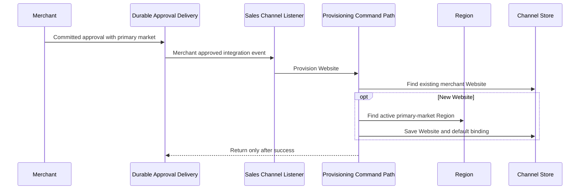

# Workflow: Default Sales Channel Provisioning

> **Purpose:** Establish the platform Marketplace and a merchant Website without SQL-driven business provisioning.
> **Starts When:** Application startup provisioning runs or a committed merchant approval is delivered.
> **Successful Result:** One platform Marketplace and at most one Website for each approved merchant, preserving existing channels.
> **Participating Domains:** Merchant · Sales Channel · Region
> **Related Features:** [Default Sales Channel](../../features/feat_001-default_saleschannel_provisioning.md), [Edge Shopping-Context Resolution](../../features/feat_004-edge-shopping-context-resolution.md), [Automated Verification & Zero-Downtime Rollout](../../features/feat_008-automated-verification-zero-downtime-rollout.md)
> **Related Domain Specs:** [Merchant](../domain/merchant/architecture/merchant-domain-spec.md), [Sales Channel](../domain/sales-channel/architecture/sales-channel-domain-spec.md), [Region](../domain/region/architecture/region-domain-spec.md)
> **Related Tech:** [Outbox](../system/transactional-outbox-tech-spec.md), [Context Resolution](../system/shopping-context-resolution-tech-spec.md), [Rollout](../system/contextual-discovery-rollout-tech-spec.md)
> **Status:** Existing command paths with conformance work remaining; this document specifies completion requirements.

## 1. Step-by-Step Execution Path

| ID | Step | Owner | Business action | Starts when | Complete when |
| :--- | :--- | :--- | :--- | :--- | :--- |
| **P-01** | Ensure Marketplace | Sales Channel | Dispatch the command before readiness and find or create the enabled platform channel named Marketplace. | Startup provisioning begins. | Existing channel is returned unchanged or one new channel commits. |
| **P-02** | Retry startup conflict | Sales Channel | Retry transient write conflicts up to three attempts in fresh transactions with 50/100 ms backoff. | A provisioning attempt fails transiently. | An attempt succeeds or startup fails after exhaustion. |
| **P-03** | Deliver merchant approval | Merchant | Publish versioned committed approval with merchant identity, primary-market country and occurrence time through outbox delivery. | Merchant approval commits. | Sales Channel listener receives the integration event. |
| **P-04** | Resolve Website/default market | Sales Channel / Region | Return an existing Website unchanged or resolve the new merchant's country to an active Region. | P-03 is consumed. | Existing channel is found or a valid default market is resolved. |
| **P-05** | Commit Website | Sales Channel | Create enabled seller Website with one enabled default-region binding and persist through the write port. | P-04 resolves a new channel's market. | Channel and binding commit under uniqueness protection. |

The Marketplace path does not fabricate regional bindings; operators configure those through feature 004. Merchant approvals before this capability are not automatically backfilled, and disabled existing channels remain unchanged.

## 2. Events & Signals

| Signal | Category | Producer | Meaning |
| :--- | :--- | :--- | :--- |
| MerchantApprovedEvent | Aggregate domain event | Merchant | Approval mutation is captured durably. |
| MerchantApprovedIntegrationEvent | Cross-module integration record | Merchant store bridge | Committed approval can trigger Website provisioning. |
| SalesChannelCreatedEvent | Aggregate domain event | Sales Channel | A new channel was established. |

`MerchantApprovedIntegrationEvent` currently includes `merchantId`, `primaryMarketCountryCode`, `occurredAt`, and `version` under `shared/events/merchant/`. There are no provisioning completion/compensation event records; startup uses a local command and merchant delivery relies on listener success or exception.

## 3. Compensation & Failure Recovery

| Reverse step order | Completed action | Recovery action | Signal |
| :--- | :--- | :--- | :--- |
| P-05 | New Website and binding | Failed local transaction rolls back; redelivery rechecks existing channel. | Exception propagates. |
| P-04 | Region lookup | No compensation because this is a read. | None. |
| P-03 | Merchant approval | Approval remains committed because provisioning is a derived follow-up. | Outbox delivery can retry. |
| P-01/P-02 | Marketplace startup provisioning | A failed attempt rolls back and retries only eligible transient conflicts. | Exhaustion fails startup. |

Uniqueness migrations create no business rows and must fail on duplicates requiring explicit correction. Approval history is not automatically replayed, and merchant suspension/closure does not change channel status within this feature.

## 4. Aggregate Cross-Lifecycle Matrix

| Stage | Merchant | Marketplace | Website | Region |
| :--- | :--- | :--- | :--- | :--- |
| Startup succeeds | Unchanged | Existing unchanged or new ENABLED | Unchanged | Unchanged. |
| Approval committed | APPROVED | Unchanged | May be absent | Unchanged. |
| Website provisioning succeeds | APPROVED | Unchanged | Existing unchanged or new ENABLED with default | Read-only active market. |
| Website provisioning fails | Remains APPROVED | Unchanged | Failed local creation rolled back | Unchanged. |

## 5. Audited Conformance Gaps

| Requirement | Current source | Remaining work |
| :--- | :--- | :--- |
| Before-readiness Marketplace named Marketplace | Startup listener uses ApplicationReadyEvent; service constant is Default Sale Channel. | Move provisioning to the required startup stage and align the new-channel name without renaming existing channels. |
| Three fresh-transaction attempts | Handler declares retry annotation and REQUIRES_NEW transaction. | Verify effective proxy ordering, timing, exhaustion and concurrent uniqueness with runtime tests. |
| Website default market | New Website resolves primaryMarketCountryCode and enables its Region as default. | Verify missing/inactive mappings and durable redelivery behavior. |
| Schema-only uniqueness | Partial uniqueness indexes exist in saleschannel V1. | Use append-only corrective migrations for deployed databases and rehearse duplicate failure paths. |
