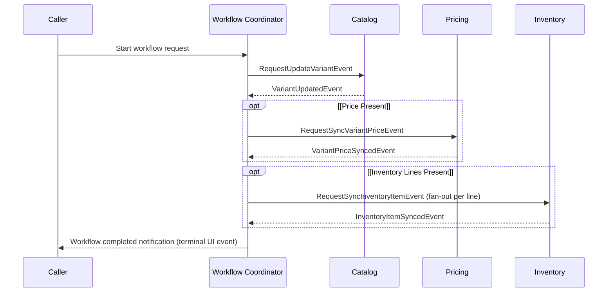
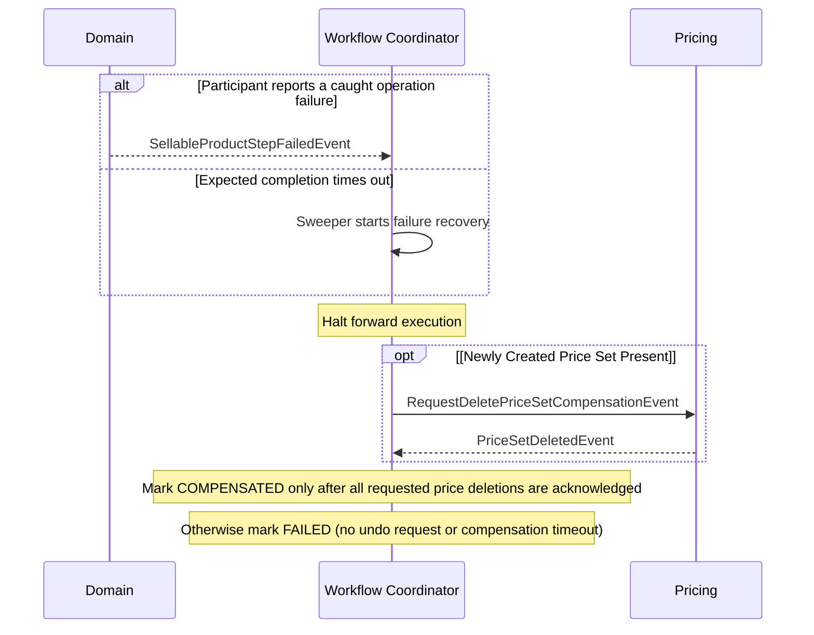

# Workflow: Update Product Variant

> **Purpose:** Update a merchant product variant's SKU and inventory-management setting, optionally synchronize its price, and process requested inventory lines.
> **Starts When:** API call `POST /api/v1/workflows/update-product-variant` is received.
> **Successful Result:** Catalog variant SKU and `manageInventory` are updated, an optional price is synchronized, and each provided inventory line is synchronized.
> **Participating Domains:** Catalog · Pricing · Inventory
> **Related Domain Specs:**
> - [Catalog Domain Spec](../domain/catalog/architecture/product-domain-spec.md)
> - [Pricing Domain Spec](../domain/pricing/architecture/pricing-domain-spec.md)
> - [Inventory Domain Spec](../domain/inventory/architecture/inventory-item-domain-spec.md)

---

## 1. Step-by-Step Execution Path

### Normal Path (Happy Path)

| # | Step Name | Owner Domain | Business Action | Starts When | Complete When |
| :--- | :--- | :--- | :--- | :--- | :--- |
| **1** | `update-variant` | Catalog | Updates the variant SKU and requested `manageInventory` value. | Workflow initiated | `VariantUpdatedEvent` received |
| **2** | `sync-variant-prices` | Pricing | Upserts the price for the variant (creates the price set if missing). | Step 1 completes | `VariantPriceSyncedEvent` received |
| **3** | `sync-inventory-item` | Inventory | Executes stock adjustment, damage, write-off, or reorder operations per inventory line. | Step 2 completes | `InventoryItemSyncedEvent` received for every line → Workflow completes |

### Special Flows & Edge Conditions

- **Parallel fan-out:** Step 3 fans out one inventory sync request per inventory line and advances when all sync.
- **Conditional / skipped steps:** Step 2 (pricing) is skipped when no price is provided; Step 3 is skipped when no inventory lines are provided. Catalog applies the requested `manageInventory` value in Step 1. Request validation rejects a `CREATE` inventory line when this request explicitly sets `manageInventory=false`; existing inventory operations remain allowed. If the field is omitted, that validator condition does not apply.

When `manageInventory` is omitted, validation does not compare the request to the current Catalog value. The workflow passes the explicit variant ID to Inventory, bypassing the Inventory service's SKU-only check of the projected `manageInventory` flag; a `CREATE` line can therefore proceed while the existing variant is not inventory-managed. This is a current implementation limitation.

### Happy Path Flow

---

## 2. Events & Signals

### Request Events (Workflow → Domain)

| Event Name | Step | Dispatched To | Intent / Payload Summary |
| :--- | :--- | :--- | :--- |
| `RequestUpdateVariantEvent` | `update-variant` | Catalog | Requests updating the variant SKU and `manageInventory` setting. |
| `RequestSyncVariantPriceEvent` | `sync-variant-prices` | Pricing | Requests price synchronization (upsert) for the variant. |
| `RequestSyncInventoryItemEvent` | `sync-inventory-item` | Inventory | Requests inventory creation, stock adjustment, damage, write-off, or reorder. |

### Completion Events (Domain → Workflow)

| Event Name | Step | Emitted By | Meaning to Workflow |
| :--- | :--- | :--- | :--- |
| `VariantUpdatedEvent` | `update-variant` | Catalog | Catalog variant updated successfully; advance to price sync. |
| `VariantPriceSyncedEvent` | `sync-variant-prices` | Pricing | Price synchronized for the variant; advance to inventory sync. |
| `InventoryItemSyncedEvent` | `sync-inventory-item` | Inventory | Inventory operation completed for a line; step completes when all lines sync. |

### Failure Events (Domain → Workflow)

| Event Name | Emitted By | Failure Cause | Resulting Workflow Action |
| :--- | :--- | :--- | :--- |
| `SellableProductStepFailedEvent` | Catalog, Pricing, or Inventory step listener | A caught operation exception for one of the three workflow steps | Halts forward execution and starts compensation when any undo request exists. |

If a completion signal never arrives, the workflow sweeper times out the waiting step; timeout is an engine action, not a `SellableProductStepFailedEvent`.

---

## 3. Compensation & Failure Recovery

> **Starts When:** A step reports failure via `SellableProductStepFailedEvent`.

### Compensation Order

| Reverse step | Completed action | Undo action | Request event | Acknowledgement event |
| :--- | :--- | :--- | :--- | :--- |
| **1** | Step 2: Created a new price set | Delete only price sets created by this workflow run | `RequestDeletePriceSetCompensationEvent` | `PriceSetDeletedEvent` |

### Explicitly Non-Compensated Actions

- **Catalog variant SKU:** The variant is intentionally retained to prevent merchant data loss on transient failures, and prior SKUs are not snapshotted for rollback.
- **In-place price updates:** Prior price amounts are not snapshotted for rollback. Only a *newly created* price set is deleted.
- **Inventory items and adjustments:** Stock adjustments, damage reports, write-offs, and newly created items are explicitly not rolled back by business policy.

Compensation requests are collected in reverse step order and published together; the engine does not wait for one compensation acknowledgement before dispatching the next request. A workflow with no compensation requests ends `FAILED`. If a new price set was created and its deletion is acknowledged, the workflow can end `COMPENSATED` even though the catalog update and any inventory operations remain applied. A compensation timeout ends `FAILED`. For terminal `FAILED` or `COMPENSATED` outcomes, `partiallyApplied` is true when the variant update completed, a price sync completed, or at least one inventory item was recorded. These values are based on received completion signals, so a committed operation whose acknowledgement was not received may not be reflected; the flag does not indicate that retained changes were rolled back.

### Failure Flow

---

## 4. Aggregate Cross-Lifecycle Matrix

| Workflow Stage | Catalog Variant | Pricing PriceSet | InventoryItem |
| :--- | :--- | :--- | :--- |
| **Initial Start** | Existing active variant | Existing or absent PriceSet | Existing or absent InventoryItem |
| **After Step 1** | Requested SKU and `manageInventory` applied | Unchanged | Unchanged |
| **After Step 2** | Updated | Price upserted when supplied; otherwise unchanged | Unchanged |
| **After Step 3** | Updated | Upserted price retained | Requested inventory operations applied; new items created when requested |
| **If Compensation Completes** | SKU and `manageInventory` changes retained | In-place edits retained; newly created PriceSet deleted | New items and stock changes retained |

Implementation references: `store/src/main/java/com/grab/store/workflows/internal/workflows/updateproductvariant/UpdateProductVariantDefinition.java`, `UpdateProductVariantContext.java`, `store/src/main/java/com/grab/store/workflows/internal/workflows/updateproductvariant/rest/dto/request/InventoryLinesValidator.java`, and `store/src/main/java/com/grab/store/catalog/internal/event/UpdateProductVariantCatalogEventListener.java`.
