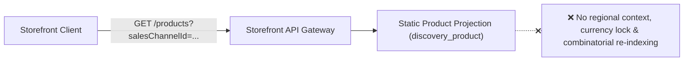
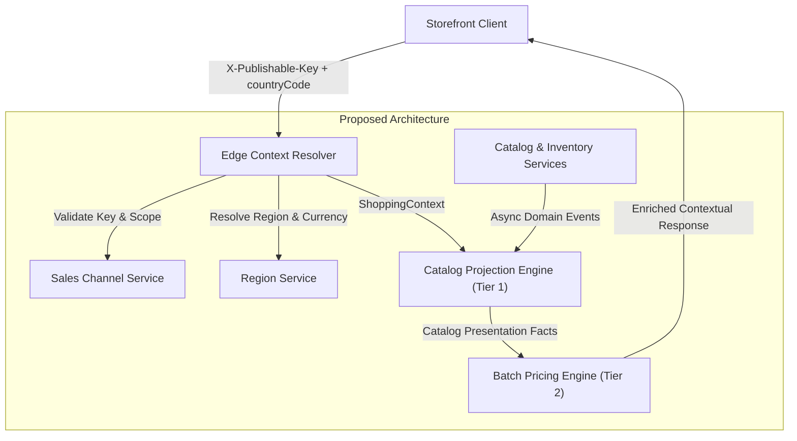
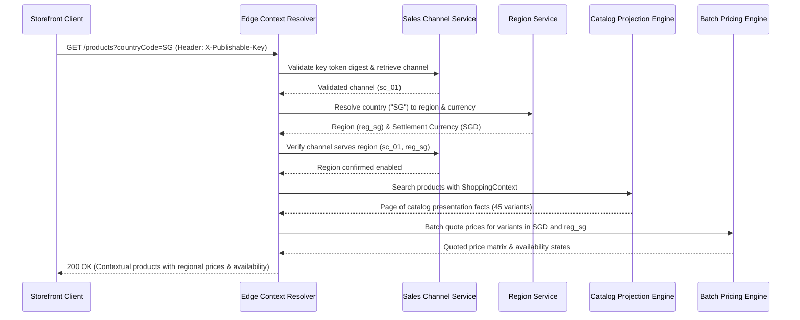

# Multi-Regional Contextual Product Discovery System Design

## 1. Business Requirement

### What does the business need?

The business requires a secure, multi-regional product discovery platform where a single merchant sales channel can serve shoppers across multiple countries in their local legal currencies (e.g., Singapore in `SGD` and Malaysia in `MYR`). Storefront requests must automatically resolve regional pricing and inventory availability based on client geographic context while preventing channel spoofing. In addition, product browsing must remain fast and resilient without pre-materializing combinatorial permutations of products across regions or hiding depleted inventory behind broken 404 pages.

### What happens if we don't solve this?

- **Security Exposure & Channel Spoofing**: Public clients can tamper with `salesChannelId` query parameters to probe arbitrary merchant channels and enumerate private commercial configurations.
- **Revenue Loss & Market Restrictions**: Merchants cannot expand internationally under a single storefront because the system cannot serve multiple currencies per channel, forcing fragmented storefronts or mispriced sales.
- **Search Engine Degradation (SEO Risk)**: Products lacking regional pricing or temporary stock return binary 404 errors or 0.00 prices, invalidating shopper bookmarks and damaging SEO crawl ranking.
- **Operational & Infrastructure Costs**: Pre-computing search documents for every region and currency combination causes combinatorial data explosion and massive database re-indexing storms on any exchange rate or pricing rule change.
- **Customer Trust & Cache Poisoning**: Price discrepancies across geographic borders and cross-border CDN cache poisoning degrade shopper trust and lead to cart abandonments.

---

## 2. Current State & Problem

### How does it work today?

> Show the current system behavior relevant to this requirement. Highlight what's missing or broken.

### What's the problem?

| # | Problem | Impact |
|:--|:--------|:-------|
| 1 | Public Channel Spoofing via Query Parameter (`?salesChannelId=...`) | Anonymous clients can enumerate private channels, probe competitor catalogs, and bypass commercial boundaries. |
| 2 | Single-Currency Channel Lock in `discovery_product` Projection | A sales channel cannot serve multiple geographic regions in their local legal currencies (e.g., Singapore in `SGD` and Malaysia in `MYR`). |
| 3 | Combinatorial Explosion & Write Amplification | Pre-calculating documents for every channel, region, and currency permutation ($O(P \times C \times R)$) triggers massive database re-indexing storms during pricing updates. |
| 4 | Binary Availability & SEO Degradation (Ephemeral 404s / 0.00 Prices) | Depleted or regionally unpriced products vanish as 404 errors or show 0.00 prices, breaking crawler ranking, invalidating bookmarks, and confusing shoppers. |

---

## 3. Solution Overview

### Architecture

> Show the proposed system design. Use role names (e.g., "API Gateway", "Order Engine", "Notification Service"), not class names. Keep it to ~7–9 nodes.

### Key Components

| Component | Role | What It Does |
|:----------|:-----|:-------------|
| **Edge Context Resolver** | Ingress Security & Context Resolution Gateway | Authenticates publishable keys, resolves regional market and currency rules, and constructs an immutable `ShoppingContext` for downstream requests. |
| **Sales Channel Service** | Channel Identity & Access Authority | Manages sales channel configuration, enabled regional bindings, and the cryptographic lifecycle of SHA-256 hashed publishable keys. |
| **Region Service** | Territorial & Currency Authority | Acts as the single source of truth for ISO country-to-region mappings and regional settlement currency definitions. |
| **Catalog Projection Engine (Tier 1)** | Currency-Agnostic Read Model | Maintains denormalized product presentation facts (titles, media, variants, stock status) decoupled from volatile pricing. |
| **Batch Pricing Engine (Tier 2)** | Request-Time Calculation Engine | Evaluates in-memory price rule precedence in a single vectorized batch call for all variants on a browse page. |
| **Catalog & Inventory Services** | Core Domain Write Services | Emits asynchronous domain events upon product updates, variant changes, and inventory movements to reconcile the read projection out-of-band. |

### How It Works (End-to-End Flow)

> Walk through the main interaction flow. This should tell the story of a request from start to finish.

---

## 4. Technology & Design Decisions

The proposed architecture adopts a decoupled CQRS model supported by cryptographic authentication and modular boundary enforcement to ensure scalability, security, and high performance.

| Decision | Choice | Why (not alternatives) |
|:---------|:-------|:-----------------------|
| **Architecture Style** | Two-Tier CQRS Pattern | Decouples static catalog facts (Tier 1) from volatile regional pricing (Tier 2). Eliminates Cartesian explosion ($O(P \times C \times R) \rightarrow O(P \times C)$) and write amplification storms of pre-materialized documents, while avoiding the high latency ($>200\text{ ms}$) of synchronous multi-module joins. |
| **Client Authentication** | Cryptographic Publishable Keys (`X-Publishable-Key` with SHA-256) | Replaces spoofable `salesChannelId` query parameters. Persisting one-way SHA-256 digests guarantees defense-in-depth against credential leaks during database inspection and prevents commercial channel enumeration. |
| **Modularity & Boundaries** | Java 21 & Spring Modulith | Enforces strict hexagonal boundary isolation and validates cross-module architectural invariants via `@ApplicationModuleTests`, preventing cyclic dependencies between write and read models. |
| **Relational Storage & Schema** | PostgreSQL & Flyway | Provides ACID transaction safety, partial unique indexes for single default regions per channel, and reproducible, versioned schema migrations. |
| **API Error Standards** | RFC 7807 Problem Details | Standardizes machine-readable error responses across all modules (`401`, `403`, `404`, `422`) with consistent status codes and error bodies without exposing internal implementation details. |
| **Storefront Availability** | 4-State Availability Precedence under HTTP 200 | Preserves SEO crawl ranking and bookmarks by returning HTTP 200 with clear variant availability states (NOT_AVAILABLE_IN_REGION, PRICE_UNAVAILABLE, SOLD_OUT, AVAILABLE) rather than hiding depleted inventory behind 404 errors. |

---

## 5. Feature Breakdown

> Decompose this system design into manageable, buildable features. Each feature gets its own Feature Spec where domain models, workflows, and tech decisions are detailed.

| # | Feature | What It Solves | Scope | Feature Spec |
|:--|:--------|:---------------|:------|:-------------|
| 1 | **Sales-Channel Key Lifecycle Management** | Eliminates spoofable public `salesChannelId` parameters by introducing cryptographically secure publishable keys with SHA-256 storage and non-destructive key rotation. | Key generation, SHA-256 hashing, secret token lifecycle, active revocation/rotation, channel association. | [feat_003-sales-channel-key-lifecycle-management.md](../features/feat_003-sales-channel-key-lifecycle-management.md) |
| 2 | **Edge Shopping-Context Resolution** | Decouples client request parameters from query execution by resolving inbound requests into an immutable 5-tuple context before queries hit read models, enforcing territorial region boundaries. | Header parsing, ISO country-to-region mapping, default region fallback, RFC 7807 boundary validation. | [feat_004-edge-shopping-context-resolution.md](../features/feat_004-edge-shopping-context-resolution.md) |
| 3 | **Vectorized Batch Regional Pricing** | Eliminates Cartesian document multiplication and re-indexing storms by calculating regional prices dynamically on demand using high-throughput in-memory rule precedence. | 4-tier rule precedence evaluation (Channel + Region > Region > Channel > Base), single-trip batch matrix querying, currency isolation. | [feat_005-vectorized-batch-regional-pricing.md](../features/feat_005-vectorized-batch-regional-pricing.md) |
| 4 | **Discovery Wiring & Projection Reconciliation** | Removes synchronous cross-module joins and static pricing locks from Tier 1 catalog projections, establishing an asynchronous event-driven read model. | Denormalized `discovery_product` projection schema, domain event consumers (catalog and inventory updates), projection reconciliation listeners. | [feat_006-discovery-wiring-projection-reconciliation.md](../features/feat_006-discovery-wiring-projection-reconciliation.md) |
| 5 | **Storefront API Cutover & Contract Refactoring** | Protects SEO crawler ranking and bookmarks by returning uniform HTTP 200 responses with granular variant availability states, while mandating `X-Publishable-Key` header authentication. | REST API contract refactoring, 4-state availability state machine, min/max price range derivation, response payload serialization. | [feat_007-storefront-api-cutover-contract-refactoring.md](../features/feat_007-storefront-api-cutover-contract-refactoring.md) |
| 6 | **Automated Verification & Zero-Downtime Rollout** | Prevents architectural drift across module boundaries and guarantees zero downtime during cutover from legacy query parameters to cryptographic headers. | Spring Modulith architectural invariant tests, expand-contract dual-resolution migration protocol, production cutover pipeline. | [feat_008-automated-verification-zero-downtime-rollout.md](../features/feat_008-automated-verification-zero-downtime-rollout.md) |
