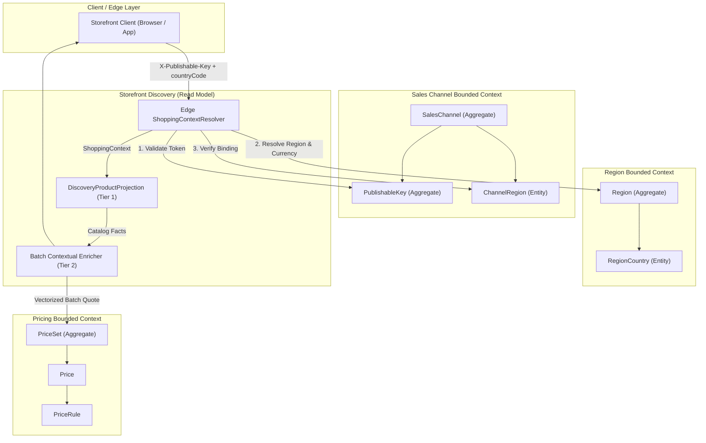
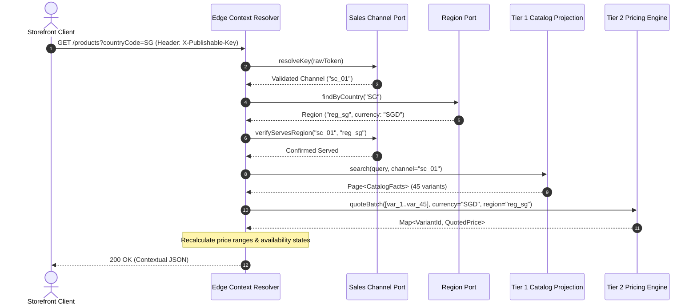
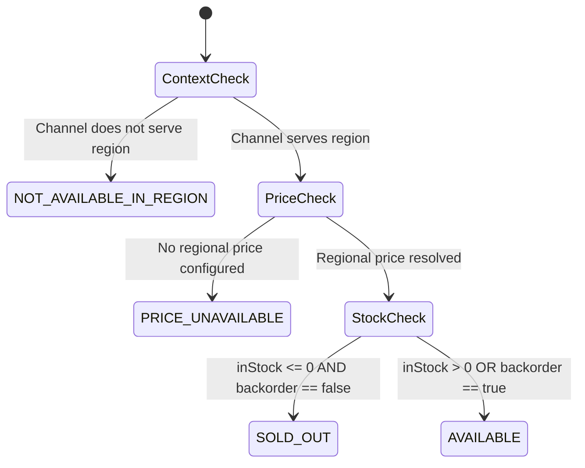
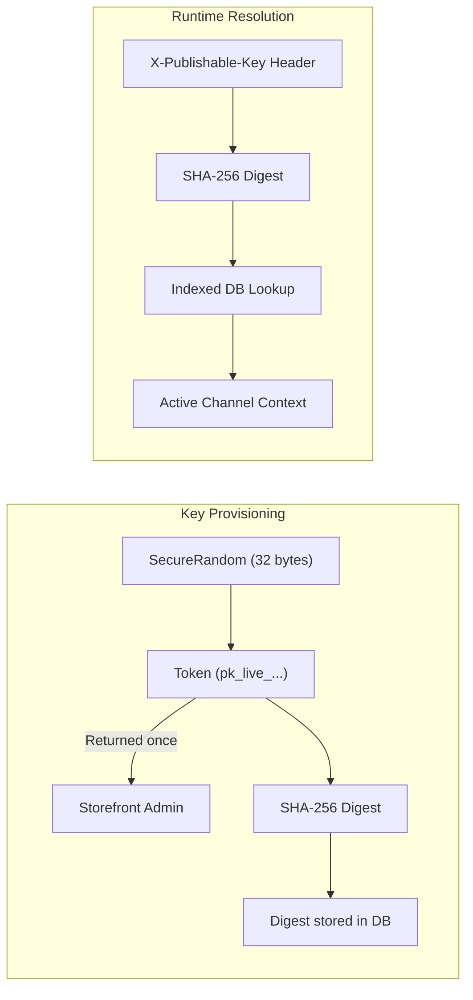

# Multi-Regional Contextual Product Discovery System Design

## 1. The Problem

### What's Not Working?

- **Public Channel Spoofing**: The storefront browse API currently accepts `?salesChannelId=...` directly in query parameters, allowing anonymous clients to probe arbitrary seller channels, bypass commercial boundaries, and enumerate private channels.
- **Single-Currency Channel Trap**: The existing `discovery_product` projection stores a single static currency and price range (`currency`, `min_price`, `max_price`), preventing a single sales channel (e.g., a merchant's global website) from serving multiple geographic regions in their local legal currencies (e.g., Singapore in `SGD` and Malaysia in `MYR`).
- **Combinatorial Explosion & Write Amplification**: Pre-calculating and storing materialized search documents for every channel, region, and currency permutation causes exponential data growth ($10,000 \text{ products} \times 5 \text{ channels} \times 10 \text{ regions} = 500,000 \text{ documents}$), causing any exchange rate or pricing rule change to trigger massive database re-indexing storms.
- **Binary & Misleading Availability**: Products that run out of stock or lack regional price configurations either disappear entirely (causing unexpected `404 Not Found` errors) or display `0.00` prices, breaking search engine crawl rankings, invalidating bookmarks, and confusing shoppers.

### What's at Stake?
Failing to implement this design exposes commercial channels to unauthorized scraping, degrades customer trust through price discrepancies, causes CDN cache poisoning across national borders, and severely harms SEO ranking due to ephemeral 404 errors on temporarily depleted inventory.

---

## 2. The Proposed Design

### 2.1 Architecture Overview
The proposed subsystem introduces a **Two-Tier CQRS Read Model** powered by **Pre-Query Edge Context Resolution** and **Vectorized Request-Time Batch Regional Pricing**.

Tier 1 stores currency-agnostic catalog presentation facts, while Tier 2 computes regional prices in memory on demand.

### 2.2 Key Components & Services
| Component / Service | Core Responsibilities | Interactions & Collaborators |
|:---|:---|:---|
| **Edge Context Resolver** | Resolves public tokens to channels, validates country or resolves default region, and builds `ShoppingContext`. | Calls `Sales Channel Service` for key verification and `Region Service` for country-to-region mapping. |
| **Sales Channel Service** | Manages channel aggregate, publishable key lifecycle with SHA-256 digests, and enabled `ChannelRegion` bindings. | Provides `PublishableKeyQuery` port to `Edge Context Resolver`. |
| **Region Service** | Acts as sole authority for ISO country membership and settlement currency codes (`currencyCode`). | Provides `RegionQueryPort` to `Edge Context Resolver` and pricing services. |
| **Catalog Projection Engine (Tier 1)** | Maintains denormalized `discovery_product` documents keyed by `(sales_channel_id, product_id)` with presentation facts only. | Consumes domain events from `Catalog` and `Inventory`; serves paged search results to `Batch Price Enricher`. |
| **Batch Price Enricher (Tier 2)** | Performs single-trip vectorized price evaluation for all variant IDs on a page using 4-tier rule precedence. | Calls `Pricing Engine` via `PricingQuoteQuery.quoteBatch` and constructs final customer response. |

### 2.3 Data Model
The subsystem decouples catalog facts from volatile pricing rules to prevent Cartesian explosion and write amplification.

#### Key Entities & Value Objects

- **`PublishableKey` (Aggregate Root)**: Stores channel ID, merchant label, 64-character SHA-256 `token_digest`, and public `display_prefix` (`pk_live_...`).
- **`ChannelRegion` (Entity in Sales Channel)**: Associates a channel with enabled regions (`sales_channel_id`, `region_id`, `is_enabled`, `is_default`).
- **`RegionCountry` (Entity in Region)**: Maps ISO 3166-1 country codes exclusively to one `Region` with settlement `currencyCode`.
- **`ShoppingContext` (Value Object)**: Immutable tuple `(salesChannelId, regionId, countryCode, currencyCode, locale)` resolved at request arrival.
- **`DiscoveryProductDocument` (Tier 1 Projection)**: Keyed by `(sales_channel_id, product_id)`; retains title, slug, media, options, and stock badges while stripping static currency and prices.

#### Ubiquitous Language & Ownership Matrix
| Bounded Context | Aggregate / Root | Owns | References by ID | Explicitly Does NOT Own |
|:---|:---|:---|:---|:---|
| **Sales Channel** | `SalesChannel`, `PublishableKey` | Channel identity, key lifecycle, enabled `ChannelRegion` bindings. | `merchantId` | Product catalog, settlement currencies, warehouse stock. |
| **Region** | `Region` | Legal market boundaries, member countries, settlement `currencyCode`. | ISO 3166-1, ISO 4217 | Sales channels, commercial prices, shipping rates. |
| **Catalog** | `Product` | Product taxonomy, media, variants, publication status. | `salesChannelId` | Prices, legal currency definitions, stock levels. |
| **Pricing** | `PriceSet` | Monetary amounts, currencies, 4-tier precedence `PriceRule`s. | `variantId` | Product titles, channels, shopping carts. |
| **Discovery** | `DiscoveryProductProjection` | Composite read model for catalog browse and PDP presentation. | `channelId`, `productId` | Transactional mutations, source inventory allocations. |

### 2.4 Key Flows & Interactions

#### Flow 1: Storefront Request & Batch Pricing Sequence
The client supplies credentials in the HTTP header, the edge resolves context, and Tier 2 enriches catalog facts in a single vectorized call.

#### Flow 2: Variant Availability State Machine
Products remain visible under HTTP 200 to protect SEO while variants declare explicit availability codes.

#### Flow 3: Publishable Key Cryptographic Lifecycle
Tokens use SHA-256 one-way hashing to guarantee defense-in-depth against credential leaks.

---

## 3. Implementation Approach

### 3.1 Technology & Tooling Choices
| Technology / Pattern | Selection Rationale |
|:---|:---|
| **Java 21 & Spring Modulith** | Enforces strict hexagonal boundary isolation and verifies cross-module architectural invariants via `@ApplicationModuleTests`. |
| **PostgreSQL & Flyway** | Delivers ACID transaction safety, partial unique indexes for single default regions, and reproducible versioned schema migrations. |
| **Two-Tier CQRS Pattern** | Decouples static catalog presentation facts from volatile regional price rules, eliminating Cartesian storage explosion. |
| **SHA-256 Token Hashing** | Ensures defense-in-depth by persisting only cryptographic digests, preventing credential exposure during database inspections or leaks. |
| **RFC 7807 Problem Details** | Standardizes error representations across modules with uniform status codes (`401`, `400`, `404`, `422`). |

---

## 4. Why This Approach (Technical Rationale)
| Evaluation Metric | Selected Design (Two-Tier CQRS) | Alternative A (Materialized Multi-Region Docs) | Alternative B (Live Joins Across Write BCs) |
|:---|:---|:---|:---|
| **Simplicity** | **High**: Clean boundaries; catalog handles media/text; pricing engine handles quotes. | **Low**: High coupling between pricing events and discovery projector. | **Low**: Complex ad-hoc distributed coordination. |
| **Performance** | **Fast ($< 15\text{ ms}$)**: Single indexed projection read plus single vectorized in-memory batch quote. | **Fastest ($< 5\text{ ms}$)**: Single flat document fetch from storage. | **Unacceptable ($> 200\text{ ms}$)**: $N+1$ synchronous network queries across 4 modules. |
| **Scalability** | **Linear ($O(P \times C)$)**: Zero write amplification on price, tax, or exchange rate adjustments. | **Exponential ($O(P \times C \times R)$)**: Re-indexing storms across hundreds of thousands of rows. | **Linear**: Minimal storage overhead but severe write lock contention. |
| **Maintainability** | **High**: Complies with Spring Modulith boundaries; domain models remain framework-free. | **Moderate**: Requires complex event choreography to synchronize cross-module updates. | **Violated**: Direct cross-boundary coupling creates cascading failure risks. |
| **Security** | **Robust**: Cryptographic SHA-256 key hashing and rejection of public `salesChannelId` spoofing. | **Weak**: Exposes query parameters susceptible to channel enumeration. | **Weak**: Relies on complex distributed permission propagation. |

---

## 5. Architectural Capability Decomposition & Feature Decisions

### Phase 1: Cryptographic Channel Identity & Access Boundary
- **Boundary & Scope**: Edge Ingress $\leftrightarrow$ `Sales Channel` Bounded Context.
- **Architectural Decisions & Invariants**:
  - Replace unauthenticated, spoofable client parameters (`salesChannelId`) with cryptographically unforgeable public tokens.
  - Enforce defense-in-depth: store only irreversible SHA-256 digests at rest to prevent credential harvesting upon database compromise.
  - Support concurrent active publishable keys per sales channel to enable non-destructive, zero-downtime key rotation.
- **Core Algorithms & Mechanics**: CSPRNG 32-byte token generation with routing prefixes (`pk_live_...`) and constant-time digest comparison for $O(1)$ indexed key lookups. Role-based access control scoped strictly to channel ownership.
- **Feature Decision Record**: [feat_003: Sales-Channel Key Lifecycle Management](../features/feat_003-sales-channel-key-lifecycle-management.md)

### Phase 2: Edge Ingress & Shopping-Context Resolution Boundary
- **Boundary & Scope**: Ingress Gateway $\leftrightarrow$ `Sales Channel` & `Region` Bounded Contexts.
- **Architectural Decisions & Invariants**:
  - Decouple contextual identity from query execution by resolving inbound requests into an immutable 5-tuple context `(channel, region, country, currency, locale)` before reaching read projections.
  - Enforce territorial isolation: channels cannot serve unassigned or disabled regional markets.
- **Core Algorithms & Mechanics**: Deterministic country-to-region membership resolution with fallback to the channel's designated primary regional market; upfront boundary rejection using RFC 7807 problem details (`401`, `403`, `422`).
- **Feature Decision Record**: [feat_004: Edge Shopping-Context Resolution](../features/feat_004-edge-shopping-context-resolution.md)

### Phase 3: Vectorized Batch Pricing & Rule Precedence Boundary
- **Boundary & Scope**: `Pricing` Bounded Context $\leftrightarrow$ Storefront Read Engine.
- **Architectural Decisions & Invariants**:
  - Pricing operates as an isolated, high-throughput calculation engine without presentation coupling.
  - Eliminate the Cartesian storage explosion of pre-materialized documents ($O(P \times C \times R) \rightarrow O(P \times C)$) by calculating regional prices on demand.
  - Strict currency isolation: prohibit cross-currency fallbacks and isolate dual-USD markets.
- **Core Algorithms & Mechanics**: In-memory 4-Tier Specificity Ranking Algorithm ($Channel + Region \succ Region \succ Channel \succ Base$) executed in a single-trip vectorized batch matrix for arbitrary $N$ variants.
- **Feature Decision Record**: [feat_005: Vectorized Batch Regional Pricing](../features/feat_005-vectorized-batch-regional-pricing.md)

### Phase 4: Two-Tier CQRS Catalog Projection Boundary
- **Boundary & Scope**: `Discovery` Read Model $\leftrightarrow$ `Catalog` & `Inventory` Write Contexts.
- **Architectural Decisions & Invariants**:
  - Establish Tier 1 eventual consistency read boundary: denormalized search projections store strictly currency-agnostic and region-agnostic catalog presentation facts.
  - Prohibit synchronous cross-boundary joins across transactional write modules during browse requests.
- **Core Algorithms & Mechanics**: Asynchronous event-driven projection reconciliation reconciling presentation read models out-of-band upon upstream domain events.
- **Feature Decision Record**: [feat_006: Discovery Wiring & Projection Reconciliation](../features/feat_006-discovery-wiring-projection-reconciliation.md)

### Phase 5: Storefront Presentation & Availability Contract Boundary
- **Boundary & Scope**: Storefront Query Surface $\leftrightarrow$ Client Applications & Web Crawlers.
- **Architectural Decisions & Invariants**:
  - Dynamic composition boundary: compose Tier 1 catalog presentation facts with Tier 2 batch pricing results on the fly.
  - Preserve SEO crawl integrity: return uniform HTTP 200 responses with granular variant availability states instead of dropping missing regional products into HTTP 404.
  - Enforce mandatory `X-Publishable-Key` header authentication, strictly rejecting legacy query parameters.
- **Core Algorithms & Mechanics**: 4-State Availability Precedence State Machine ($NOT\_AVAILABLE\_IN\_REGION \succ PRICE\_UNAVAILABLE \succ SOLD\_OUT \succ AVAILABLE$) and dynamic min/max price range derivation over active quoted variants.
- **Feature Decision Record**: [feat_007: Storefront API Cutover & Contract Refactoring](../features/feat_007-storefront-api-cutover-contract-refactoring.md)

### Phase 6: Architectural Invariant Verification & Safe Migration Boundary
- **Boundary & Scope**: System Modular Invariants & Production Deployment Pipeline.
- **Architectural Decisions & Invariants**:
  - Enforce modular boundaries and prevent architectural drift (zero circular dependencies, verified cross-module SPI boundaries).
  - Guarantee zero-downtime rollout with zero disruption to active storefront clients.
- **Core Algorithms & Mechanics**: Expand-Contract migration protocol (Introduce cryptographic authentication $\rightarrow$ Parallel dual-resolution validation $\rightarrow$ Deprecation and strict header cutover).
- **Feature Decision Record**: [feat_008: Automated Verification & Zero-Downtime Rollout](../features/feat_008-automated-verification-zero-downtime-rollout.md)

