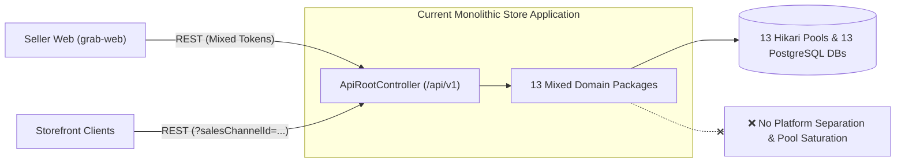
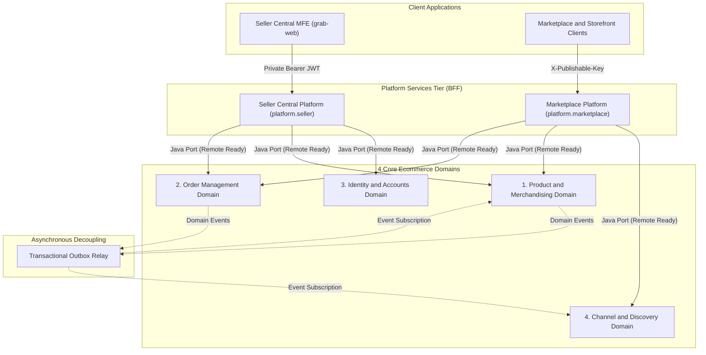

# Ecommerce Platform Services and Domain Architecture System Design

## 1. Business Requirement

### What does the business need?

The business requires a scalable, multi-channel commerce platform that cleanly decouples two distinct operational user groups: **Third-Party Sellers (via Seller Central)** managing merchant profiles, product catalogs, inventory replenishment, and order fulfillment, and **Shoppers (via Marketplace & Storefronts)** searching products, resolving regional pricing, managing carts, and completing checkouts. To sustain long-term business growth without costly architectural rewrites, the platform must operate as an efficient **Modular Monolith today** while enforcing strict **shared-nothing domain boundaries** that allow individual domains to be extracted into autonomous **microservices tomorrow**.

### What happens if we don't solve this?

- **Security & Multi-Tenant Exposure**: Conflating seller administration with public shopper traffic in a single monolithic API allows channel parameter tampering, exposes private inventory allocations, and risks unauthorized access across merchant boundaries.
- **Development Bottlenecks Across Frontend & Backend**: The seller frontend platform and public storefronts require fundamentally different data contracts; mixing them in a single generic web module forces teams to coordinate release cycles and slows feature delivery.
- **Database & Connection Pool Exhaustion**: Running 13 fine-grained databases with 13 independent HikariCP connection pools in a single JVM consumes over 130 peak connections, exceeding standard PostgreSQL limits and causing deployment stability issues.
- **Multi-Million Dollar Microservice Rewrite**: If internal domain logic relies on cross-domain database joins, shared tables, or direct Spring bean injection, splitting into microservices later will require an expensive, high-risk "big bang" rewrite of core business flows.
- **Operational Complexity Overhead**: Moving prematurely to distributed microservices today would burden the team with Kubernetes deployment sprawl, distributed tracing overhead, and network latency before market scale demands it.

---

## 2. Current State & Problem

### How does it work today?

Currently, all 13 fine-grained domain bounded contexts reside in a single catch-all web module. All REST endpoints—whether intended for internal operators, authenticated sellers, or anonymous shoppers—are exposed through a flat with no structural separation between seller management and customer discovery. Furthermore, the application maintains 13 independent PostgreSQL databases and 13 connection pools in a single process.

### What's the problem?

| # | Problem | Impact |
|:--|:--------|:-------|
| 1 | **Conflated Platform Entrypoints** | Seller administration and customer browsing are hosted in the same module `store`, preventing tailored rate limiting, caching, and distinct authentication models. |
| 2 | **Database & Connection Pool Saturation** | 13 independent Hikari pools create up to 130 database connections per application instance ($13 \times 10$), exceeding default PostgreSQL limits (100) and wasting memory on idle pools. |
| 3 | **Lack of Ingress Security Segregation** | Seller operations (requiring merchant-scoped JWT sessions) and storefront queries (requiring revocable SHA-256 publishable keys) lack dedicated gateway enforcement. |
| 4 | **Absence of Microservice Extraction Seams** | Domain services are invoked via direct bean wiring without strict contract ports, creating hidden dependencies that prevent extracting services without code rewrites. |

---

## 3. Solution Overview

### Architecture

The proposed architecture adopts the **Extractable Modular Monolith with Backend-for-Frontend (BFF) & Shared-Nothing Domain Services**. It separates client-facing concerns into dedicated **Platform Ingress Namespaces** (`platform.seller` backing `grab-web` on port 3000 and `platform.marketplace` backing public storefronts) while consolidating backend capabilities into **4 Core Ecommerce Domains** with private schemas and swappable port interfaces.

### Key Components

| Component | Role | Grouped Modules & Scope | What It Does |
|:----------|:-----|:------------------------|:-------------|
| **Seller Central Platform (`platform.seller`)** | Dedicated Seller BFF | Ingress Gateway for `grab-web` & Seller Workflows | Enforces merchant-scoped JWT sessions, houses seller product workflows (`create-sellable-product`, `update-sellable-product`, `update-product-variant`), and provides tailored APIs for product listing, inventory adjustments, price list management, and seller order fulfillment. |
| **Marketplace Platform (`platform.marketplace`)** | Public Storefront BFF | Ingress Gateway for Shoppers & Channels | Enforces `X-Publishable-Key` authentication, resolves multi-regional shopping context, and exposes optimized search, cart mutation, and checkout endpoints. |
| **1. Product & Merchandising Domain** | PIM & Buyability Core | `catalog`, `inventory`, `pricing` | Owns product master data, multi-variant schemas, warehouse stock allocations, reservations, price lists, and regional currency price rules. Ready to absorb promotions, discounts, and reviews. |
| **2. Order Management Domain** | OMS & Transaction Pipeline | `cart`, `order`, `payment` | Manages shopping cart sessions, order lifecycle state machines, invoices, payments, Cash on Delivery (COD) collection, and checkout saga orchestrations. Ready to absorb fulfillment, shipping, returns, and C2C deals. |
| **3. Identity & Accounts Domain** | IAM & Account Directory | `identity`, `merchant`, `customer` | Manages user credentials, JWT tokens, RBAC permissions, merchant business profiles/KYC, and customer address books. Ready to absorb seller verification and profile extensions. |
| **4. Channel & Discovery Domain** | Contextual Ingress & Search | `discovery`, `saleschannel`, `region` | Manages sales channels, cryptographic publishable keys (SHA-256), geographic regions/currencies, and high-throughput denormalized search projections. Ready to absorb storefront CMS assets and multi-market localization. |
| **Transactional Outbox Relay (`outbox-infrastructure`)** | Asynchronous Decoupling Engine | `outbox-infrastructure` | Persists integration events atomically with domain changes and dispatches them in-process today, switching to Kafka when split into microservices. |

---

## 4. Technology & Design Decisions

| Decision | Choice | Why (not alternatives) |
|:---------|:-------|:-----------------------|
| **Architecture Topology** | Modular Monolith with Platform BFFs | Delivers 90% of microservice benefits (clean domain isolation, dedicated client contracts, zero-shared tables) without the deployment complexity, latency, and distributed tracing costs of premature microservices. |
| **Domain Partitioning** | 4 Core Ecommerce Domains | Organizes all 12 modules into high-cohesion subdomains matching MACH Alliance / commercetools standards: Product & Merchandising, Order Management, Identity & Accounts, Channel & Discovery. |
| **Inter-Service Communication** | Ports & Adapters (Hexagonal Seams) | Platforms invoke Domain Services strictly through Java interface ports returning immutable records (`DTOs`). When a service is split into a microservice, replacing the local adapter with a gRPC/REST client requires **zero changes** to platform code. |
| **Database Isolation** | 4 Service Schemas in PostgreSQL | Consolidates 13 databases into **4 isolated schemas** (`product_merchandising`, `order_management`, `identity_account`, `channel_discovery`). Eliminates connection pool exhaustion while strictly forbidding cross-schema foreign keys and SQL joins. |
| **Cross-Domain Consistency** | Transactional Outbox + Eventual Consistency | Decouples domain write paths. Cross-domain actions (e.g. Order Placed $\rightarrow$ Deduct Stock) are coordinated asynchronously via outbox events, ensuring business logic works identically when extracted to Kafka later. |
| **Client Authentication Separation** | Dual-Ingress Security Model | Separates private, stateful/JWT merchant authentication (Seller Central) from public, rate-limited SHA-256 publishable keys (Marketplace), preventing channel enumeration and credential leakage. |
| **Boundary Enforcement** | ArchUnit & Spring Modulith Tests | Automated CI architecture tests fail builds if any platform module imports internal domain classes directly or if cross-domain persistence leakage occurs. |

---

## 5. Feature Breakdown

| # | Feature | What It Solves | Scope | Feature Spec |
|:--|:--------|:---------------|:------|:-------------|
| 1 | **Creating 4 Composite Service POMs & Packaging Organization** | Eliminates the 25+ direct module imports and the 14-package sprawl by introducing a dedicated runnable module `app` with 4 clean Composite POMs without moving existing domain libraries in the filesystem. | Create 4 Composite Service POMs (`product-merchandising`, `order-management`, `identity-account`, `channel-discovery`); establish runnable `app` module (`com.grab.app`) depending solely on composite POMs; organize `com.grab.app` into 4 domain clusters + 2 platform BFF namespaces (`platform.seller`, `platform.marketplace`); verify Spring Modulith tests. | [feat_009-industrial-project-structure-organization.md](../features/feat_009-industrial-project-structure-organization.md) |
| 2 | **Service-Level Database & Connection Pool Consolidation in Spring Modulith** | Solves connection pool saturation (130 peak connections from 13 databases) by configuring 4 isolated PostgreSQL service schemas and 4 shared Hikari pools in the Spring Modulith application runner with configurable per-domain dedicated database overrides. | Configure 4 shared HikariCP connection pools in `app` (one per domain cluster: `product_merchandising`, `order_management`, `identity_account`, `channel_discovery`); PostgreSQL schema namespacing for table isolation; consolidate Flyway migrations per service schema with independent history tables; support declarative per-domain dedicated database override (`<domain>.datasource.dedicated=true`); configure unified `JpaTransactionManager` & `EntityManagerFactory` beans. | [feat_010-service-level-database-consolidation.md](../features/feat_010-service-level-database-consolidation.md) |
| 3 | **Four Core Domains Swappable Contract Ports** | Eliminates direct bean wiring and entity leakage by defining strict Hexagonal Port interfaces and immutable DTO records across the 4 Core Domains. | Define public API port interfaces (`*QueryPort`, `*CommandPort`) and DTO records; implement local in-process provider adapters in Spring Modulith; decouple domain write paths using Spring Application Events and Transactional Outbox; eliminate cross-domain repository/entity imports. | [feat_011-four-core-domains-contract-ports.md](../features/feat_011-four-core-domains-contract-ports.md) |
| 4 | **Platform Seller Central BFF Implementation** | Provides a dedicated, secure backend-for-frontend API for the seller web portal (`grab-web` on port 3000), decoupling merchant administration and seller workflows from public shopper traffic. | Implement `/seller/v1/*` and `/seller/v1/workflows/*` REST controllers under `com.grab.app.platform.seller`; migrate seller product workflows (`create-sellable-product`, `update-sellable-product`, `update-product-variant`) from legacy `store.workflows` into `platform.seller.workflow`; configure merchant-scoped Bearer JWT authentication filter; resolve merchant ID security context; MapStruct DTO mappings delegating strictly to Product, Identity/Account, and Order domain ports. | [feat_012-platform-seller-central-bff.md](../features/feat_012-platform-seller-central-bff.md) |
| 5 | **Platform Marketplace BFF Implementation** | Establishes a dedicated, high-throughput public storefront entrypoint with edge security, multi-regional discovery, and checkout orchestration. | Implement `/store/v1/*` REST controllers under `com.grab.app.platform.marketplace`; implement `X-Publishable-Key` (SHA-256) ingress security filter and regional shopping context resolver; orchestrate search, cart mutation, and checkout flows delegating strictly to Order and Channel domain ports. | [feat_013-platform-marketplace-bff.md](../features/feat_013-platform-marketplace-bff.md) |
| 6 | **Microservice Seam Enforcement & Spring Modulith ArchUnit Verification** | Enforces architectural invariants via automated tests, guaranteeing that modules remain 100% extractable to standalone microservices without code refactoring. | ArchUnit test suite enforcing hexagonal boundaries and zero forbidden imports; Spring Modulith test verification (`ModularityTests.java`); serialization tests ensuring all outbox events are Kafka/remote ready. | [feat_014-microservice-seam-archunit-verification.md](../features/feat_014-microservice-seam-archunit-verification.md) |

