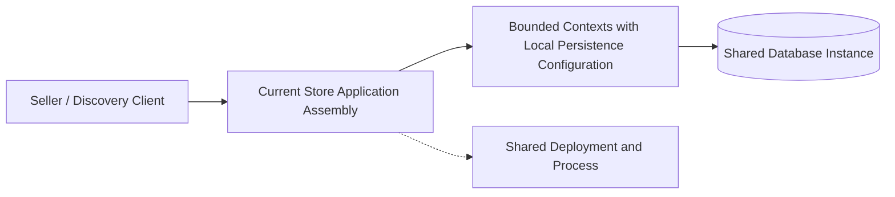
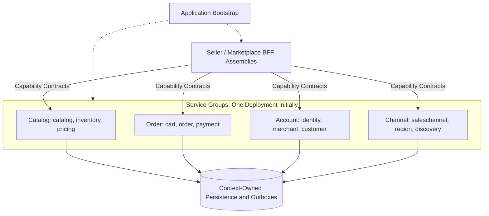
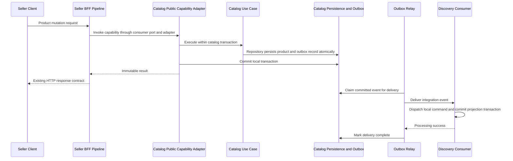

# E-Commerce Service Architecture & Platform Modernization System Design

## 1. Business Requirement

### What does the business need?

The business requires a modular e-commerce assembly that replaces the current `store` module with bootstrap in `com.grab.app`, bounded-context assemblies under `com.grab.app.<group>.<context>`, and platform Backend-for-Frontend (BFF) assemblies for Seller Central (`seller`) and `marketplace`. The four service groups (`catalog`, `order`, `account`, `channel`) are future deployment compositions; domain, application, and persistence modules retain their existing packages and inward dependencies.

Each bounded context MUST retain ownership of its datasource, transaction manager, persistence operations, migrations, and distinct outbox table. The initial deployment remains a modular monolith; independent scaling and deployment require subsequent physical extraction, and zero-downtime cutover requires a separate migration design.

### What happens if we don't solve this?

- **Assembly Coupling**: Platform ingress, context configuration, and application startup remain coupled to the current assembly, increasing the work required to extract a service group.
- **Boundary Erosion**: Grouping related contexts without explicit ownership can introduce shared transactions, repository access, and outbox tables that make later separation harder.
- **Transport Coupling**: Consumers that depend on provider implementation classes cannot replace local invocation with remote capability adapters cleanly.
- **Unclear Event Ownership**: Without an atomic producer transaction and independently recoverable consumers, product updates and discovery projections can diverge after failures.
- **Shared Runtime Exposure**: Package restructuring alone leaves process memory, runtime availability, and database-instance resources shared until physical separation.

---

## 2. Current State & Problem

### How does it work today?

> Seller-based APIs and product discovery are the completed business capabilities in scope. The current `store` application assembles bounded contexts in one deployment and already contains context-specific datasource and transaction-manager configurations; this is not a migration from one universal persistence unit or pool.

### What's the problem?

| # | Problem | Impact |
|:--|:--------|:-------|
| 1 | Bootstrap & Assembly Coupling | Contexts and platform ingress depend on the current application composition instead of explicit future service-group assemblies. |
| 2 | Ambiguous Group Ownership | Treating a service group as one transaction or outbox owner would weaken the existing bounded-context separation. |
| 3 | Package & Contract Migration | Relocating assemblies requires explicit module discovery, published interfaces, and shared-contract migration without leaking internal classes. |
| 4 | Local Communication Assumptions | In-process capability calls and event delivery need explicit transport replacements when a group becomes a separate process. |

---

## 3. Solution Overview

### Architecture

> Bootstrap lives in `com.grab.app`; context assemblies live in `com.grab.app.<group>.<context>`, and BFF assemblies live in `com.grab.app.platform.seller` and `com.grab.app.platform.marketplace`. Service groups organize future deployments, while bounded contexts remain the units of encapsulation and transaction ownership.

The existing core domain, application, and persistence packages do not acquire deployment-group prefixes. Assemblies MUST preserve each context's `internal/` boundary and explicitly register nested contexts for Modulith verification; a group MUST NOT become an unrestricted module that hides its contexts from verification.

Extraction introduces separate boot assemblies and remote capability/event adapters for selected groups. Business logic and local transaction ownership remain in their contexts; startup configuration, contract distribution, remote failure handling, and data cutover require explicit implementation before independent deployment is available.

### Key Components

| Component | Role | What It Does |
|:----------|:-----|:-------------|
| **Application Bootstrap** | Runtime Composition | Starts from `com.grab.app` and explicitly assembles selected contexts, platform APIs, and infrastructure without owning business logic or persistence. |
| **Platform BFF Assemblies** | Ingress & Response Composition | Implements Seller Central and marketplace APIs using consumer-owned capability ports without owning persistence or domain transactions. |
| **Catalog Service Group** | Future Deployment Composition | Groups `catalog`, `inventory`, and `pricing` assemblies under `com.grab.app.catalog`, preserving each context's ownership. |
| **Order Service Group** | Future Deployment Composition | Groups `cart`, `order`, and `payment` assemblies under `com.grab.app.order`; unfinished business workflows are outside this restructuring scope. |
| **Account Service Group** | Future Deployment Composition | Groups `identity`, `merchant`, and `customer` assemblies under `com.grab.app.account`. |
| **Channel Service Group** | Future Deployment Composition | Groups `saleschannel`, `region`, and `discovery` assemblies under `com.grab.app.channel`. |
| **Bounded-Context Persistence** | Local Transaction Ownership | Each context owns its datasource, transaction manager, tables, migration stream, and distinct outbox table even when database instances or group schemas are shared. |
| **Capability & Event Contracts** | Cross-Context Communication | Exposes public provider ports and published integration events while hiding use case implementations and persistence internals. |

### How It Works (End-to-End Flow)

> A seller product mutation commits product state and an outgoing event in the catalog context's local transaction; discovery processes the event in its own transaction. This is the target assembly interaction for the existing capabilities, not an endpoint or payload change.

HTTP ingress follows Controller → CommandService/QueryService → local Bus → Handler → UseCase. BFF application orchestration invokes a consumer-owned outbound port; its adapter calls the provider's public interface, whose adapter starts the context transaction and delegates directly to an inbound use case without dispatching the provider bus.

Business rules remain in aggregates and policies; persistence adapters write the aggregate and outbox record using the same local transaction resources. Discovery failure does not roll back the committed product mutation: failed delivery remains retryable, and duplicate delivery must be safe.

The relay dispatches after the producer commit. Once producer and consumer run in separate processes, local Spring event publication MUST be replaced or bridged by durable remote transport with explicit acknowledgement and recovery semantics; package relocation alone does not provide remote delivery.

---

## 4. Technology & Design Decisions

| Decision | Choice | Why (not alternatives) |
|:---------|:-------|:-----------------------|
| **Architecture Pattern** | Hexagonal Modular Monolith with Future Service Groups | Establishes extraction boundaries before adding separate deployment infrastructure; independent scaling follows physical extraction. |
| **Bootstrap & Packaging** | Bootstrap in `com.grab.app`, Context Assemblies in `com.grab.app.<group>.<context>` | Replaces the current `store` assembly while keeping core module packages independent of deployment composition. |
| **Persistence Isolation** | Bounded-Context-Owned Transactions & Outboxes | Sharing an instance or group schema does not merge datasources, transaction managers, table ownership, migrations, or outbox tables. |
| **HTTP Ingress Pipeline** | Controller → CommandService/QueryService → Bus → Handler → UseCase | Preserves thin controllers, CQRS separation, and handler-level context transaction demarcation. |
| **Shared-Interface Ingress** | Provider Public Port → Transactional Provider Adapter → UseCase | Preserves the provider boundary without exposing application interfaces directly to consumers or routing shared-interface calls through the provider bus. |
| **BFF Communication** | Consumer-Owned Capability Ports with Local or Remote Adapters | Keeps provider implementation dependencies out of BFF application logic while allowing transport replacement during extraction. |
| **Cross-Context Eventing** | Context Outbox & Independent Consumer Transactions | Atomically records outgoing events with business state and supports retryable delivery without a transaction spanning contexts. |
| **Connection Management** | Budget Every Context Pool Across Replicas & Deployment Overlap | Bounds connection allocation but does not eliminate shared database CPU, I/O, or availability risks. |

---

## 5. Feature Breakdown

> The three features separate packaging, persistence configuration, and communication responsibilities. This revision establishes the target boundaries; unfinished business workflows and a zero-downtime cutover procedure are outside scope.

| # | Feature | What It Solves | Scope | Feature Spec |
|:--|:--------|:---------------|:------|:-------------|
| 1 | **Modular Hexagonal Package Structure** | Defines bootstrap, grouped assemblies, and verifiable context boundaries for future extraction. | `com.grab.app` bootstrap, four service groups, `seller` and `marketplace` BFFs, core package preservation, nested module discovery. | [feat_009-modular-hexagonal-package-structure.md](../features/feat_009-modular-hexagonal-package-structure.md) |
| 2 | **Multi-Schema Database Isolation & Connection Budgeting** | Defines context-owned persistence resources within shared hosting constraints. | Context datasources, transaction managers, migration ownership, distinct outboxes, schema allocation, discovery isolation, connection budgeting. | [feat_010-multi-schema-database-isolation-connection-budgeting.md](../features/feat_010-multi-schema-database-isolation-connection-budgeting.md) |
| 3 | **Decoupled Service Communication & CQRS Pipeline** | Defines capability invocation and recoverable event delivery across context boundaries. | Local bus scoping, HTTP and shared-interface ingress, transport adapters, atomic producer outbox writes, independent consumers, future remote delivery. | [feat_011-decoupled-service-communication-cqrs-pipeline.md](../features/feat_011-decoupled-service-communication-cqrs-pipeline.md) |
