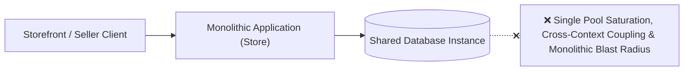
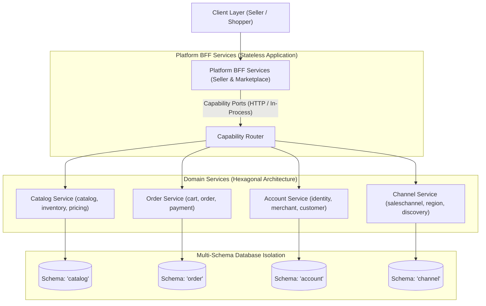
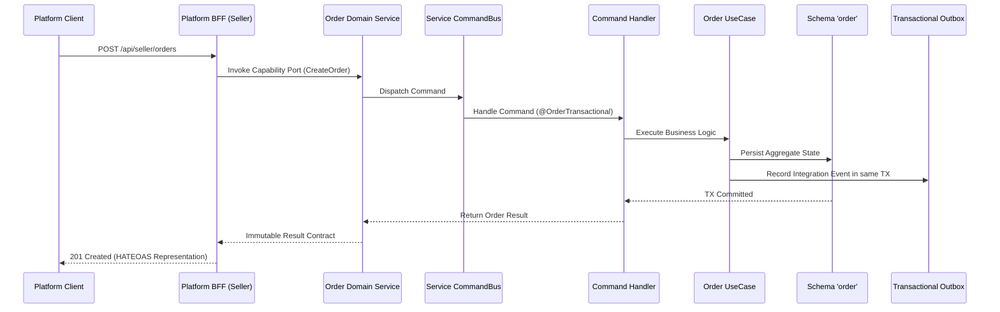

# E-Commerce Service Architecture & Platform Modernization System Design

## 1. Business Requirement

### What does the business need?

The business requires an independently scalable and deployable e-commerce service architecture that transitions the monolithic codebase into decoupled domain services (`catalog`, `order`, `account`, `channel`) orchestrated by dedicated platform Backend-for-Frontend (BFF) layers (`sellercentral` and `marketplace`). Each domain service must maintain strict hexagonal layering and isolated persistence schemas on a shared database instance, preventing cascading database pool exhaustion and coupling while paving a zero-downtime migration path toward standalone microservices.

### What happens if we don't solve this?

- **Deployment & Release Coupling**: Any minor change in one domain (e.g., catalog pricing) forces a high-risk full application rebuild and redeployment across all commerce capabilities.
- **Cascading Database Connection Saturation**: Bursts of traffic or slow queries in one domain exhaust shared database connection pools, bringing down critical checkout and payment flows.
- **Spaghetti Cross-Domain Dependencies**: Unrestricted internal method calls, cross-context database joins, and shared transactions create tangled boundaries, making microservice extraction cost-prohibitive.
- **Fragile Cross-Service Communication**: Without isolated CQRS command/query buses and outbox-driven integration events, data mutation and query side-effects leak across domain boundaries.
- **Monolithic Blast Radius**: An infrastructure failure, memory leak, or schema migration lock in seller back-office functions immediately degrades customer-facing storefronts.

---

## 2. Current State & Problem

### How does it work today?

> The current system operates as a unified monolithic deployment where bounded contexts share a single persistence unit, common connection pools, and in-process execution paths without deployment-level isolation.

### What's the problem?

| # | Problem | Impact |
|:--|:--------|:-------|
| 1 | Monolithic Packaging & Ingress Coupling | Platform interfaces (seller and marketplace) are tightly coupled with domain services, blocking independent scaling and microservice extraction. |
| 2 | Shared Database Connection Pool Saturation | All domains compete for a single connection pool, causing high-load domains to starve transactional checkout flows. |
| 3 | Unconstrained Cross-Context Data Access | Lack of explicit schema and repository barriers permits cross-domain joins, foreign keys, and shared transactions that violate bounded context autonomy. |
| 4 | Blurry CQRS & Communication Boundaries | Cross-service bus dispatching and controller-to-repository shortcuts bypass formal use cases, leading to untracked side-effects. |

---

## 3. Solution Overview

### Architecture

> The proposed architecture establishes autonomous Domain Services (`catalog`, `order`, `account`, `channel`) and Platform BFFs (`sellercentral`, `marketplace`) adhering to hexagonal boundaries, isolated schemas, and decoupled CQRS pipelines.

### Key Components

| Component | Role | What It Does |
|:----------|:-----|:-------------|
| **Platform BFF Services** | Ingress Gateway & Aggregation | Orchestrates seller and marketplace user journeys by consuming domain capability ports without owning persistence schemas. |
| **Catalog Domain Service** | Product & Inventory Authority | Enapsulates catalog, inventory, and pricing bounded contexts within the dedicated `catalog` database schema. |
| **Order Domain Service** | Transactional Checkout Coordinator | Manages cart, order, and payment contexts within the dedicated `"order"` database schema and orchestrates checkout workflows. |
| **Account Domain Service** | Identity & Merchant Authority | Encapsulates identity, merchant, and customer domains within the dedicated `account` database schema. |
| **Channel Domain Service** | Commercial & Discovery Authority | Manages sales channels, territories, regional markets, and contextual search projections. |
| **Multi-Schema Database Layer** | Isolated Relational Persistence | Provides separate Flyway migration streams, connection pools, and transactional outboxes per service schema on the database instance. |
| **Decoupled CQRS Pipeline** | In-Service Bus & Event Relay | Guarantees strict per-service Command/Query bus isolation and asynchronous integration event dispatching via transactional outbox. |

### How It Works (End-to-End Flow)

> A platform BFF receives a client request, dispatches it to the appropriate domain service over an explicit capability port, executes the CQRS use case pipeline, and emits integration events via the transactional outbox.

---

## 4. Technology & Design Decisions

| Decision | Choice | Why (not alternatives) |
|:---------|:-------|:-----------------------|
| **Architecture Pattern** | Hexagonal Modular Monolith with Platform BFFs | Enables independent domain scaling, clean separation of concern, and future microservice extraction without the operational overhead of premature physical clustering. |
| **Persistence Isolation** | Schema-per-Service Group with Per-Domain Overrides | Provides logical schema boundaries and isolated connection pools by default on a shared instance, while allowing individual domain services to override their connection or target a separate database instance. |
| **Service Ingress Pipeline** | Controller → Service → Bus → Handler → UseCase | Enforces strict CQRS isolation and decouples HTTP transport representation from business domain execution. |
| **BFF Communication** | REST Ingress & Java Port Interfaces (gRPC-Ready) | BFF exposes external REST APIs and invokes domain groups via typed Java interfaces in-process today, migrating cleanly to gRPC stubs upon microservice split. |
| **Cross-Service Eventing** | Transactional Outbox & Shared Integration Events | Guarantees at-least-once asynchronous event delivery across domains with event contracts centralized in shared module. |
| **Connection Management** | Direct HikariCP Pools per Group Instance | Direct, bounded connection pools per service group database instance, eliminating proxy layers for operational simplicity. |

---

## 5. Feature Breakdown

> This system design is decomposed into 3 core architectural features divided by system responsibility. Note that business domain entities and multi-step business workflows are governed by dedicated Domain and Workflow specs.

| # | Feature | What It Solves | Scope | Feature Spec |
|:--|:--------|:---------------|:------|:-------------|
| 1 | **Modular Hexagonal Package Structure** | Eliminates package entanglement and monolithic coupling by enforcing hexagonal module boundaries, domain service groupings, and stateless platform BFF layers. | Domain module boundaries (`catalog`, `order`, `account`, `channel`), platform BFF structures (`seller`, `marketplace`), app boot orchestration. | [feat_009-modular-hexagonal-package-structure.md](../features/feat_009-modular-hexagonal-package-structure.md) |
| 2 | **Multi-Schema Database Isolation & Connection Budgeting** | Eliminates connection pool starvation and cross-domain data bleeding by isolating schemas, migration streams, pools, and budgeting connections. | Schemas `catalog`, `"order"`, `account`, `channel`, separate `discovery` connection, dedicated pools, Flyway streams, zero cross-schema FKs. | [feat_010-multi-schema-database-isolation-connection-budgeting.md](../features/feat_010-multi-schema-database-isolation-connection-budgeting.md) |
| 3 | **BFF-to-Domain Communication Protocol & Controller Contract Migration** | Eliminates direct domain HTTP coupling by converting domain controllers to Java port interfaces, exposing equivalent REST controllers in Seller BFF with centralized security, and moving events to shared. | Inbound Java port interfaces (`com.grab.app.{group}.{domain}.port`), Seller BFF REST controllers, Seller web security config, gRPC migration path, shared integration events. | [feat_011-decoupled-service-communication-cqrs-pipeline.md](../features/feat_011-decoupled-service-communication-cqrs-pipeline.md) |