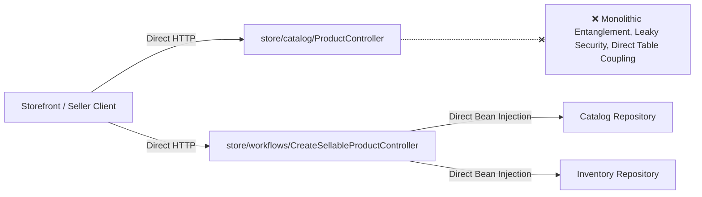
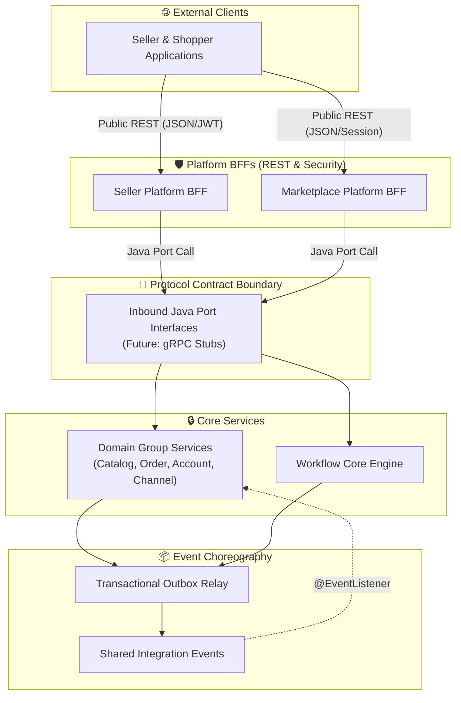
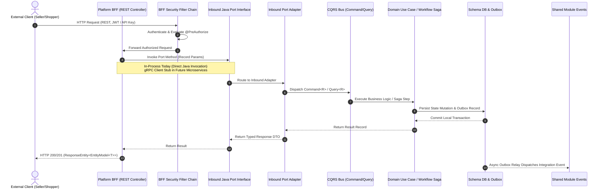

# Service Communication & Protocol System Design

## 1. Business Requirement

### What does the business need?

The e-commerce platform serves two distinct user groups: **Merchants/Sellers** managing back-office catalogs, inventory, and order fulfillment, and **Shoppers/Consumers** searching products, managing carts, and placing orders.

To scale both experiences independently and prepare for microservice migration, the business requires a decoupled, secure, and standardized communication architecture:
1. **Public Ingress Layer**: Dedicated Platform Backend-for-Frontend (BFF) layers—**Seller Platform BFF** and **Marketplace Platform BFF**—exposing persona-tailored public REST APIs.
2. **Internal Service Protocol**: Core domain groups (`catalog`, `order`, `account`, `channel`) and the cross-domain **Workflow Core** (`workflow`) expose pure, framework-agnostic **Java port interfaces** for zero-latency in-process execution today, with a seamless, zero-code-change migration path to **gRPC / Protocol Buffers** in future microservices.
3. **Asynchronous Event Choreography**: Cross-domain side-effects coordinate asynchronously via the Transactional Outbox pattern and centralized integration events in the `shared` module, eliminating distributed two-phase commit (2PC) transactions.

### What happens if we don't solve this?

- **Monolithic Ingress Entanglement**: Domain services directly host Spring MVC REST controllers, mixing web presentation DTOs, Jackson formatting, and HTTP routing with pure business domain logic.
- **Leaky Security Perimeter**: Authentication, authorization, and role checks become fragmented across dozens of domain packages rather than unified at the ingress perimeter.
- **Frontend Latency & Network Chatty-ness**: Client applications must make multiple remote round-trips to individual domain endpoints to render a single UI view.
- **Microservice Migration Roadblock**: Tightly coupling web controllers to domain repositories prevents extracting domain groups or the workflow engine into independent microservices without complete codebase rewrites.

---

## 2. Current State & Problem

### How does it work today?

> Currently, Spring MVC `@RestController` endpoints are co-located directly inside domain persistence and service packages. External clients, internal domain services, and workflows invoke these controllers or internal beans directly without a formal communication protocol.

### What's the problem?

| # | Problem | Impact |
|:--|:--------|:-------|
| 1 | **Direct Domain REST Exposure** | Domain packages are coupled to Spring WebMvc, HTTP annotations, and serialization formats, violating hexagonal boundaries. |
| 2 | **Scattered Security Logic** | Role checks and route authorizations are duplicated across domain controllers instead of enforced at the client ingress boundary. |
| 3 | **Lack of Contract Decoupling** | No formal interface contract exists between BFFs and domain groups; extracting services requires rewriting every consumer call. |
| 4 | **Synchronous Multi-Domain Coupling** | Workflows mutate cross-domain state via direct bean calls rather than through port-and-adapter saga orchestration. |

---

## 3. Solution Overview

### Architecture

> The system enforces a Three-Tier Communication Protocol: Public REST APIs on Platform BFFs (Tier 1), pure Java Port Interfaces migrating to gRPC (Tier 2), and Transactional Outbox event choreography (Tier 3).

### Key Components

| Component | Role | What It Does |
|:----------|:-----|:-------------|
| **Seller Platform BFF** | Merchant Ingress Gateway | Exposes public REST controllers, applies JWT security rules (`SellerSecurityConfig`), and delegates to domain/workflow port interfaces. |
| **Marketplace Platform BFF** | Consumer Ingress Gateway | Exposes high-throughput storefront REST controllers, aggregates edge shopping context, and routes queries to discovery and orders. |
| **Java Port Interfaces** | Universal Protocol Boundary | Pure Java interfaces (`port.message`) defining capability contracts without web annotations; swappable for gRPC stubs in microservices. |
| **Domain Service Groups** | Headless Business Core | Four autonomous domain groups (`catalog`, `order`, `account`, `channel`) executing local CQRS pipelines behind isolated databases. |
| **Workflow Core Engine** | Multi-Domain Saga Orchestrator | Headless process manager (`com.grab.app.workflow`) managing multi-step sagas, step checkpoints, and automated compensation rollbacks. |
| **Shared Integration Events** | Event-Driven Choreography | Centralized immutable event records in `store/src/main/java/com/grab/store/shared/events` powering cross-module asynchronous notifications. |

### How It Works (End-to-End Flow)

> Walk through the main interaction flow: client REST ingress, BFF security evaluation, Java port invocation, domain CQRS execution, and asynchronous outbox event publishing.

---

## 4. Technology & Design Decisions

| Decision | Choice | Why (not alternatives) |
|:---------|:-------|:-----------------------|
| **Public API Protocol** | REST API (JSON over HTTP/1.1 & HTTP/2) on BFFs Only | Standardized for browser and mobile clients; provides rich OpenAPI documentation, client caching, and HATEOAS navigability. |
| **Internal Synchronous Protocol** | Pure Java Port Interfaces (In-Process) → gRPC (Microservices) | In-process Java calls provide zero-overhead execution today. When extracted, gRPC provides high-throughput binary serialization over HTTP/2 without changing BFF controller code. |
| **Security Architecture** | Centralized at BFF Perimeter (`SellerSecurityConfig`, `MarketplaceSecurityConfig`) | Guards the public entrance with JWT/OAuth2 and route-level authorization, keeping domain services completely headless and decoupled from Spring Security Web. |
| **Domain Ingress Pipeline** | Port → Adapter → Bus → Handler → UseCase | Strictly preserves CQRS isolation; CommandService never queries, QueryService never mutates, and handlers remain decoupled from web models. |
| **Asynchronous Integration** | Transactional Outbox + Shared Module Events | Avoids brittle distributed two-phase commit (2PC) transactions; guarantees at-least-once cross-module notification delivery. |

---

## 5. Feature Breakdown

> Decompose this system design into manageable, buildable features. Each feature gets its own Feature Spec where domain models, workflows, and tech decisions are detailed.

| # | Feature | What It Solves | Scope | Feature Spec |
|:--|:--------|:---------------|:------|:-------------|
| 1 | **BFF-to-Domain Communication Protocol & Controller Contract Migration** | Defines the exact scope and acceptance criteria for converting domain REST controllers into Java port interfaces, creating equivalent Seller BFF REST controllers, and centralizing security and events. | Inbound Java port interfaces (`com.grab.app.{group}.{domain}.port`), Seller BFF REST controllers, Seller web security config, gRPC migration protocol, shared integration events. | [feat_011-decoupled-service-communication-cqrs-pipeline.md](../features/feat_011-decoupled-service-communication-cqrs-pipeline.md) |
