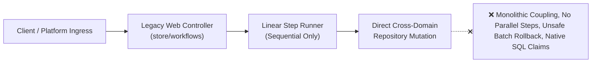
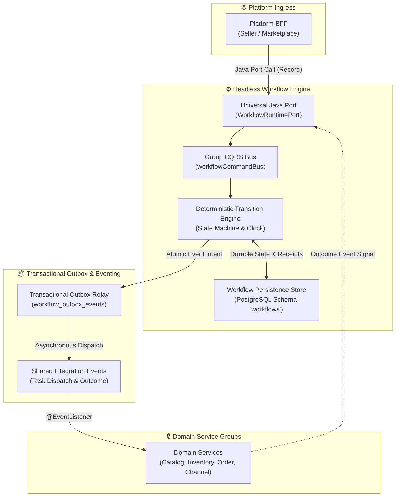
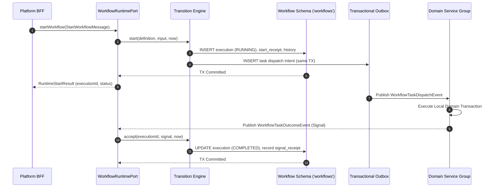
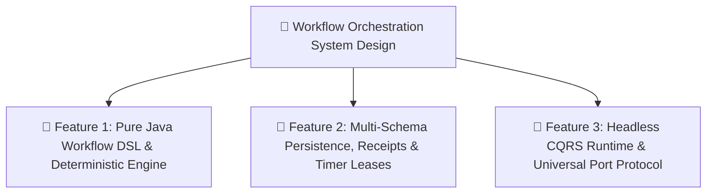

# Workflow Orchestration & Durable Saga Runtime System Design

## 1. Business Requirement

### What does the business need?

Modern e-commerce operations—such as multi-channel product publishing, price and inventory updates, order placement, and checkout fulfillment—naturally span multiple autonomous business domains (`catalog`, `inventory`, `pricing`, `saleschannel`, and `order`). 

Under the platform's modular architecture, each domain service operates with an isolated database schema and dedicated database connection pool. Because distributed two-phase commit (2PC/XA) transactions are strictly prohibited to protect system availability and avoid distributed locks, the business requires a **durable, event-driven workflow orchestration runtime**. This runtime must execute multi-step sagas across isolated service transactions, guarantee at-least-once task execution, coordinate parallel tasks, provide automated backward compensation upon failure, and maintain complete auditability and operational visibility.

### What happens if we don't solve this?

- **Data Inconsistency Across Domains**: Partial failures (e.g., product created in catalog but inventory reservation fails) leave orphaned records and inconsistent business state across domain boundaries.
- **Cascading Connection Pool Starvation**: Attempting synchronous cross-domain HTTP calls or distributed transactions ties up precious database connections across multiple service groups, triggering cascading platform-wide outages.
- **Untracked Business Operations**: Without durable execution state, node progression tracking, and transition history, dropped messages or node crashes result in lost operations that customer support cannot inspect or recover.
- **Uncontrolled Rollbacks**: Without structured reverse dependency compensation, rolling back failed multi-step operations requires hazardous manual database corrections.
- **Silent Duplicate Executions**: Lack of deterministic idempotency keys and fingerprint hashing causes duplicate orders, double-billed charges, or repeated inventory allocations during network retries.

---

## 2. Current State & Problem

### How does it work today?

> In the legacy architecture, multi-step operations were handled by hardcoded, sequential runners embedded directly in web controllers and domain packages, executing without version pinning, parallel branch support, or dependency-aware rollback.

### What's the problem?

| # | Problem | Impact |
|:--|:--------|:-------|
| 1 | **Monolithic Ingress Entanglement** | REST controllers were embedded directly inside the workflow module, exposing internal domain state and violating headless architecture rules. |
| 2 | **Sequential-Only Execution** | The legacy engine could only execute linear step chains, preventing parallel multi-item operations (e.g., reserving inventory and locking pricing concurrently). |
| 3 | **Unpinned & Untyped Definitions** | Workflow state relied on untyped String maps and lacked definition version pinning, causing in-flight workflows to fail unpredictably upon application deployment. |
| 4 | **Unsafe Batch Compensation** | Failed steps dispatched rollback actions as a single uncontrolled batch rather than in strict reverse topological dependency order. |
| 5 | **Native SQL & Port Violations** | Signal claiming relied on native SQL queries (`nativeQuery = true`), violating repository persistence invariants and risking concurrency deadlocks. |
| 6 | **Vulnerability to Payload Tampering & Replay** | No cryptographic fingerprinting verified input or signal integrity, allowing duplicate or mismatched payloads to corrupt execution state. |

---

## 3. Solution Overview

### Architecture

> The proposed architecture establishes a headless, event-driven Workflow Orchestration Engine adhering to the platform's Three-Tier Communication Protocol: ingress via Platform BFFs, synchronous invocation via Universal Java Ports, and asynchronous saga dispatch via Transactional Outbox.

### Key Components

| Component | Role | What It Does |
|:----------|:-----|:-------------|
| **Platform BFF** | Client Ingress Boundary | Receives external HTTP requests, validates permissions and caller identity, and triggers workflows via typed Java port interfaces. |
| **Workflow Runtime Port** | Universal Protocol Boundary | Pure Java interface (`port.message`) exposing command, query, and signal operations using immutable records without web annotations. |
| **Workflow CQRS Bus** | Group Command & Query Router | Scoped in-memory bus (`workflowCommandBus` / `workflowQueryBus`) routing messages strictly to workflow handlers within isolated transaction boundaries. |
| **Deterministic Transition Engine** | Pure State Machine | Evaluates immutable execution state, advances nodes (tasks, sequences, choices, parallel branches, delays), and computes compensation plans using an explicit clock. |
| **Workflow Persistence Store** | Isolated State Repository | Manages durable execution snapshots, receipts, history logs, and timer claims in the dedicated PostgreSQL `workflows` schema using Spring Data derived queries. |
| **Transactional Outbox Relay** | Guaranteed Dispatcher | Writes task dispatch events into `workflow_outbox_events` in the same database transaction as the state transition, ensuring zero dual-write data loss. |
| **Domain Participants** | Headless Task Executors | Autonomous domain groups that consume task dispatch events, execute local business logic, and emit task outcome events back to the workflow engine. |

### How It Works (End-to-End Flow)

> A client triggers a multi-step operation through the Platform BFF. The Workflow Engine advances the state machine, records state in the database, dispatches asynchronous tasks via the outbox, and processes participant signals until completion or compensation.

---

## 4. Technology & Design Decisions

| Decision | Choice | Why (not alternatives) |
|:---------|:-------|:-----------------------|
| **Architecture Style** | Orchestrated Saga with Custom Engine | Centralizes flow visibility, compensation ordering, and operational incident tracking; rejected pure event choreography due to unmaintainable distributed logic. |
| **Third-Party Engines** | Custom Pure Java Engine (Rejected Temporal / Camunda) | Avoids heavy external infrastructure dependencies and license costs; fits the modular monolith's existing PostgreSQL schema isolation and Transactional Outbox. |
| **Framework Isolation** | Pure Java Domain (`framework`) | Pure POJO DSL and transition engine without Spring, JPA, or Jackson annotations, enabling ultra-fast unit testing and long-term framework independence. |
| **Communication Protocol** | Three-Tier Protocol (REST → In-Process Port → Outbox) | Exposes external REST only at BFFs; internal services communicate via pure Java records today, providing a zero-downtime migration path to gRPC stubs. |
| **Idempotency & Integrity** | Deterministic SHA-256 Fingerprinting | Uses canonical JSON hashing for start receipts and incoming signals, preventing replay attacks and catching payload mutation conflicts. |
| **Concurrency Control** | Optimistic Locking + Pessimistic Timer Leases | Optimistic version checks prevent conflicting state mutations; pessimistic `SELECT ... FOR UPDATE` leases ensure single-worker execution of due timers without distributed locks. |
| **Query & Storage Compliance** | Spring Data Derived Repositories | Strictly prohibits native queries (`nativeQuery = true`) to satisfy repository architectural invariants and support database-agnostic portability. |

---

## 5. Feature Breakdown

> This system design is decomposed into 3 core architectural features. Each feature corresponds to a dedicated Feature Spec and Tech Spec defining its implementation contracts and testable acceptance criteria.

| # | Feature | What It Solves | Scope | Feature Spec |
|:--|:--------|:---------------|:------|:-------------|
| 1 | **Pure Java Workflow DSL & Deterministic Engine** | Provides a typed, compile-time validated DSL supporting sequences, choices, parallel branches, delays, signals, and reverse topological compensation. | `framework` module: `WorkflowDsl`, `WorkflowDefinition`, `WorkflowTransitionEngine`, `CompensationPlanner`, `WorkflowFingerprint`. | [feat_012-durable-workflow-orchestration-and-saga-runtime.md](../features/feat_012-durable-workflow-orchestration-and-saga-runtime.md) |
| 2 | **Multi-Schema Persistence, Receipts & Timer Leases** | Guarantees durable execution states, receipt-based idempotency, tamper prevention, audit history, and lease-based timer scheduling without native SQL. | `workflow-infrastructure` module: PostgreSQL schema `workflows`, JPA entities, derived repositories, `WorkflowSnapshotCodec`, `JpaWorkflowTimerScheduler`. | [feat_013-workflow-persistence-receipts-and-timer-leases.md](../features/feat_013-workflow-persistence-receipts-and-timer-leases.md) |
| 3 | **Headless CQRS Runtime & Universal Port Protocol** | Decouples workflow orchestration from HTTP endpoints by exposing pure Java port interfaces, group-scoped CQRS buses, and transactional outbox task dispatch. | `app` module (`com.grab.app.workflow`): `WorkflowRuntimeCommandPort`, `WorkflowRuntimeQueryPort`, `WorkflowRuntimeSignalPort`, CQRS handlers, outbox listener. | [feat_014-headless-workflow-runtime-and-port-protocol.md](../features/feat_014-headless-workflow-runtime-and-port-protocol.md) |
