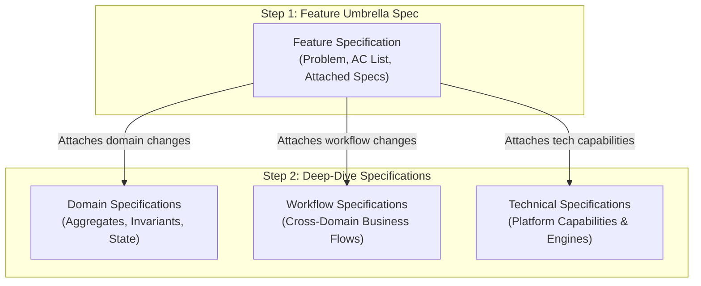

# Specification Architecture Guide (Pre-Implementation Guidance)

This guide establishes the mandatory pre-implementation workflow and specification architecture for the platform. Before any production code, database migration, domain model, or API endpoint is implemented, all features and architectural changes MUST be formally specified.

---

## 1. Pre-Implementation Workflow

Every new capability or architectural change progresses through a disciplined 3-step specification process:

### Step 1: Create the Feature Umbrella Specification (`feature-spec-template.md`)
The feature file acts as the single source of truth anchoring the feature from both product and technical perspectives:
- **Problem Statement (Pain Points):** Articulates the user, business, or operational friction being solved and explains why existing capabilities are insufficient.
- **Acceptance Criteria (AC List):** The explicit, testable conditions the feature must fulfill to be considered complete ("Done When").
- **Related Specifications:** Attaches links to all underlying domain, workflow, and technical specs that must be created or updated to satisfy the ACs:
  - **Domain changes:** If new domain models or aggregate invariants are introduced.
  - **Workflow changes:** If end-to-end multi-aggregate business processes change.
  - **Tech changes:** If platform capabilities, query projections, or security mechanisms change.

### Step 2: Detail Underlying Specifications (The 3-Tier Model)
Depending on what the feature impacts, author or update specifications across three cohesive tiers:
1. **Domain Changes:** If new business concepts, aggregate roots, entities, invariants, or state machines are introduced $\rightarrow$ author/update **Domain Specifications** ([`domain-spec-template.md`](domain-spec-template.md)).
2. **Workflow Changes:** If multi-aggregate choreography, sagas, outbox events, or cross-domain user flows are introduced $\rightarrow$ author/update **Workflow Specifications** ([`workflow-spec-template.md`](workflow-spec-template.md)).
3. **Technical Changes:** If platform capabilities, query read models, edge context resolvers, security manifests, or performance optimizations are required $\rightarrow$ author/update **Technical Specifications** ([`tech-spec-template.md`](tech-spec-template.md)).

### Step 3: Verify Traceability & Pass Checklist
Before code implementation starts:
- Verify that every criterion in the Feature AC list directly maps to a domain invariant, workflow step, or technical contract.
- Verify bidirectional cross-links between all attached specifications.
- Ensure all diagrams adhere to the golden authoring rules.

---

## 4. Golden Authoring Rules

1. **Explain with diagrams, not massive text blocks:** Keep paragraphs under 3 sentences. Replace long explanations with clear Mermaid flowcharts, sequence diagrams, and state machines.
2. **Cap diagram complexity:** Cap diagrams at ~7–9 nodes. Do not create tangled webs; split diagrams into focused views when necessary.
3. **Use role names in diagrams:** In diagrams, use logical participant and architectural roles (e.g. `Workflow Coordinator`, `Pricing Service`, `Outbox Poller`), **never** framework classes, Java types, or table schema names.
4. **Precise tables:** Use concise tables for invariants, steps, events, properties, and configuration. Keep each cell to 1 clear, unambiguous sentence.
5. **Strict boundaries:** In Domain Specs, show composition inside an aggregate root vs. ID-only references across aggregates and contexts. Never show direct cross-aggregate navigation.
6. **Normative contracts:** In Tech Specs and Acceptance Criteria, define non-negotiable rules using RFC 2119 keywords (`MUST`, `MUST NOT`, `REQUIRED`).
7. **Traceability:** Every criterion in a Feature Spec's Acceptance Criteria MUST correspond to a concrete invariant in a Domain Spec, a step in a Workflow Spec, or a requirement in a Tech Spec.

---

## 5. File Placement & Naming Conventions

### 1. Feature Specifications (Tier 0)
Place feature umbrella specifications in:
- `grab/docs/spec/features/feat_{xxx}-{kebab-feature-name}.md`
- *Example:* `grab/docs/spec/features/feat_003-regional_discovery_and_publishable_keys.md`

### 2. Domain Specifications (Tier 2)
Place domain aggregate specifications in the corresponding module directory:
- `grab/docs/spec/domain/{domain}/architecture/{aggregate}-domain-spec.md`
- *Example:* `grab/docs/spec/domain/sales-channel/architecture/sales-channel-domain-spec.md`

### 3. Workflow Specifications (Tier 1)
Place all cross-domain workflows in the central workflows directory:
- `grab/docs/spec/workflows/{kebab-case-workflow-name}.md`
- *Example:* `grab/docs/spec/workflows/browse-and-discover-products-workflow.md`

### 4. Tech Specifications (Tier 3)
Place technical capabilities and pattern specifications in:
- `grab/docs/spec/system/{kebab-case-tech-name}-tech-spec.md`
- *Example:* `grab/docs/spec/system/storefront-query-tech-spec.md`

---

## 6. Navigation & Cross-Linking

- **Feature Specs** MUST link to all underlying **Domain Specs**, **Workflow Specs**, and **Tech Specs** that define its implementation.
- **Workflow Specs** MUST link to the **Domain Specs** of all participating aggregates and supporting **Tech Specs**.
- **Domain Specs** MUST link to relevant **Workflow Specs** where the aggregate participates.
- **Tech Specs** MUST link to relevant **Domain Specs** whose facts they project or enforce.
