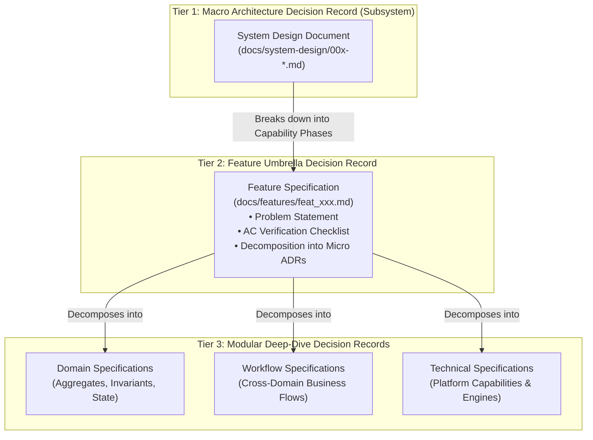

# Architecture Decision Record (ADR) & Specification Guide

This guide establishes the mandatory pre-implementation architecture decision record (ADR) framework for the platform. Before any production code, database migration, domain model, or API endpoint is implemented, all capabilities and architectural changes MUST be formally specified as decision records.

---

## 1. Core Philosophy: Decision Records vs. Implementation Trackers

All specifications in this repository are **Architecture Decision Records (ADRs)** and **Architectural Specifications**, **NOT implementation task trackers or sprint backlogs**:

1. **Architecture Blueprint:** Specifications define architectural boundaries, bounded contexts, domain invariants, cross-domain workflows, platform contracts, and core algorithms.
2. **Implementation-Agnostic:** Specifications **NEVER** mention framework class names (`*Service`, `*Controller`, `*Adapter`, `*UseCase`), package paths, or database table schemas.
3. **Reference for Developers:** Developers treat these decision records as the definitive reference blueprint, writing their code and creating classes to satisfy the decisions.
4. **Verification via Acceptance Criteria:** The Acceptance Criteria (AC) list serves as the testable verification checklist indicating when the architectural decisions have been fulfilled.

---

## 2. The 3-Tier Decision Record Hierarchy

Platform architecture is structured across three cohesive decision tiers:

### Tier 1: Macro Architecture Decision — System Design (`system-design-template.md`)
Captures the overarching subsystem architecture, business/technical problem statement, boundary ownership, technical rationale, and the sequential breakdown into **Architectural Capability Phases**. Each phase maps 1:1 to a Feature Decision Record.

### Tier 2: Feature Umbrella Decision — Feature Specification (`feature-spec-template.md`)
Anchors a cohesive feature capability from both business and architectural perspectives:
- **Problem Statement & Context:** The specific tension, vulnerability, or friction solved.
- **Acceptance Criteria (AC) Checklist:** The normative, testable verification checklist defining when the decision is fulfilled. Criteria use RFC 2119 keywords (`MUST`, `MUST NOT`), HTTP response codes, and domain invariants without referencing code artifacts.
- **Decomposition into Micro-ADRs:** Links to all underlying Domain, Workflow, and Technical specifications.

### Tier 3: Modular Deep-Dive Decisions (The Micro-ADR Model)
Decomposes the feature into atomic, focused specifications across three domains:
1. **Domain Decision Records:** Business concepts, aggregate roots, entities, invariants, and lifecycle state machines $\rightarrow$ [`domain-spec-template.md`](domain-spec-template.md).
2. **Workflow Decision Records:** Multi-aggregate choreography, sagas, outbox signals, and compensation/failure recovery $\rightarrow$ [`workflow-spec-template.md`](workflow-spec-template.md).
3. **Technical Decision Records:** Platform capabilities, query read models, edge resolvers, caching contracts, and core algorithms $\rightarrow$ [`tech-spec-template.md`](tech-spec-template.md).

---

## 3. Golden Authoring Rules

1. **Decision records, not implementation trackers:** Focus on boundaries, invariants, trade-offs, and algorithms. Do not record task breakdowns or class creation checklists.
2. **Strictly no class names:** Use logical participant and architectural roles (e.g. `Workflow Coordinator`, `Pricing Engine`, `Outbox Poller`, `Token Authority`), **never** framework classes (`*Service`, `*Controller`, `*Adapter`), Java types, or table schema names.
3. **Explain with diagrams, not massive text blocks:** Keep paragraphs under 3 sentences. Replace long explanations with clear Mermaid flowcharts, sequence diagrams, and state machines.
4. **Cap diagram complexity:** Cap diagrams at ~7–9 nodes. Avoid tangled graphs; split into focused views when necessary.
5. **Normative contracts in ACs:** Define non-negotiable rules using RFC 2119 keywords (`MUST`, `MUST NOT`, `REQUIRED`).
6. **Strict boundaries:** Show composition inside an aggregate root vs. ID-only references across aggregates and contexts. Never show direct cross-aggregate navigation.
7. **Traceability:** Every criterion in a Feature Spec's Acceptance Criteria MUST correspond to a concrete invariant in a Domain Spec, a step in a Workflow Spec, or a requirement in a Tech Spec.

---

## 4. File Placement & Naming Conventions

### 1. Macro Architecture Decisions (Tier 1)
- `grab/docs/system-design/{00x}-{kebab-subsystem-name}.md`
- *Example:* `grab/docs/system-design/001-multi_regional_contextual_discovery_system_design.md`

### 2. Feature Umbrella Decision Records (Tier 2)
- `grab/docs/features/feat_{xxx}-{kebab-feature-name}.md`
- *Example:* `grab/docs/features/feat_003-sales-channel-key-lifecycle-management.md`

### 3. Domain Decision Records (Tier 3)
- `grab/docs/spec/domain/{domain}/architecture/{aggregate}-domain-spec.md`
- *Example:* `grab/docs/spec/domain/sales-channel/architecture/sales-channel-domain-spec.md`

### 4. Workflow Decision Records (Tier 3)
- `grab/docs/spec/workflows/{kebab-case-workflow-name}.md`
- *Example:* `grab/docs/spec/workflows/browse-and-discover-products-workflow.md`

### 5. Tech Decision Records (Tier 3)
- `grab/docs/spec/system/{kebab-case-tech-name}-tech-spec.md`
- *Example:* `grab/docs/spec/system/storefront-query-tech-spec.md`
