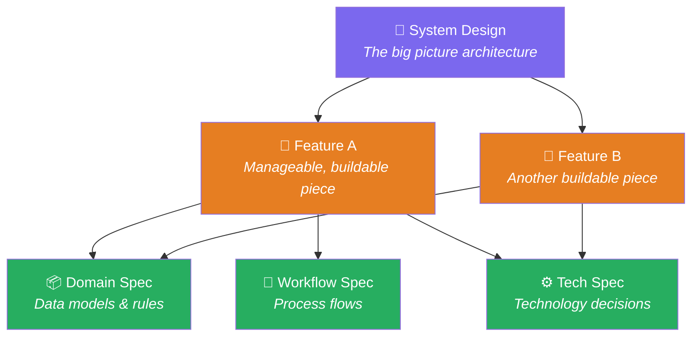

# Tech Document Templates

> Turn business requirements into technical blueprints that developers can build from.

---

## The Flow

Every business requirement follows this path from idea to implementation:



---

## Templates

| Template | What It Does | When to Create |
|:---------|:-------------|:---------------|
| [**System Design**](system-design-template.md) | Translates a business requirement into high-level architecture and decomposes it into features | When a new business requirement arrives |
| [**Feature Spec**](feature-spec-template.md) | Defines what a feature does, its acceptance criteria, and links to implementation specs | For each feature identified in the System Design |
| [**Domain Spec**](domain-spec-template.md) | Blueprints the data model, business rules, and state lifecycle for a domain entity | When a feature involves domain logic with clear entities and rules |
| [**Workflow Spec**](workflow-spec-template.md) | Maps out a multi-step process flow across domains/services | When a feature involves coordination across multiple domains |
| [**Tech Spec**](tech-spec-template.md) | Documents a technology or pattern decision with usage rules | When a feature involves a technology choice or cross-cutting concern |

---

## Quick Start: A New Requirement Arrived

**Step 1 →** Create a **System Design** document.
  - Capture the business requirement
  - Design the solution architecture
  - Break it down into features

**Step 2 →** For each feature, create a **Feature Spec**.
  - Define what it does and why
  - Write testable acceptance criteria
  - Identify which specs are needed (domain? workflow? tech?)

**Step 3 →** Create the implementation specs the feature needs:
  - **Domain Spec** — if the feature has entities, business rules, or state machines
  - **Workflow Spec** — if the feature has multi-step processes across domains
  - **Tech Spec** — if the feature requires a technology decision or shared pattern

**Step 4 →** Developers build from the specs. Acceptance criteria in the Feature Spec verify completeness.

---

## Suggested Folder Structure

```
docs/
├── system/                          # System Design documents
│   └── [system-name].md
├── features/                        # Feature Specs
│   ├── feat-001-[feature-name].md
│   └── feat-002-[feature-name].md
└── spec/                            # Implementation Specs
    ├── domain/
    │   └── [domain-name]/
    │       └── [entity]-domain-spec.md
    ├── workflows/
    │   └── [workflow-name].md
    └── system/
        └── [tech-name]-tech-spec.md
```

---

## Principles

1. **Start from the business need** — not from technology
2. **Visual first** — if you can show it with a diagram, do it. Diagrams beat paragraphs.
3. **Simple language** — write so a new team member understands it on first read
4. **Every section earns its place** — if a section doesn't apply, skip it (optional sections are marked)
5. **Testable criteria** — acceptance criteria must have a clear pass/fail answer
6. **Diagrams stay clean** — cap at ~7–9 nodes. If it's more complex, decompose further.
