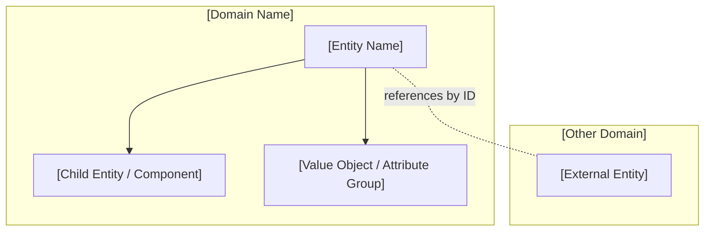
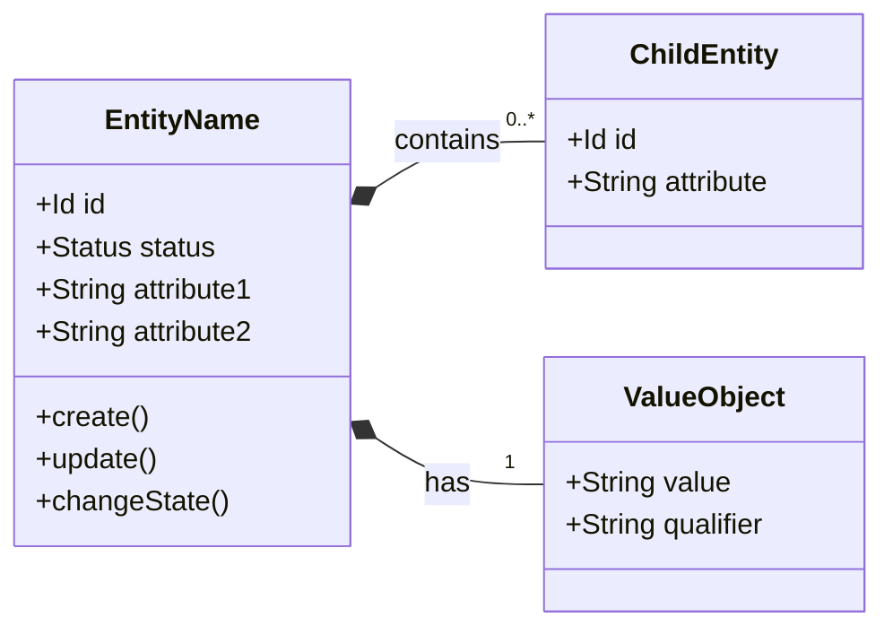
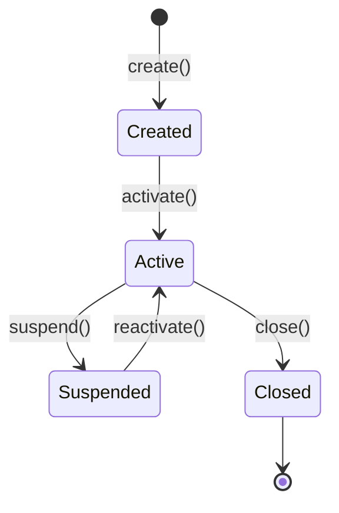

<!-- TEMPLATE INSTRUCTIONS
─────────────────────────────────────────────────────────────────
This defines the data model, business rules, and lifecycle for one domain entity.

PURPOSE: Blueprint for how data is structured, what rules protect it,
         and how it transitions through states.
         Developers code the entity, validation, and state machine from this document.

WHEN TO CREATE: When a Feature Spec identifies domain logic that needs
                a clear model, rules, or state lifecycle.

RULES:
- Use business language — not database column names or Java types.
- Every property in the model diagram MUST appear in the Property table with a business reason.
- Invariants are rules that can NEVER be broken. If violated, the system rejects the action.
- State diagrams show only real, implemented states — not aspirational ones.
- Replace every [placeholder] before publishing.
─────────────────────────────────────────────────────────────────
-->

# Domain Spec: [Entity / Aggregate Name]

- **Domain:** [e.g., Catalog, Order, Pricing, Identity]
- **Purpose:** [1–2 sentences — what business concept this entity represents and protects]
- **Feature Spec:** [[Feature Name]](../../features/[feat-xxx-feature-name].md)

---

## 1. Ownership & Boundaries

### What does this domain own?

- **Owns:** [Core data and behavior this entity is the source of truth for]
- **Does NOT own:** [Related concepts that belong to other domains — referenced by ID only]

### Boundary Diagram

> Show this entity, its internal parts, and how it relates to other domains (ID references only — no direct object navigation).

---

## 2. Domain Model

### Model Diagram

> Show the entity structure — attributes and key operations. Keep it to ~7–9 nodes.

### Property Rationale

> Every property must exist for a business reason — not "because the database needs it."

| Property | Type | Belongs To | Why It Exists |
|:---------|:-----|:-----------|:--------------|
| `id` | Identifier | [Entity] | [Unique identity for this entity across the system] |
| `status` | Enum | [Entity] | [Tracks the entity's lifecycle position — controls what actions are allowed] |
| `[property]` | [Type] | [Owner] | [Business reason this data is captured] |

### Key Terms

| Business Term | Technical Name | Meaning |
|:--------------|:---------------|:--------|
| [What users call it] | `[EntityName]` | [What it represents in the system] |
| [Business state name] | `[STATUS_CODE]` | [What this state means in the business process] |

---

## 3. Business Rules (Invariants)

> These rules can **never** be violated. If any rule is broken, the system **rejects** the action immediately.

| Rule | What Must Be True | If Violated | Enforced By |
|:-----|:-------------------|:------------|:------------|
| **R-01** | [Business rule in plain language — e.g., "An order cannot exceed the customer's credit limit"] | [What happens — e.g., "Command rejected with CREDIT_LIMIT_EXCEEDED error"] | [Method or component that enforces this] |
| **R-02** | [Another invariant] | [Rejection behavior] | [Enforcement point] |
| **R-03** | [Another invariant] | [Rejection behavior] | [Enforcement point] |

---

## 4. State Lifecycle

### State Diagram

> Show all states and the transitions between them. Label transitions with the action that triggers them.

### Transition Rules

| Current State | Action | Next State | Conditions |
|:--------------|:-------|:-----------|:-----------|
| `—` (new) | `create()` | `Created` | [What must be provided or true to create this entity] |
| `Created` | `activate()` | `Active` | [Conditions that must be met before activation] |
| `Active` | `suspend()` | `Suspended` | [When and why suspension is allowed] |
| `Active` | `close()` | `Closed` | [Conditions for closing — e.g., no pending items] |

---

## 5. Events *(optional — include only if this domain emits or consumes events)*

### Events This Domain Emits

| Event | When It's Emitted | Key Data | Who Consumes It |
|:------|:-------------------|:---------|:----------------|
| `[EntityCreatedEvent]` | [After successful creation] | [Key fields included in the event] | [Consuming domain or service] |

### Events This Domain Reacts To

| Event | Emitted By | What This Domain Does | Business Impact |
|:------|:-----------|:----------------------|:----------------|
| `[ExternalEvent]` | [Other domain] | [Action taken in response] | [Why this reaction matters] |
