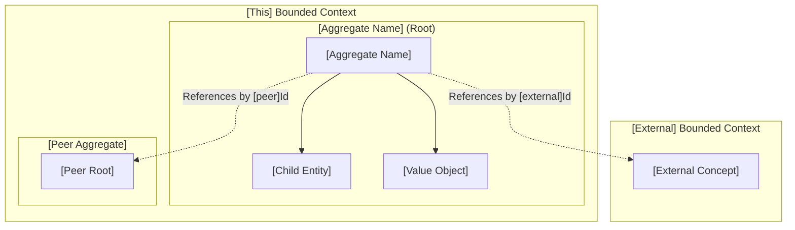
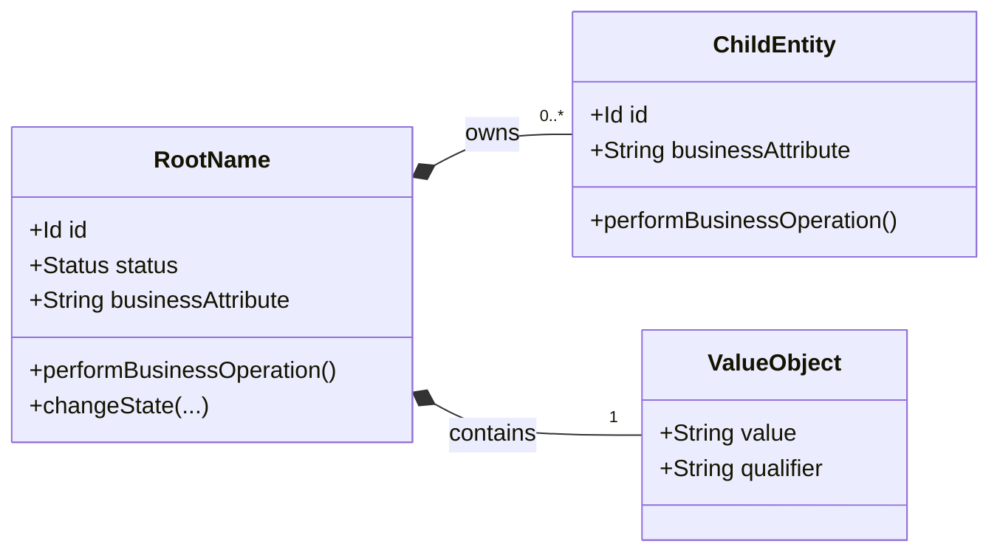
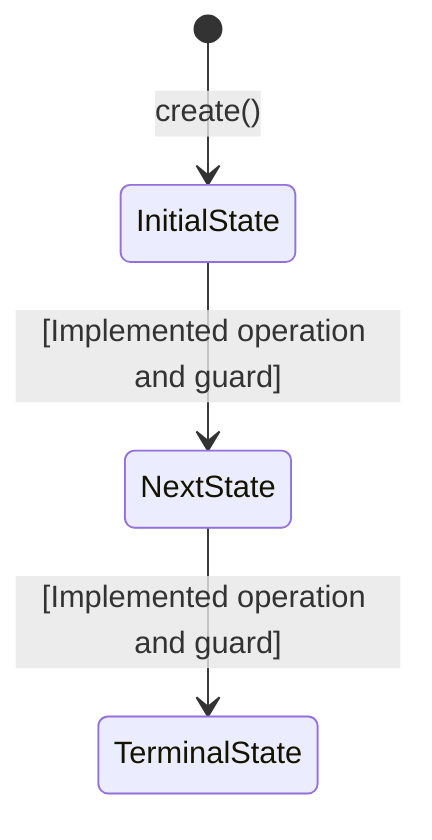

You are writing a Domain Specification (Domain Model Architecture Decision Record): a micro-architectural decision record defining a business domain aggregate, its boundaries, invariants, and lifecycle.

A Domain Specification is an **Architecture Decision Record (ADR)**. It is NOT an implementation class tracker or entity mapping file.

**Author rules:**
- Talk less and explain with diagrams and structured tables. Avoid massive paragraphs.
- In diagrams and specifications, use pure domain concepts and business roles. **NEVER** include Java types, framework annotations, class names (`*Service`, `*Repository`), or database table names.
- Keep diagrams clean and readable. Cap each diagram at ~7–9 nodes.
- Explicit boundaries: show composition inside the aggregate root vs. ID-only references across other aggregates or bounded contexts. Cross-aggregate object navigation is strictly forbidden.
- In Section 3, every property shown on the aggregate diagram MUST appear in the Property Rationale table with a business justification (never "needed for database/JPA").
- In Section 4, state invariants in business language and name the domain concept or policy that enforces each invariant.
- In Section 5, show states and allowable transitions visually.
- Replace every `[placeholder]` before publishing.

---

# Domain Decision Record: [Aggregate Name]

> **Bounded Context:** [e.g. Catalog, Inventory, Pricing, Identity]
> **Primary Purpose:** [1–2 sentences explaining the core business concept this aggregate models and protects.]
> **Module Root:** `[domain]-domain / [domain]-application / [domain]-adapter-persistence / store/[domain]`
> **Related Workflows:** [[Workflow Name 1]](../../../workflows/[file.md]), [[Workflow Name 2]](../../../workflows/[file.md])

---

## 1. Boundary & Context Map

### Ownership

- **This aggregate OWNS:** [Core entities, value objects, and lifecycle state it is source-of-truth for]
- **This aggregate DOES NOT OWN:** [Related business concepts that belong to other aggregates or contexts]

### Context Map

> Show this aggregate, its internal entities/value objects, and external relationships (ID references only).

---

## 2. Ubiquitous Language

| Business Term | Domain Concept | Business Definition |
| :--- | :--- | :--- |
| **[Term 1]** | `[AggregateRootName]` (Aggregate Root) | [Exact business definition used by users and domain experts] |
| **[Term 2]** | `[EntityName]` (Entity) | [Child entity with independent identity within this aggregate] |
| **[Term 3]** | `[ValueObjectName]` (Value Object) | [Immutable attribute or value structure without separate identity] |
| **[State Term]** | `[STATUS_CODE]` | [What this status signifies in the business lifecycle] |

---

## 3. Domain Aggregate Model

### Model Diagram

> Show the aggregate root, child entities, value objects, and method operations. Cap diagram at ~7–9 nodes.

### Property & Attribute Rationale

| Property | Type | Belongs To | Business Rationale |
| :--- | :--- | :--- | :--- |
| `[business property]` | [Business concept] | Root / Child | [Specific business reason this property exists; not "for DB"]. |

---

## 4. Business Invariants & Rules

> Invariants are non-negotiable business rules that must ALWAYS hold. If an invariant is violated, the aggregate rejects the command.

| Rule ID | Invariant Rule | Violation Outcome | Enforced By |
| :--- | :--- | :--- | :--- |
| **INV-01** | [State the implemented business invariant; avoid assuming a review or moderation process.] | [Observed rejection or failure outcome.] | [Actual aggregate method or policy] |
| **INV-02** | [State the actual uniqueness boundary, such as per aggregate or per merchant, only when enforced.] | [Observed rejection or failure outcome.] | [Actual method, policy, or persistence constraint] |
| **INV-03** | [Another implemented invariant, if present.] | [Observed rejection or failure outcome.] | [Actual aggregate method or value object] |

---

## 5. State Lifecycle & Transitions

### State Machine

### Transition Matrix

| Current State | Trigger / Event | Next State | Guard Condition / Prerequisite |
| :--- | :--- | :--- | :--- |
| `[State 1]` | `[Command / Action]` | `[State 2]` | [Condition that must be satisfied before transition is allowed] |
| `[State 2]` | `[Command / Action]` | `[State 3]` | [Condition that must be satisfied] |
| `[State 2]` | `[Cancel / Reject]` | `[State 1]` | [Allowed rollback or reversion condition] |

---

## 6. Domain Events

### Emitted Events (What Happened)

| Event Name | Trigger | Key Attributes | Target Consumers |
| :--- | :--- | :--- | :--- |
| [Actual aggregate domain event] | [Actual trigger] | [Actual event fields] | [Observed consumers] |

Separate aggregate-emitted domain events from store-level integration events and workflow request/completion signals; do not label all three as aggregate events.

### Store Integration Events

[List only integration event records that are actually published for cross-module consumers, or state that none are currently emitted.]

### Workflow Signals

[List only workflow request, completion, or failure signal records that are actually emitted/consumed, or state that none apply.]

### Consumed Events (Cross-Domain Signals)

| Consumed Event | Emitted By | Aggregate Action | Business Impact |
| :--- | :--- | :--- | :--- |
| `[ExternalEvent]` | `[External Domain]` | `[Execute Command]` | [How this aggregate reacts to external business events] |
