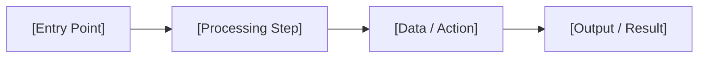

<!-- TEMPLATE INSTRUCTIONS
─────────────────────────────────────────────────────────────────
This document bridges a System Design feature to its implementation details.

PURPOSE: Define WHAT a feature does, WHY it matters, and HOW it's verified —
         then link to the detailed specs (domain, workflow, tech) that developers
         will code against.

WHEN TO CREATE: When a feature is identified in a System Design's Feature Breakdown (Section 5).

RULES:
- One Feature Spec per feature identified in the System Design.
- Acceptance Criteria must be testable — clear pass/fail, no ambiguity.
- This document does NOT contain implementation details. Those live in the linked specs.
- Replace every [placeholder] before publishing.
─────────────────────────────────────────────────────────────────
-->

# Feature: [Feature Name]

> **System Design:** [[System Design Name]](../system/[system-design-name].md)

---

## 1. What & Why

### What does this feature do?

[2–3 sentences explaining what this feature delivers. Write it so someone unfamiliar with the system understands the value.]

### Why is it needed?

[Connect back to the business problem. What part of the System Design's problem does this feature solve?]

### What's in scope / out of scope?

| In Scope | Out of Scope |
|:---------|:-------------|
| [What this feature covers] | [What it explicitly does NOT cover] |
| [Another in-scope item] | [Another exclusion] |

---

## 2. Acceptance Criteria

> This feature is **done** when all criteria below pass. Each criterion must be testable — no vague language.

| # | Criteria | How to Verify |
|:--|:---------|:--------------|
| AC-1 | [Observable behavior — e.g., "System returns HTTP 201 with created resource when valid payload is submitted"] | [Test method — API test, UI check, log inspection] |
| AC-2 | [Another testable behavior] | [How to verify] |
| AC-3 | [Another testable behavior] | [How to verify] |

---

## 3. Solution Design

### How does this feature work?

> Show the key architectural flow for this feature. This is the "zoomed-in" view of the relevant part of the System Design.

### Key Design Decisions

[If there are feature-specific design decisions not already covered in the System Design, document them here.]

| Decision | Choice | Rationale |
|:---------|:-------|:----------|
| [e.g., Validation approach] | [e.g., Schema-based validation at API layer] | [Why — catches errors early, single validation point] |

---

## 4. Implementation Specifications

> These are the detailed blueprints developers code against. Each spec covers one aspect of this feature's implementation.

### Domain Specs (Data Models & Business Rules)

[Domain Spec Name](../spec/domain/[domain]/[aggregate]-domain-spec.md)

### Workflow Specs (Process Flows)

[Workflow Spec Name](../spec/workflows/[workflow-name].md)

### Tech Specs (Technology Decisions & Rules)

[Tech Spec Name](../spec/system/[tech-name]-tech-spec.md)