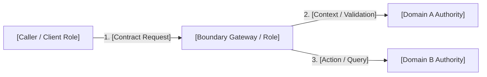
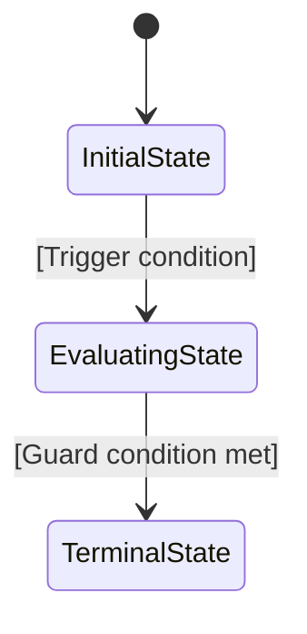

You are writing a Feature Specification (Feature Umbrella Architecture Decision Record): the cohesive feature-level architectural decision record that bridges a macro System Design capability phase to detailed modular specifications.

A Feature Specification is an **Architecture Decision Record (ADR)**. It is NOT an implementation tracker, sprint task backlog, or developer scratchpad.

**Author rules:**
- Explain the architectural decision and business problem clearly.
- **NEVER include implementation class names**, package paths, Spring stereotype names (`*Service`, `*Controller`, `*Adapter`, `*UseCase`), or Java annotations. Use logical participant roles, domain terms, and architectural contracts.
- **Acceptance Criteria (AC) Checklist:** The AC list serves as the testable verification checklist indicating when the architectural decision is fully satisfied. Every criterion must use RFC 2119 keywords (`MUST`, `MUST NOT`) and state concrete, observable behavior (HTTP response codes, security invariants, data constraints, boundary rules) without referencing code-level artifacts.
- **Decomposition:** Decompose the feature into underlying **Micro Architecture Decision Records** (Domain Specs, Workflow Specs, and Technical Specs). Developers will reference these decision records as the definitive specification to code against.
- Replace every `[placeholder]` before publishing.

---

# Feature Decision Record: [Feature Name]
## Participating Bounded Contexts: [e.g. Sales Channel · Storefront Query · Pricing]

### 1. Problem Statement & Architectural Context
[What friction, security vulnerability, scalability bottleneck, or business need does this feature address? Why can't existing platform capabilities or current boundaries satisfy this?]

---

### 2. Acceptance Criteria (Architectural Verification Checklist)

> The Acceptance Criteria list constitutes the testable verification checklist. An implementation satisfies this architectural decision record if and only if all criteria pass.
> 
> **CRITICAL RULE:** Do NOT list implementation class names, method signatures, or internal package files. Describe behavior in terms of observable contracts, status codes, invariants, and role responsibilities.

- [ ] **AC-01 — [Contract / Invariant Name]:** The system **MUST** [specify exact observable behavior, contract, or invariant rule].
- [ ] **AC-02 — [Security / Boundary Rule]:** Requests [specify condition] **MUST NOT** [specify forbidden behavior] and **MUST** return [standard status code, e.g. RFC 7807 403 Forbidden].
- [ ] **AC-03 — [Algorithmic / Data Constraint]:** The evaluation **MUST** follow [specific precedence or algorithm, e.g. 4-tier rule ranking] without [unwanted side-effect, e.g. write amplification].
- [ ] **AC-04 — [State Lifecycle Rule]:** When [trigger occurs], the entity state **MUST** transition from `[STATE_A]` to `[STATE_B]`; invalid transitions **MUST** be rejected.
- [ ] **AC-05 — [Contract Schema & Compatibility]:** Storefront responses **MUST** include `[attribute]` while strictly excluding `[sensitive/internal attribute]`.

---

### 3. Core Algorithms & State Transitions

#### 3.1 Decision State Machine / Evaluation Logic
[Include a stateDiagram-v2 or flowchart describing the core algorithm or state transitions governed by this feature decision.]

#### 3.2 Key States & Definitions

| State / Precedence Code | Architectural Definition | Observability / Contract Impact | Allowed Transitions |
| :--- | :--- | :--- | :--- |
| **`[CODE_1]`** | [What this state signifies in the architecture] | [How caller/client observes this state] | [Next allowable states] |
| **`[CODE_2]`** | [What this state signifies in the architecture] | [How caller/client observes this state] | [Next allowable states] |

---

### 4. Underlying Architectural Decision Records (Decomposition)

This feature decision record decomposes into the following detailed micro-decision records. Developers must consult these referenced specifications when implementing the solution.

#### Domain Decision Records (Aggregate boundaries, invariants, & entities)
- [[Domain Spec Name]](../spec/domain/{domain}/architecture/{aggregate}-domain-spec.md) — [Summary of domain aggregate decisions]

#### Workflow Decision Records (Cross-domain business orchestration & sagas)
- [[Workflow Spec Name]](../spec/workflows/{workflow-name}.md) — [Summary of cross-aggregate workflow decisions]

#### Technical Decision Records (Platform infrastructure, read models, & protocols)
- [[Tech Spec Name]](../spec/system/{tech-name}-tech-spec.md) — [Summary of technical capability contracts]