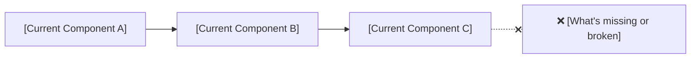
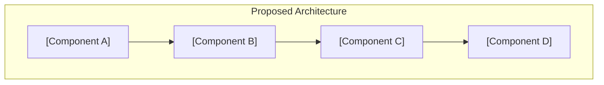
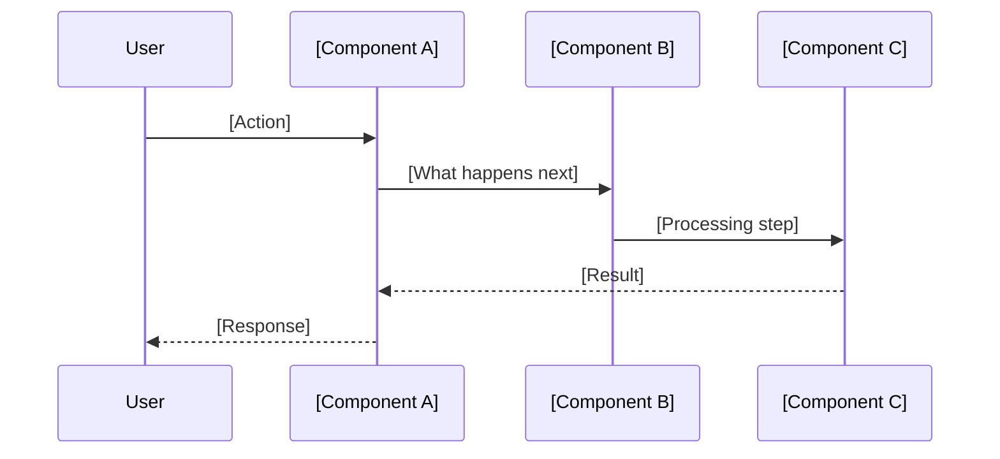
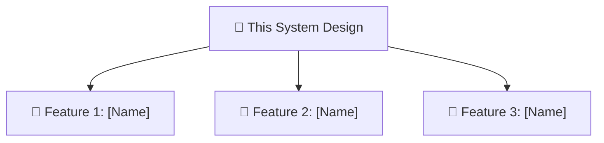

<!-- TEMPLATE INSTRUCTIONS
─────────────────────────────────────────────────────────────────
This is the starting point for any new business requirement.

PURPOSE: Translate a business requirement into a high-level technical blueprint.
         Anyone reading this should understand:
         - WHY this work exists (the business need)
         - WHAT the solution looks like (architecture overview)
         - HOW it breaks down into buildable features

WHEN TO CREATE: When a new business requirement, initiative, or major change request arrives.

RULES:
- Start from the business requirement — not from technology.
- Keep architecture diagrams to ~7–9 nodes. If it's more complex, you need more features.
- Every feature listed in Section 5 maps to its own Feature Spec document.
- Replace every [placeholder] before publishing.
─────────────────────────────────────────────────────────────────
-->

# [System Design Title]

## 1. Business Requirement

### What does the business need?

[Summarize the business requirement in 2–3 sentences. Write it as if you're explaining to a new team member who just joined.]

### What happens if we don't solve this?

[Bullet points — business impact, revenue risk, user friction, security exposure, or operational cost.]

- [Impact 1]
- [Impact 2]
- [Impact 3]

---

## 2. Current State & Problem

### How does it work today?

> Show the current system behavior relevant to this requirement. Highlight what's missing or broken.

### What's the problem?

| # | Problem | Impact |
|:--|:--------|:-------|
| 1 | [Specific technical or process gap] | [How it manifests — errors, latency, manual work, data loss] |
| 2 | [Another problem] | [Its impact] |

---

## 3. Solution Overview

### Architecture

> Show the proposed system design. Use role names (e.g., "API Gateway", "Order Engine", "Notification Service"), not class names. Keep it to ~7–9 nodes.

### Key Components

| Component | Role | What It Does |
|:----------|:-----|:-------------|
| **[Component A]** | [e.g., API Gateway] | [One sentence — what this component is responsible for] |
| **[Component B]** | [e.g., Processing Engine] | [One sentence] |
| **[Component C]** | [e.g., Data Store] | [One sentence] |

### How It Works (End-to-End Flow)

> Walk through the main interaction flow. This should tell the story of a request from start to finish.

---

## 4. Technology & Design Decisions

[Explain the key technology and architectural pattern choices. Focus on *why* — not just *what*.]

| Decision | Choice | Why (not alternatives) |
|:---------|:-------|:-----------------------|
| **[Decision area, e.g., Message Broker]** | [e.g., Kafka] | [Why this over RabbitMQ, SQS, etc. — fit for our scale, ordering guarantees, team familiarity] |
| **[Decision area, e.g., Data Storage]** | [e.g., PostgreSQL] | [Why this — ACID transactions needed, relational model fits domain] |
| **[Decision area, e.g., Architecture Style]** | [e.g., Event-Driven] | [Why this — decoupling between services, async processing required] |

---

## 5. Feature Breakdown

> Decompose this system design into manageable, buildable features. Each feature gets its own Feature Spec where domain models, workflows, and tech decisions are detailed.

| # | Feature | What It Solves | Scope | Feature Spec |
|:--|:--------|:---------------|:------|:-------------|
| 1 | **[Feature Name]** | [Which part of the problem this feature addresses] | [Key boundaries — what's in/out] | [feat-001-feature-name.md](../features/feat-001-feature-name.md) |
| 2 | **[Feature Name]** | [Problem it addresses] | [Boundaries] | [feat-002-feature-name.md](../features/feat-002-feature-name.md) |
| 3 | **[Feature Name]** | [Problem it addresses] | [Boundaries] | [feat-003-feature-name.md](../features/feat-003-feature-name.md) |
