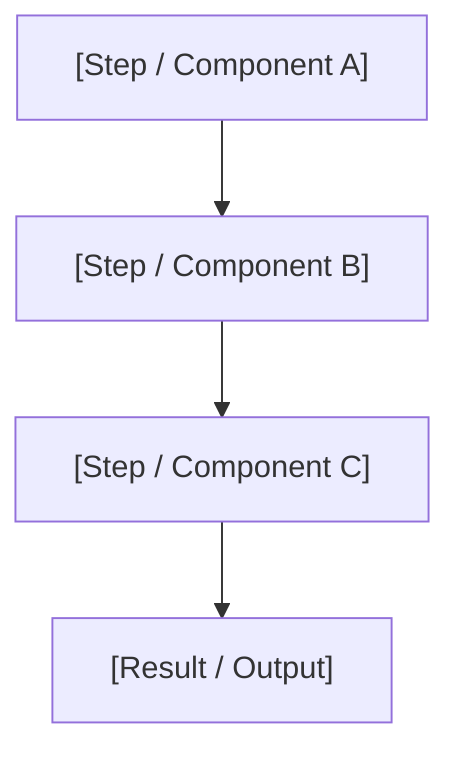
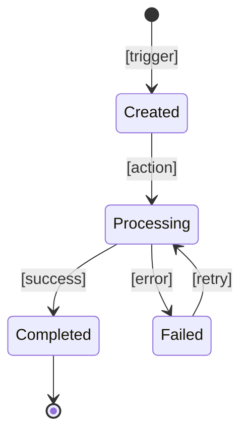
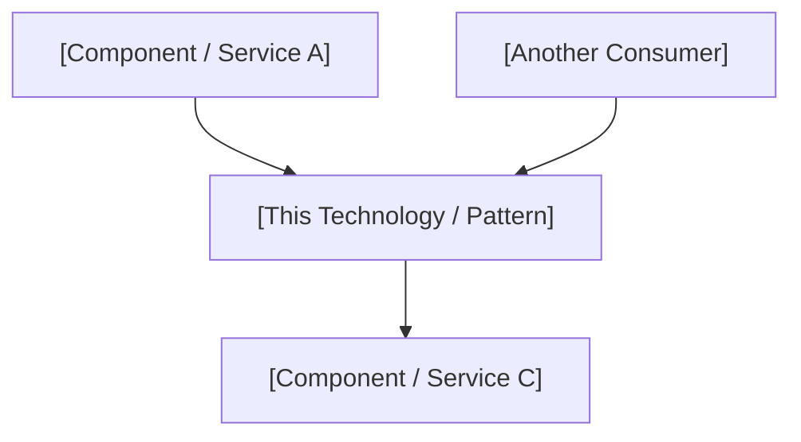
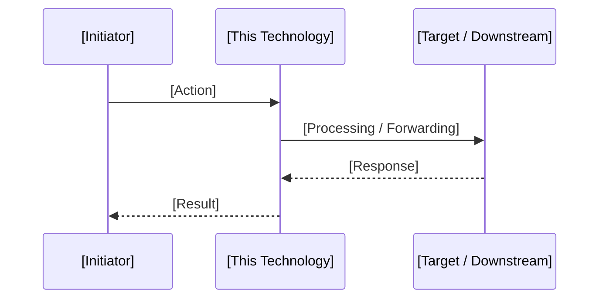

<!-- TEMPLATE INSTRUCTIONS
─────────────────────────────────────────────────────────────────
This documents a technology or architectural pattern decision.

PURPOSE: Explain WHY a specific technology/pattern is needed, HOW it works,
         and WHAT rules implementations must follow.
         Developers use the Rules section as the compliance contract.

WHEN TO CREATE: When a Feature Spec involves a technology choice, infrastructure pattern,
                or cross-cutting concern (caching, messaging, auth, etc.) that needs
                shared understanding and consistent usage rules.

RULES:
- Lead with the problem — not the technology.
- Compare against alternatives so the decision is justified.
- Keep diagrams to ~7–9 nodes.
- Rules section uses MUST / MUST NOT — these are non-negotiable contracts.
- Replace every [placeholder] before publishing.
─────────────────────────────────────────────────────────────────
-->

# Tech Spec: [Technology / Pattern Name]

- **Summary:** [One sentence anyone on the team can understand — what this technology does for us]
- **Type:** Infrastructure | Architecture Pattern | Cross-Cutting Concern
- **Feature Spec:** [[Feature Name]](../../features/[feat-xxx-feature-name].md)

---

## 1. Problem & Decision

### What breaks without this?

[Concrete problem in under 100 words — what fails, degrades, or becomes impossible without this technology.]

### Decision

| Option | Decision | Why |
|:-------|:---------|:----|
| **[Chosen Option]** | Adopted | [Why this fits — performance, simplicity, team familiarity, ecosystem support] |
| [Alternative A] | Rejected | [Why not — too complex, doesn't scale, wrong fit, cost] |
| [Alternative B] | Deferred | [Under what conditions we'd reconsider] |

### Trade-offs

| Benefits | Trade-offs |
|:-----------|:-------------|
| [Benefit 1 — what this gives us] | [Trade-off 1 — what we accept in return] |
| [Benefit 2] | [Trade-off 2] |

---

## 2. How It Works

### Core Concept

> Explain the pattern or technology in plain language. Then choose the diagram type that best shows how it works.

[2–3 sentences explaining the core idea — as if explaining to someone who hasn't used this pattern before.]

<!-- USE THE DIAGRAM TYPE THAT FITS BEST:

For ARCHITECTURE PATTERNS (CQRS, Event Sourcing, Hexagonal):
  → Use a flowchart/topology showing the structural split

For SECURITY PATTERNS (OAuth, JWT, mTLS):
  → Use a sequence diagram showing the auth/handshake flow

For ALGORITHMS (vectorized query, search ranking, cache invalidation):
  → Use a flowchart showing the step-by-step algorithm logic

For INFRASTRUCTURE (logging, monitoring, CI/CD):
  → Use a flowchart showing how data flows through the tool
-->

### How It Works Step by Step

> Walk through the mechanism — whether it's an algorithm, a protocol handshake, or a processing pipeline.

| Step | What Happens | Why |
|:-----|:-------------|:----|
| 1 | [First thing that happens — e.g., "Client redirects to authorization server"] | [Why this step exists] |
| 2 | [Next step — e.g., "Auth server validates credentials and issues authorization code"] | [Why] |
| 3 | [Next step — e.g., "Client exchanges code for access token"] | [Why] |
| 4 | [Final step — e.g., "Client uses token to access protected resource"] | [Why] |

### Lifecycle *(optional — include if this technology manages stateful resources)*

---

## 3. How We Use It

### Where It Fits in Our System

> Show how this technology integrates into the project's architecture. Use whatever diagram shape fits — don't force it into layers if it doesn't belong there.

### Component Responsibilities

| Component | Role | What It Does |
|:----------|:-----|:-------------|
| [Component name] | [e.g., Producer, Consumer, Gateway, Logger] | [What this component does in relation to this technology] |
| [Component name] | [Role] | [Responsibility] |
| [Component name] | [Role] | [Responsibility] |

### Runtime Flow

> Show a realistic trace of this technology in action — a request, an auth handshake, a query, or a log pipeline.

---

## 4. Implementation Rules

> These are **non-negotiable contracts**. An implementation is compliant only when **all** rules are satisfied.

| Rule | Requirement |
|:-----|:------------|
| **R-01** | The system **MUST** [specific required behavior — e.g., "validate JWT signature before granting access"] |
| **R-02** | The system **MUST NOT** [specific prohibited behavior — e.g., "store plaintext credentials in configuration files"] |
| **R-03** | [Another implementation rule] |
| **R-04** | [Another implementation rule] |