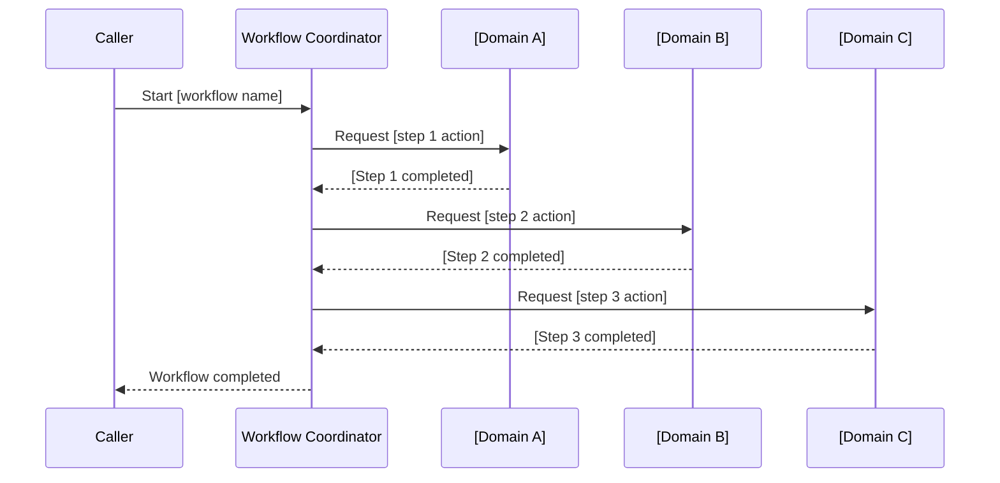
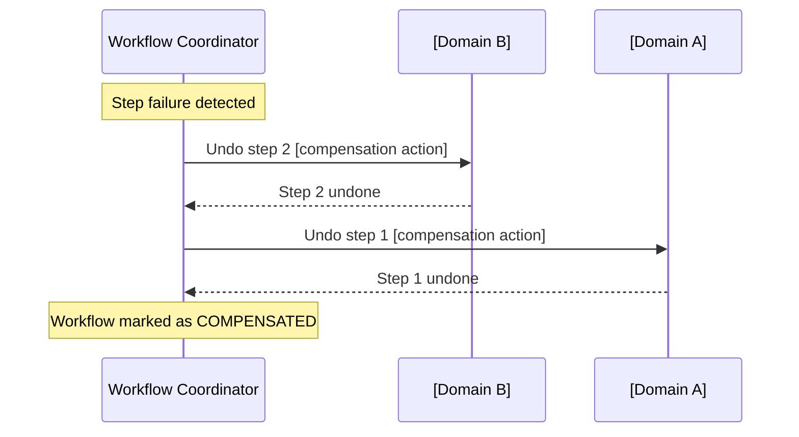

<!-- TEMPLATE INSTRUCTIONS
─────────────────────────────────────────────────────────────────
This defines a process that spans multiple domains or services.

PURPOSE: Blueprint for multi-step business processes — what happens step by step,
         what events drive the flow, and what happens when things fail.
         Developers code the orchestration logic from this document.

WHEN TO CREATE: When a Feature Spec involves a process that coordinates
                across multiple domains, services, or external systems.

RULES:
- Describe the business flow, not framework internals.
- Steps must be in exact execution order.
- Use role names (e.g., "Order Service", "Payment Gateway") — not class names.
- Compensation section is OPTIONAL — include only when the workflow has undo/rollback needs.
- Replace every [placeholder] before publishing.
─────────────────────────────────────────────────────────────────
-->

# Workflow: [Workflow Name]

- **Purpose:** [The business outcome when this workflow completes successfully]
- **Trigger:** [What starts this workflow — API call, scheduled job, upstream event]
- **Success Result:** [System state after all steps complete]
- **Feature Spec:** [[Feature Name]](../../features/[feat-xxx-feature-name].md)
- **Domains Involved:** [Domain A] · [Domain B] · [Domain C]

---

## 1. Step-by-Step Flow

### Steps

| # | Step | Domain | What Happens | Starts When | Done When |
|:--|:-----|:-------|:-------------|:------------|:----------|
| 1 | [Step name] | [Domain A] | [Action performed — e.g., "Create order record with status PENDING"] | Workflow triggered | `[StepOneCompleted]` event |
| 2 | [Step name] | [Domain B] | [Action performed — e.g., "Reserve inventory for all line items"] | Step 1 completes | `[StepTwoCompleted]` event |
| 3 | [Step name] | [Domain C] | [Action performed — e.g., "Charge payment method"] | Step 2 completes | `[StepThreeCompleted]` event → Workflow done |

### Flow Diagram

### Edge Cases

- **[Parallel steps]:** [If any steps run in parallel, describe what and when — e.g., "Steps 2 and 3 execute concurrently; workflow advances when both complete"]
- **[Skipped steps]:** [If any step is conditionally skipped — e.g., "Step 3 is skipped when order total is zero"]

---

## 2. Events & Signals

### Events Sent (Workflow → Domain)

| Event | Step | Sent To | What It Requests |
|:------|:-----|:--------|:-----------------|
| `[RequestStepOneEvent]` | Step 1 | [Domain A] | [What action this event asks the domain to perform] |
| `[RequestStepTwoEvent]` | Step 2 | [Domain B] | [Requested action] |

### Events Received (Domain → Workflow)

| Event | Step | Sent By | What It Means |
|:------|:-----|:--------|:--------------|
| `[StepOneCompletedEvent]` | Step 1 | [Domain A] | Step 1 succeeded → advance to Step 2 |
| `[StepOneFailedEvent]` | Step 1 | [Domain A] | Step 1 failed → [trigger failure handling or stop] |

---

## 3. Failure Recovery *(optional — include only when the workflow needs to undo completed steps)*

### When Does Failure Handling Start?

[Describe the trigger — e.g., "When any step emits a failure event, or when a step times out after 30 minutes."]

### What Gets Undone?

> List compensations in **reverse** order. If a completed action is intentionally NOT undone, state why.

| Reverse # | Completed Action | Undo Action | Undo Event | Why / Notes |
|:----------|:-----------------|:------------|:-----------|:------------|
| 2 | [Step 2: Reserved inventory] | [Release inventory reservation] | `[CompensateStepTwoEvent]` | [Inventory must be freed for other orders] |
| 1 | [Step 1: Created order] | [Mark order as CANCELLED] | `[CompensateStepOneEvent]` | [Order record retained for audit, status changed] |

### Failure Flow Diagram

---

## 4. State Matrix *(optional — include only for complex multi-domain workflows)*

> Track how each domain's entities change state as the workflow progresses.

| Workflow Stage | [Domain A Entity] State | [Domain B Entity] State | [Domain C Entity] State |
|:---------------|:------------------------|:------------------------|:------------------------|
| **Start** | — (not yet created) | — | — |
| **After Step 1** | `PENDING` | — | — |
| **After Step 2** | `PENDING` | `RESERVED` | — |
| **Completed** | `CONFIRMED` | `COMMITTED` | `CHARGED` |
| **After Compensation** | `CANCELLED` | `RELEASED` | — (not yet reached) |
