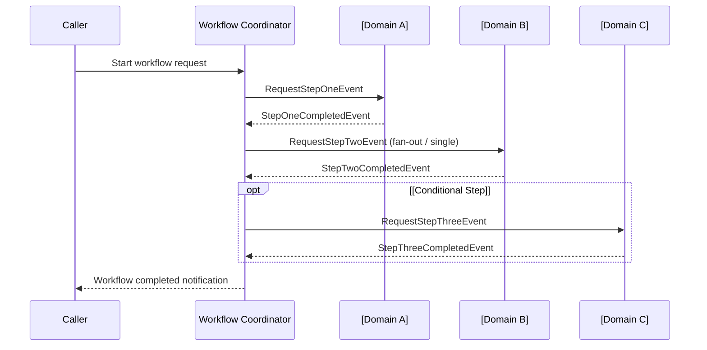
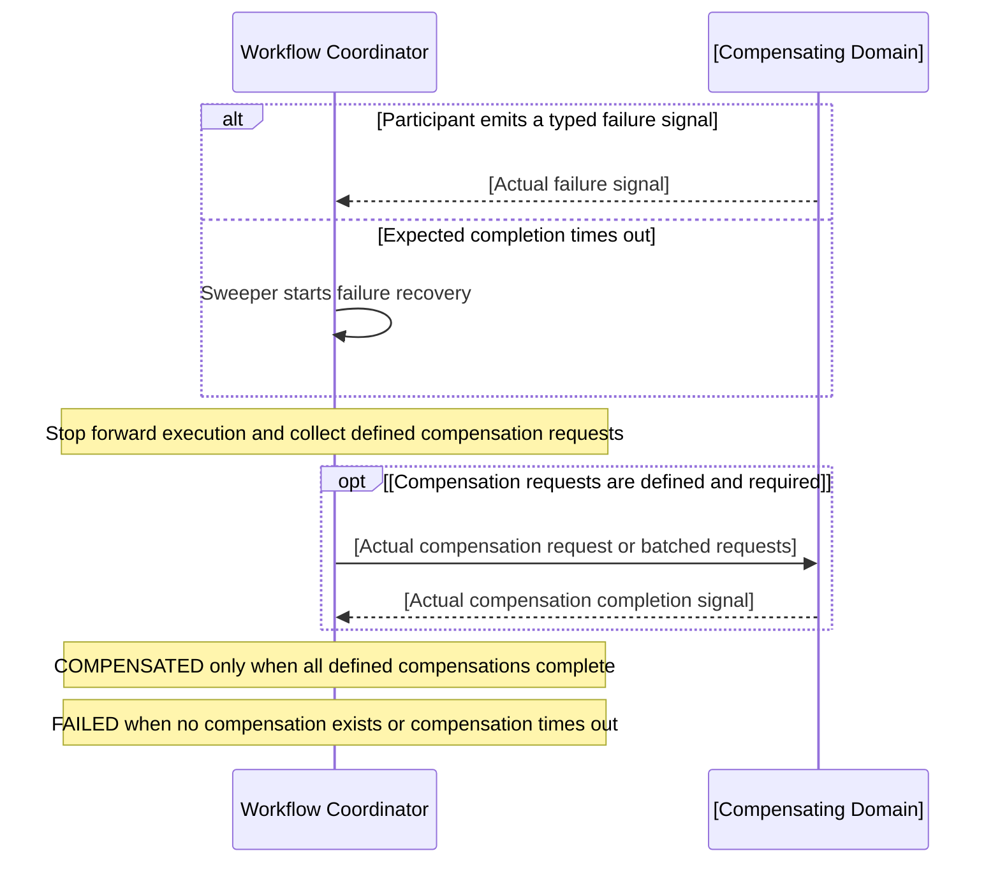

You are writing a Workflow Specification (Workflow Architecture Decision Record): a micro-architectural decision record defining an event-driven cross-domain business process, its orchestration, compensation, and failure recovery.

A Workflow Specification is an **Architecture Decision Record (ADR)**. It is NOT an implementation task tracker or class orchestration log.

Keep the document cohesive and answer four core questions:
1. What happens step by step across domain aggregates?
2. Which events move the workflow forward or report failure?
3. What is undone when the workflow fails?
4. How do participating domain aggregate states transition across the flow?

**Author rules:**
- Describe the business flow across bounded contexts, not workflow framework internals.
- List steps in exact execution order with precise step and event names.
- Keep each table cell to one clear sentence.
- In sequence diagrams and specifications, use participant roles and bounded contexts (e.g. `Workflow Coordinator`, `Catalog`, `Pricing`, `Inventory`), **never** framework class names (`*Service`, `*Handler`, `*Listener`) or Java types.
- List compensation undo actions in reverse execution order unless a specific business policy dictates otherwise.
- Explicitly state why any completed action is intentionally not compensated.
- Link participating Domain Decision Records instead of repeating domain model details.
- Replace every `[placeholder]` before publishing.

---

# Workflow Decision Record: [Workflow Display Name]

> **Purpose:** [The business outcome delivered when this cross-domain workflow completes.]
> **Starts When:** [API call, scheduled trigger, or upstream business event.]
> **Successful Result:** [State of the system and created/updated aggregates after all steps complete.]
> **Participating Domains:** [Catalog] · [Pricing] · [Inventory]
> **Related Domain Specs:**
> - [[Catalog Domain Spec]](../domain/catalog/architecture/product-domain-spec.md)
> - [[Pricing Domain Spec]](../domain/pricing/architecture/pricing-domain-spec.md)
> - [[Inventory Domain Spec]](../domain/inventory/architecture/inventory-item-domain-spec.md)

---

## 1. Step-by-Step Execution Path

### Normal Path (Happy Path)

| # | Step Name | Owner Domain | Business Action | Starts When | Complete When |
| :--- | :--- | :--- | :--- | :--- | :--- |
| **1** | `[step-one]` | [Domain A] | [Action performed on Aggregate A] | Workflow initiated | `[StepOneCompletedEvent]` received |
| **2** | `[step-two]` | [Domain B] | [Action performed on Aggregate B] | Step 1 completes | `[StepTwoCompletedEvent]` received |
| **3** | `[step-three]` | [Domain C] | [Action performed on Aggregate C] | Step 2 completes | `[StepThreeCompletedEvent]` received → Workflow completes |

### Special Flows & Edge Conditions

- **Parallel fan-out:** [Describe the actual fan-out and its completion condition, e.g. all requested lines acknowledged.]
- **Conditional / skipped steps:** [Describe when a step is intentionally bypassed, e.g. when no inventory lines are tracked.]

### Happy Path Flow

> Keep the diagram clean. Use participant roles and module names, not class names.

---

## 2. Events & Signals

### Request Events (Workflow → Domain)

| Event Name | Step | Dispatched To | Intent / Payload Summary |
| :--- | :--- | :--- | :--- |
| `[RequestStepOneEvent]` | `[step-one]` | [Domain A] | Requests creation or state mutation of [Aggregate A]. |
| `[RequestStepTwoEvent]` | `[step-two]` | [Domain B] | Requests creation or state mutation of [Aggregate B]. |

### Completion Events (Domain → Workflow)

| Event Name | Step | Emitted By | Meaning to Workflow |
| :--- | :--- | :--- | :--- |
| `[StepOneCompletedEvent]` | `[step-one]` | [Domain A] | Step 1 succeeded; advance workflow to step 2. |
| `[StepTwoCompletedEvent]` | `[step-two]` | [Domain B] | Step 2 succeeded; advance workflow to step 3. |

### Failure Events (Domain → Workflow)

| Event Name | Emitted By | Failure Cause | Resulting Workflow Action |
| :--- | :--- | :--- | :--- |
| `[StepFailedEvent]` | [Actual failure emitter] | [Observed failure cause] | [Describe current behavior: compensate if actions are defined, otherwise fail, or another implemented outcome.] |

---

## 3. Compensation & Failure Recovery

> **Starts When:** [Describe the actual trigger for failure handling, including failures before the first completed step.]

### Compensation Requests and Completion

Collect the compensations actually defined by the workflow, in reverse step-definition order. State whether requests are published together or dispatched sequentially, and whether acknowledgements gate later requests. Do not imply full rollback when only selected writes are compensated.

| Reverse step order | Completed action | Compensation action | Request event | Completion signal |
| :--- | :--- | :--- | :--- | :--- |
| [Actual reverse position] | [Action that completed] | [Undo action or "not compensated" with reason] | [Actual request event or N/A] | [Actual signal or N/A] |

### Explicitly Non-Compensated Actions

- **[Action / Resource]:** [State whether it remains applied, and the actual business or technical reason; avoid inventing a policy.]

### Failure Flow

---

## 4. Aggregate Cross-Lifecycle Matrix

| Workflow Stage | [Aggregate A] State | [Aggregate B] State | [Aggregate C] State |
| :--- | :--- | :--- | :--- |
| **Initial Start** | Non-existent | Non-existent | Non-existent |
| **After Step 1** | `CREATED / DRAFT` | Non-existent | Non-existent |
| **After Step 2** | `CREATED / DRAFT` | `ACTIVE / ASSIGNED` | Non-existent |
| **Workflow Completed** | [Actual aggregate state] | [Actual aggregate state] | [Actual aggregate state] |
| **After compensation** | [Actual state, including retained partial changes] | [Actual state] | [Actual state] |
