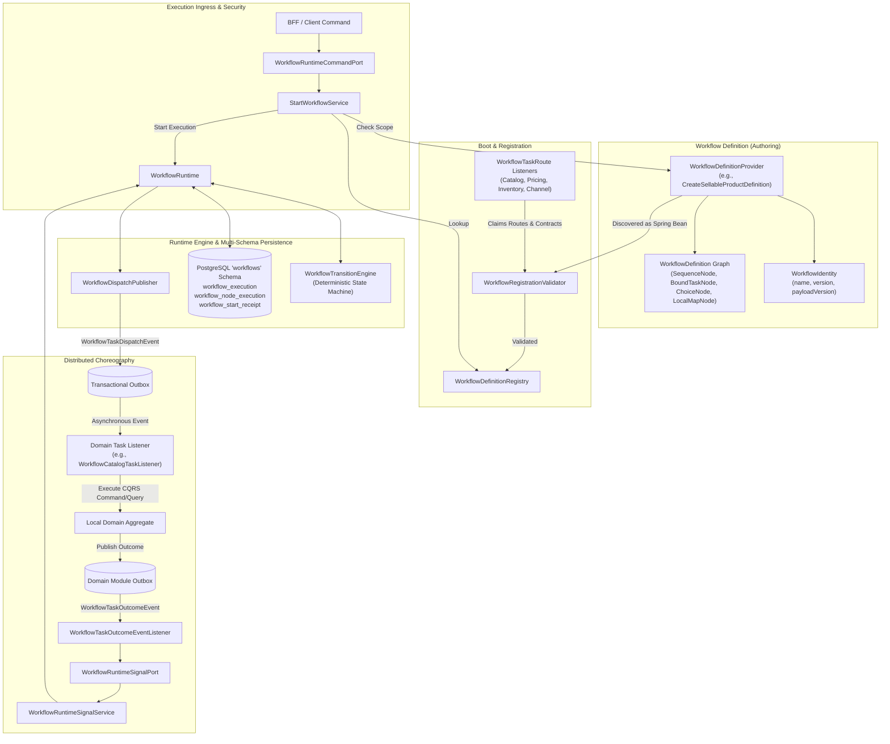
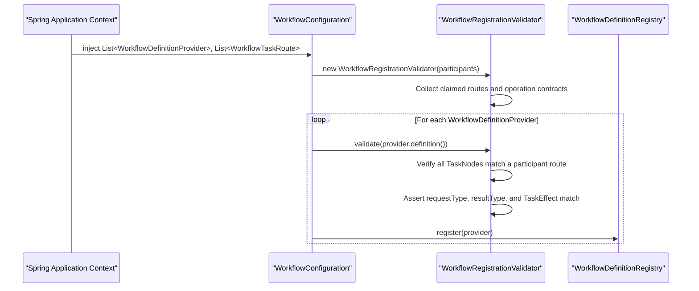
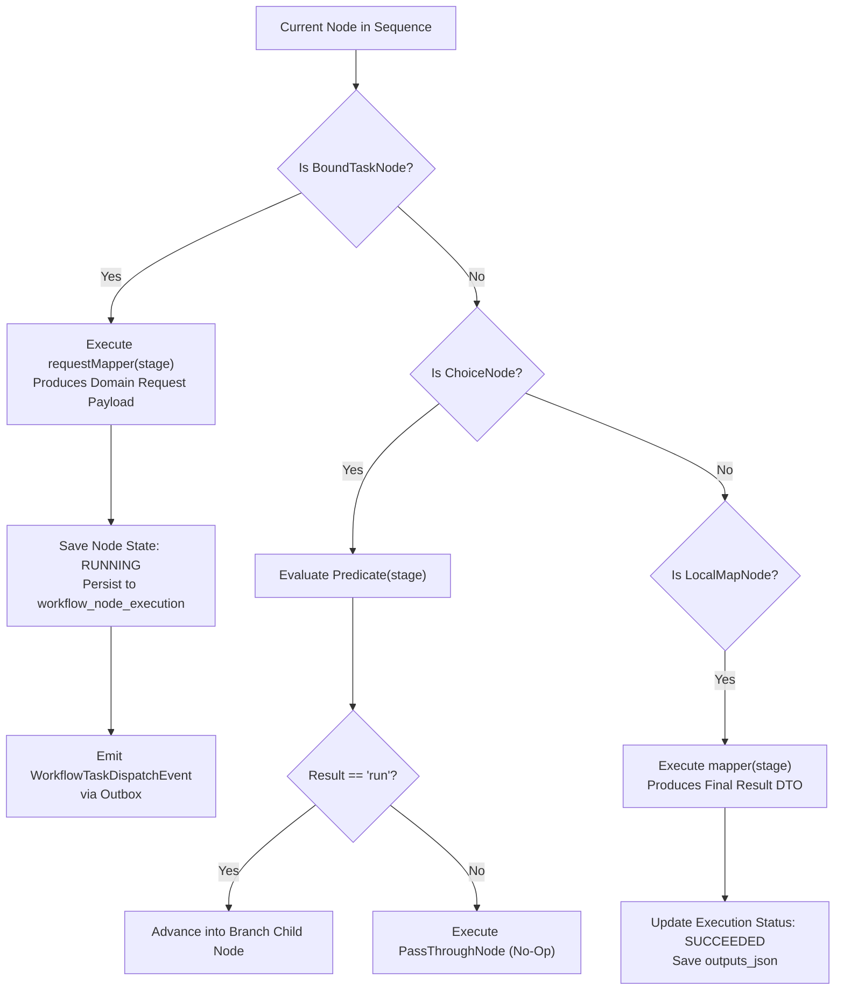

# Workflow Definition Structure & Runtime Component Architecture

> **Module Scope**: `framework` (Workflow DSL, Graph Models & Transition Engine), `app/workflow` (Headless Workflow Runtime, Definitions & CQRS Buses), and `workflow-infrastructure` (Persistence, Receipts & Timers)  
> **Target Audience**: Backend Engineers, Distributed Systems Architects, and Module Owners  
> **Reference File**: [workflow-definition-structure.md](file:///Users/khinemyaezin/Repository/grab-ecommerce/grab/docs/workflow-definition-structure.md)  

---

## 1. Executive Summary

In Grab E-Commerce, long-running business processes—such as creating sellable products, updating catalog variants, and synchronizing inventory across channels—span multiple autonomous service groups (`catalog`, `inventory`, `pricing`, `saleschannel`). Each service group maintains schema isolation with dedicated PostgreSQL connection pools; distributed 2PC/XA transactions are strictly forbidden.

Cross-domain orchestration is executed by the **Durable Workflow Runtime**. The core of this model is the **Workflow Definition**: a declarative, immutable directed acyclic graph (DAG) specifying:
1. **Execution Steps**: Sequenced task operations mapped to external domain participants.
2. **Data Flow**: An immutable stage record accumulator evolving from input to terminal result.
3. **Branching Logic**: Deterministic predicates selecting alternative paths (`"run"` vs `"skip"`).
4. **Resilience & Compensation**: Timeout constraints, retry policies, and automated rollback actions.

This document details the internal structure of workflow definitions and describes how internal runtime components interpret, execute, validate, and persist them.

---

## 2. High-Level Architecture & Interaction Topology



---

## 3. Workflow Definition Structure

Workflow definitions are declared as `@Component` beans implementing [`WorkflowDefinitionProvider<I, O>`](file:///Users/khinemyaezin/Repository/grab-ecommerce/grab/framework/src/main/java/com/grab/framework/workflow/WorkflowDefinitionProvider.java#L3-L10).

### 3.1 The Provider Contract

```java
public interface WorkflowDefinitionProvider<I, O> {
    WorkflowIdentity identity();
    WorkflowDefinition<I, O> definition();
    void validateStart(String callerScope, I input);
}
```

* **`identity()`**: Supplies the triple `(name, definitionVersion, payloadVersion)`. The runtime pins executions to this exact identity.
* **`definition()`**: Produces the compiled, immutable graph ([`WorkflowDefinition<I, O>`](file:///Users/khinemyaezin/Repository/grab-ecommerce/grab/framework/src/main/java/com/grab/framework/workflow/WorkflowDefinition.java)).
* **`validateStart(callerScope, input)`**: Implements tenant and security boundaries (e.g. verifying `input.merchantId()` matches the authenticated `callerScope`).

### 3.2 The Graph Hierarchy & Node Kinds

The runtime represents a workflow as a tree of [`WorkflowNode`](file:///Users/khinemyaezin/Repository/grab-ecommerce/grab/framework/src/main/java/com/grab/framework/workflow/WorkflowNode.java) instances:

```
WorkflowDefinition<I, O>
 └── root: SequenceNode
      ├── BoundTaskNode (Step 1)
      │    ├── TaskNode (Remote Contract)
      │    ├── requestMapper: S -> Q
      │    └── resultCombiner: (S, R) -> S'
      ├── ChoiceNode (Step 2: Conditional Branch)
      │    ├── branches: {"run" -> BoundTaskNode, "skip" -> PassThroughNode}
      │    └── selector: S -> "run" | "skip"
      └── LocalMapNode (Step 3: Terminal Projection)
           └── mapper: S_final -> O
```

#### Node Kinds and Functions

| Node Class | Node Kind | Description | Execution Location |
| :--- | :--- | :--- | :--- |
| **[`SequenceNode`](file:///Users/khinemyaezin/Repository/grab-ecommerce/grab/framework/src/main/java/com/grab/framework/workflow/SequenceNode.java)** | `SEQUENCE` | Executes child steps strictly sequentially. Fails or triggers compensation if any child fails. | In-Process Engine |
| **[`BoundTaskNode<S, Q, R, T>`](file:///Users/khinemyaezin/Repository/grab-ecommerce/grab/framework/src/main/java/com/grab/framework/workflow/BoundTaskNode.java)** | `BOUND_TASK` | Encapsulates external task interaction. Transforms internal stage `S` into request `Q`, dispatches inner `TaskNode`, and combines result `R` back into `T`. | Hybrid (Maps locally, dispatches remotely) |
| **[`TaskNode<Q, R>`](file:///Users/khinemyaezin/Repository/grab-ecommerce/grab/framework/src/main/java/com/grab/framework/workflow/TaskNode.java)** | `TASK` | Remote contract holder: operation name (e.g. `catalog.create-product-set`), timeout duration, retry policy, task effect (`MUTATING` or `READ_ONLY`), and optional `CompensationDefinition`. | Remote Participant via Outbox |
| **[`ChoiceNode<S>`](file:///Users/khinemyaezin/Repository/grab-ecommerce/grab/framework/src/main/java/com/grab/framework/workflow/ChoiceNode.java)** | `CHOICE` | Evaluates a predicate against the stage to select a child branch (e.g., `"run"` vs `"skip"`). | In-Process Engine |
| **[`LocalMapNode<I, O>`](file:///Users/khinemyaezin/Repository/grab-ecommerce/grab/framework/src/main/java/com/grab/framework/workflow/LocalMapNode.java)** | `LOCAL_MAP` | Deterministic, synchronous state transformation (e.g. mapping the final accumulated stage to the public result DTO). | In-Process Engine |
| **[`PassThroughNode<T>`](file:///Users/khinemyaezin/Repository/grab-ecommerce/grab/framework/src/main/java/com/grab/framework/workflow/PassThroughNode.java)** | `PASS_THROUGH` | No-op node that forwards input unmodified to output; used by skipped branches. | In-Process Engine |

### 3.3 The Stage Accumulator Pattern

Workflows in this platform do not pass raw untyped dictionaries between steps. Instead, they use strongly typed, immutable Java records:

```java
// 1. Inbound Request
public record CreateSellableProductInput(Id merchantId, Id actorId, String name, ...) {}

// 2. Mutable State Stage (evolves across steps)
public record CreateSellableProductStage(
    CreateSellableProductInput request,
    Id productId,
    List<VariantInput> resolvedVariants,
    List<Id> priceSetIds,
    List<Id> inventoryItemIds,
    List<PublicationInput> publishedTargets
) {
    public CreateSellableProductStage withPriceSetIds(List<Id> newPriceSetIds) {
        return new CreateSellableProductStage(request, productId, resolvedVariants, newPriceSetIds, inventoryItemIds, publishedTargets);
    }
}

// 3. Final Result DTO
public record CreateSellableProductResult(Id productId, List<VariantInput> variants, ...) {}
```

---

## 4. How Definitions Use Workflow Internal Components

Workflow definitions are declarative representations. The runtime components coordinate their execution across state transitions and transactional outboxes.

### 4.1 Startup Verification & Route Matching

During application startup, [`WorkflowConfiguration`](file:///Users/khinemyaezin/Repository/grab-ecommerce/grab/app/src/main/java/com/grab/app/workflow/internal/config/WorkflowConfiguration.java#L26-L41) passes all discovered definitions and participants into [`WorkflowRegistrationValidator`](file:///Users/khinemyaezin/Repository/grab-ecommerce/grab/app/src/main/java/com/grab/app/workflow/internal/config/WorkflowRegistrationValidator.java#L22-L74):



If a definition references an operation not backed by an active listener, or if request/response types diverge, the validator throws `IllegalStateException` to fail fast during deployment.

### 4.2 Inbound Execution Start & Idempotency

When a client initiates a workflow via [`StartWorkflowService`](file:///Users/khinemyaezin/Repository/grab-ecommerce/grab/app/src/main/java/com/grab/app/workflow/internal/service/StartWorkflowService.java#L46-L73):

1. **Definition Retrieval**: Fetches the compiled definition from [`WorkflowDefinitionRegistry`](file:///Users/khinemyaezin/Repository/grab-ecommerce/grab/framework/src/main/java/com/grab/framework/workflow/WorkflowDefinitionRegistry.java#L16-L45) by name and version.
2. **Serialization & Scope Validation**: Uses `WorkflowPayloadCodec` to deserialize the input and invokes `provider.validateStart(callerScope, input)`.
3. **Execution Claim**: [`WorkflowRuntime`](file:///Users/khinemyaezin/Repository/grab-ecommerce/grab/framework/src/main/java/com/grab/framework/workflow/WorkflowRuntime.java) calculates a SHA-256 fingerprint of `(callerScope, idempotencyKey, inputJson)` and inserts into `workflow_start_receipt`. If an identical request arrives, the existing execution ID is returned without duplicate processing.
4. **Initial State Creation**: Persists the execution record into `workflows.workflow_execution` with initial status `RUNNING`.

### 4.3 Deterministic Engine Progression

The state machine is driven by [`WorkflowTransitionEngine`](file:///Users/khinemyaezin/Repository/grab-ecommerce/grab/framework/src/main/java/com/grab/framework/workflow/WorkflowTransitionEngine.java):



#### Handling of Local vs Remote Nodes
* **Local Nodes (`LocalMapNode`, `ChoiceNode`, `PassThroughNode`)**: Executed synchronously in memory within the current transaction. They require zero database dispatches or network roundtrips.
* **Remote Nodes (`BoundTaskNode`)**: The engine calls `requestMapper(stage)`, saves the node state as `RUNNING` in `workflow_node_execution`, and triggers `WorkflowDispatchPublisher`.

### 4.4 Task Dispatch & Transactional Outbox

When a `BoundTaskNode` runs, [`WorkflowDispatchPublisher`](file:///Users/khinemyaezin/Repository/grab-ecommerce/grab/framework/src/main/java/com/grab/framework/workflow/WorkflowDispatchPublisher.java) produces a [`WorkflowTaskDispatchEvent`](file:///Users/khinemyaezin/Repository/grab-ecommerce/grab/framework/src/main/java/com/grab/framework/workflow/WorkflowTaskDispatchEvent.java):

```java
public record WorkflowTaskDispatchEvent(
    String messageId,
    String executionId,
    String nodeId,
    String logicalOperationId,
    String attemptId,
    int attempt,
    WorkflowPhase phase,
    String definitionName,
    int definitionVersion,
    int payloadVersion,
    String operation,
    String input,
    String callerScope,
    Instant scheduledAt
) implements Event {}
```

This event is written to `workflows.outbox` in the same database transaction that updates `workflow_node_execution`. The Outbox Poller / Hot-Queue Relay asynchronously routes the event to registered listeners.

### 4.5 Task Outcome Signaling & Stage Evolution

When the external module completes its work:

1. **Outcome Delivery**: The participant emits [`WorkflowTaskOutcomeEvent`](file:///Users/khinemyaezin/Repository/grab-ecommerce/grab/framework/src/main/java/com/grab/framework/workflow/WorkflowTaskOutcomeEvent.java).
2. **Adapter Ingress**: [`WorkflowTaskOutcomeEventListener`](file:///Users/khinemyaezin/Repository/grab-ecommerce/grab/app/src/main/java/com/grab/app/workflow/internal/adapter/inbound/event/WorkflowTaskOutcomeEventListener.java#L20-L40) forwards the message to `WorkflowRuntimeSignalPort`.
3. **Signal Verification**: [`WorkflowRuntimeSignalService`](file:///Users/khinemyaezin/Repository/grab-ecommerce/grab/app/src/main/java/com/grab/app/workflow/internal/service/WorkflowRuntimeSignalService.java#L51-L76) validates that the caller scope and `payloadVersion` match the execution.
4. **State Transition**: `WorkflowRuntime` invokes `WorkflowTransitionEngine.applySignal(state, signal)`:
   - Matches the signal's `nodeId` to the active `BoundTaskNode`.
   - Deserializes the participant result.
   - Invokes the definition's **`resultCombiner(stage, result)`**, creating an updated stage instance.
   - Marks the node `SUCCEEDED` in `workflow_node_execution`.
   - Transitions to the next node in the root sequence.

---

## 5. Concrete Code Walkthrough: `CreateSellableProductDefinition`

Below is an annotated walk-through of [CreateSellableProductDefinition.java](file:///Users/khinemyaezin/Repository/grab-ecommerce/grab/app/src/main/java/com/grab/app/workflow/internal/definition/CreateSellableProductDefinition.java#L33-L95):

```java
@Component
public final class CreateSellableProductDefinition 
        implements WorkflowDefinitionProvider<CreateSellableProductInput, CreateSellableProductResult> {

    // 1. Identity declaration
    private static final WorkflowIdentity IDENTITY =
            new WorkflowIdentity(SellableProductWorkflowDefinitions.CREATE_SELLABLE_PRODUCT, 2, 2);

    private final WorkflowDefinition<CreateSellableProductInput, CreateSellableProductResult> definition = build();

    @Override
    public WorkflowIdentity identity() { return IDENTITY; }

    @Override
    public WorkflowDefinition<CreateSellableProductInput, CreateSellableProductResult> definition() { return definition; }

    // 2. Caller scope boundary validation
    @Override
    public void validateStart(String callerScope, CreateSellableProductInput input) {
        SellableTaskInputs.requireScope(callerScope, input.merchantId());
    }

    private static WorkflowDefinition<CreateSellableProductInput, CreateSellableProductResult> build() {
        // 3. Step 1: Bound Task Node (Catalog Product Creation)
        WorkflowStep<CreateSellableProductInput, CreateSellableProductStage> product = bind(
                "write-product", CreateSellableProductInput.class, CreateSellableProductStage.class,
                CatalogWorkflowOperations.CREATE_PRODUCT,
                CreateSellableProductDefinition::productRequest,           // Request Mapper
                (input, result) -> {                                      // Result Combiner
                    List<VariantInput> variants = SellableTaskInputs.resolvedVariants(result.variants());
                    return new CreateSellableProductStage(input, result.productId(), variants, List.of(), List.of(), List.of());
                });

        // 4. Step 2: Conditional Bound Task Node (Media Replacement)
        WorkflowStep<CreateSellableProductStage, CreateSellableProductStage> media = bind(
                "replace-media", CreateSellableProductStage.class, CreateSellableProductStage.class,
                CatalogWorkflowOperations.REPLACE_MEDIA,
                CreateSellableProductDefinition::mediaRequest,
                (stage, result) -> stage);
        WorkflowStep<CreateSellableProductStage, CreateSellableProductStage> optionalMedia =
                when("media-choice", CreateSellableProductDefinition::hasMedia, media);

        // 5. Terminal Step: Local Map Node (Stage -> Output Result)
        WorkflowStep<CreateSellableProductStage, CreateSellableProductResult> result = map(
                "result", CreateSellableProductStage.class, CreateSellableProductResult.class,
                CreateSellableProductDefinition::result);

        // 6. Assembly into Flow
        WorkflowFlow<CreateSellableProductInput, CreateSellableProductInput> start = flow(CreateSellableProductInput.class);
        WorkflowFlow<CreateSellableProductInput, CreateSellableProductResult> steps = start
                .then(product)
                .then(optionalMedia)
                // ... remaining steps (descriptions, prices, inventory, publication)
                .then(result);

        return steps.build(IDENTITY, "create-sellable-product-root");
    }
}
```

---

## 6. Architectural Invariants & Rules

1. **Pure Data Mapping**: Mappers (`requestMapper`, `resultCombiner`, and `mapper`) must be pure, deterministic functions without side effects, network calls, or database lookups.
2. **No Domain/JPA Leakage**: Workflow definitions must only reference Java records (`dto`, `payload`, `contract`). They must never import JPA entities, repositories, or domain aggregates.
3. **Immutability of Pinned Versions**: Once a workflow version (e.g. `definitionVersion = 2`) is in flight, its graph structure and contract payload cannot be modified. Any graph or schema alterations require incrementing `definitionVersion` or `payloadVersion`.
4. **Scope Partitioning**: Every workflow definition must enforce `validateStart(callerScope, input)` to guarantee multi-tenant boundary isolation.
5. **Universal Port Isolation**: Inbound workflow execution is accessible only via `WorkflowRuntimeCommandPort`, `WorkflowRuntimeQueryPort`, and `WorkflowRuntimeSignalPort`. Direct calls to internal services or buses from external modules are strictly prohibited.
