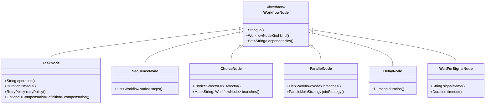
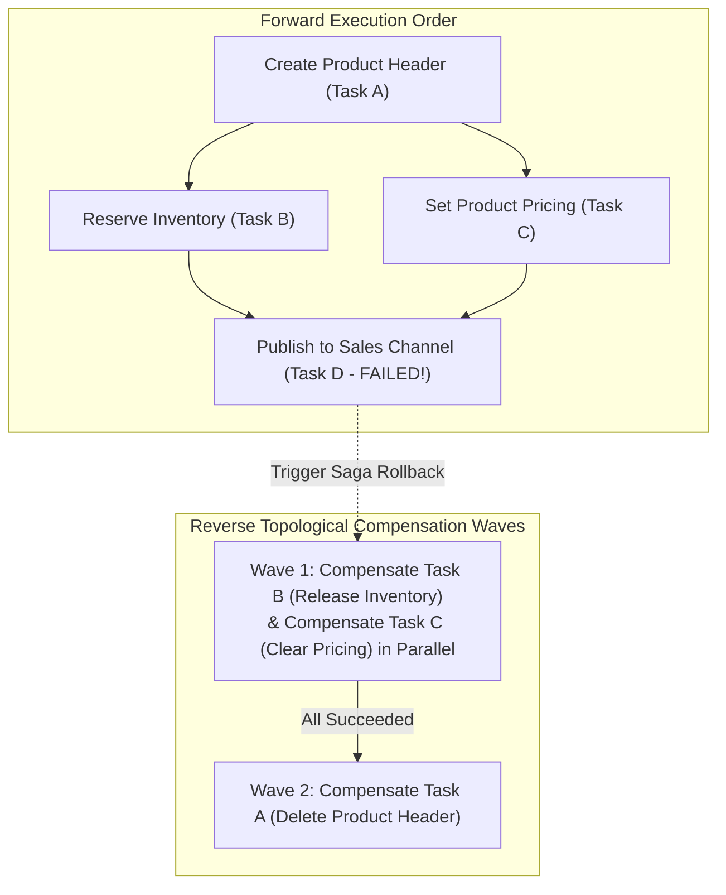
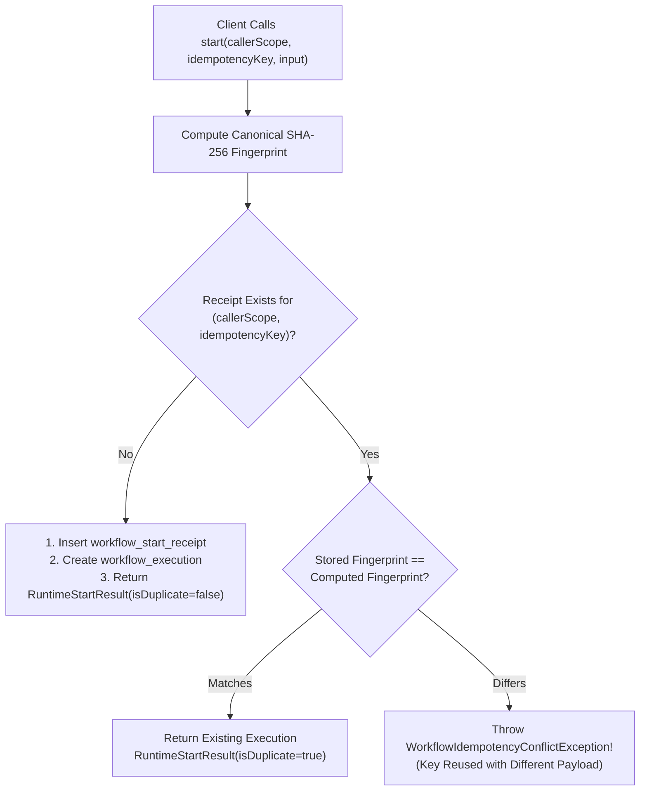
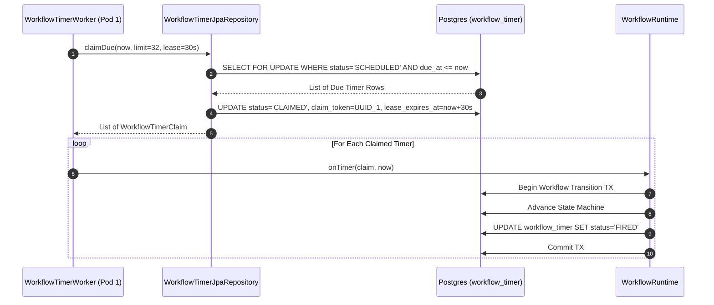
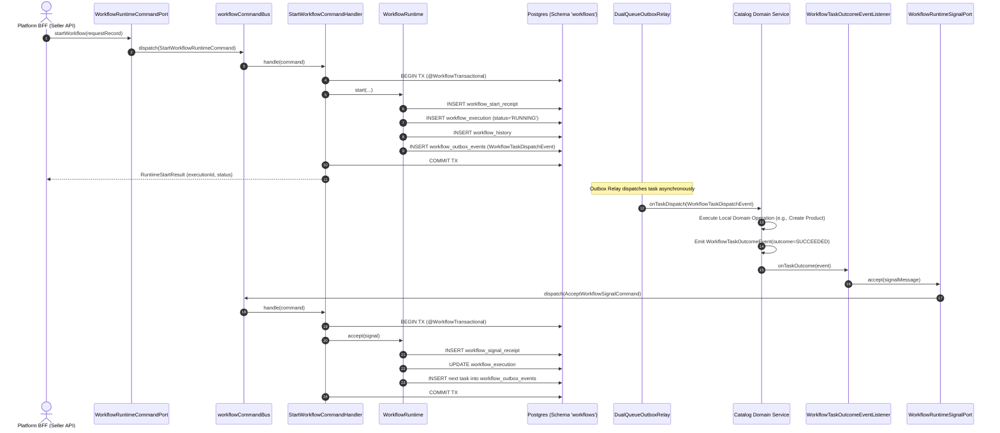

# Technical Documentation: Durable Workflow Orchestration & Distributed Saga Runtime

> **Module Scope**: `framework` (Workflow DSL & Deterministic Engine), `workflow-infrastructure` (PostgreSQL Persistence & Timers), and `app/workflow` (Headless Runtime, Universal Port Protocol, and CQRS Buses)  
> **Target Audience**: Backend Engineers, Distributed Systems Architects, and Operational Reviewers  
> **Status**: Production Reference Implementation  

---

## 1. Architectural Overview & Business Motivation

Modern e-commerce operations—such as multi-channel product publishing, order placement, inventory reservation, and payment capture—naturally span multiple autonomous business domains (`catalog`, `inventory`, `pricing`, `saleschannel`, and `order`). 

Under the platform's modular architecture, each domain operates with a dedicated database schema and isolated connection pool. Distributed two-phase commit (2PC/XA) transactions are strictly prohibited to protect database availability, prevent distributed locks, and eliminate cascading connection pool starvation.

The **Durable Workflow Orchestration Runtime** provides an event-driven, deterministic Saga framework that coordinates multi-step business transactions across isolated schemas. It guarantees:
1. **At-Least-Once Task Execution**: All task dispatches are committed atomically into the Transactional Outbox alongside workflow state transitions.
2. **Deterministic State Progression**: A pure, side-effect-free state machine driven by an explicit clock ensures reproducible execution and auditability.
3. **Automated Reverse-Dependency Compensation**: If a task fails and retries are exhausted, the runtime computes a reverse topological DAG of completed tasks and rolls them back in dependency order.
4. **Cryptographic Idempotency Receipts**: Canonical SHA-256 fingerprinting on start requests and incoming signals prevents duplicate executions and rejects payload tampering under network retries.
5. **Headless Tier-2 Communication Protocol**: Headless domain core exposing typed Java port interfaces (`WorkflowRuntimeCommandPort`, `WorkflowRuntimeQueryPort`, `WorkflowRuntimeSignalPort`, `WorkflowTimerProcessingPort`) with nested records, delegating to group-scoped CQRS buses without web controller entanglement.

---

### 1.1 High-Level Component & Saga Choreography Topology

The diagram below illustrates how client ingress, headless universal ports, the deterministic transition engine, persistence stores, the transactional outbox, and participating domain services interact.

```mermaid
flowchart TD
    subgraph ClientAndBFF["Platform BFF Boundary (Web & Client Ingress)"]
        Client["Seller / Marketplace Client"] --> BFF["Platform BFF Controller\n(e.g., SellerProductPublishController)"]
        BFF -->|Universal Port Call\n(Typed Java Record)| CommandPort["WorkflowRuntimeCommandPort"]
        BFF -->|Query Port Call| QueryPort["WorkflowRuntimeQueryPort"]
    end

    subgraph HeadlessWorkflowCore["Headless Workflow Runtime (com.grab.app.workflow)"]
        CommandPort --> CommandAdapter["WorkflowRuntimeCommandPortAdapter"]
        CommandAdapter -->|Dispatch Command| Bus["workflowCommandBus\n(Group-Scoped CQRS Bus)"]
        Bus --> Handler["StartWorkflowRuntimeCommandHandler\n(@WorkflowTransactional)"]
        
        Handler --> Coordinator["WorkflowRuntime (Coordinator)"]
        Coordinator <--> Registry["WorkflowDefinitionRegistry\n(Immutable Validated DAGs)"]
        Coordinator <--> Engine["WorkflowTransitionEngine\n(Pure State Machine + Explicit Clock)"]
        Coordinator <--> Fingerprint["WorkflowFingerprint\n(SHA-256 Digest Generator)"]
    end

    subgraph PersistenceLayer["Workflow Multi-Schema Persistence ('workflows' Schema)"]
        Coordinator --> JpaStore["JpaWorkflowExecutionStore"]
        Coordinator --> StartReceiptStore["JpaWorkflowStartReceiptStore"]
        Coordinator --> SignalReceiptStore["JpaWorkflowSignalReceiptStore"]
        Coordinator --> HistoryStore["JpaWorkflowHistoryStore"]
        Coordinator --> TimerStore["JpaWorkflowTimerScheduler"]
        
        JpaStore <--> ExecutionTable[("workflows.workflow_execution\nworkflow_node_execution")]
        StartReceiptStore <--> StartReceiptTable[("workflows.workflow_start_receipt")]
        SignalReceiptStore <--> SignalReceiptTable[("workflows.workflow_signal_receipt")]
        HistoryStore <--> HistoryTable[("workflows.workflow_history")]
        TimerStore <--> TimerTable[("workflows.workflow_timer\n(Pessimistic Leases)")]
    end

    subgraph OutboxMessaging["Transactional Outbox & Event Choreography"]
        Coordinator --> DispatchPub["OutboxWorkflowDispatchPublisher"]
        DispatchPub -->|Atomic Outbox Insert| OutboxTable[("workflows.workflow_outbox_events")]
        OutboxTable -.->|Outbox Relay Dispatch| OutboxEvent["WorkflowTaskDispatchEvent"]
    end

    subgraph DomainParticipants["Participating Autonomous Domains"]
        OutboxEvent -->|@EventListener| DomainListener["Domain Task Consumer\n(e.g., Catalog, Inventory)"]
        DomainListener -->|Local Schema TX| DomainDB[("Domain Schema\n(catalog, inventory)")]
        DomainListener -->|Emit Outcome Event| OutcomeEvent["WorkflowTaskOutcomeEvent"]
    end

    subgraph SignalFeedback["Signal Feedback Loop"]
        OutcomeEvent -->|@EventListener| OutcomeListener["WorkflowTaskOutcomeEventListener"]
        OutcomeListener --> SignalPort["WorkflowRuntimeSignalPort"]
        SignalPort --> SignalAdapter["WorkflowRuntimeSignalPortAdapter"]
        SignalAdapter --> Bus
        Bus --> SignalHandler["AcceptWorkflowSignalCommandHandler\n(@WorkflowTransactional)"]
        SignalHandler --> Coordinator
    end

    subgraph TimerWorkerSubsystem["Scheduled Timer Poller"]
        TimerWorker["WorkflowTimerWorker\n(@Scheduled Class A Worker)"] --> TimerPort["WorkflowTimerProcessingPort"]
        TimerPort --> TimerStore
    end
```

---

## 2. Pure Java Workflow DSL & Deterministic State Machine (`framework`)

The core workflow engine resides in `framework/src/main/java/com/grab/framework/workflow` and is strictly **framework-agnostic**. It contains zero dependencies on Spring, Jakarta Persistence, Hibernate, or Jackson (verified by ArchUnit in [`WorkflowArchitectureTest`](file:///Users/khinemyaezin/Repository/grab-ecommerce/grab/app/src/test/java/com/grab/app/workflow/WorkflowArchitectureTest.java)).

```
framework/src/main/java/com/grab/framework/workflow/
├── WorkflowDefinition.java             # Immutable definition graph
├── WorkflowDefinitionKey.java          # (name, version) identifier
├── WorkflowDefinitionRegistry.java     # Registry of validated definitions
├── WorkflowDsl.java                    # Fluent builder DSL
├── WorkflowNode.java                   # Base node contract
├── WorkflowNodeKind.java               # TASK, SEQUENCE, CHOICE, PARALLEL, DELAY, WAIT_FOR_SIGNAL
├── TaskNode.java                       # External task node with timeout & retry
├── SequenceNode.java                   # Linear sequential branch
├── ChoiceNode.java                     # Dynamic branching selector
├── ParallelNode.java                   # Concurrent fork-join branches
├── DelayNode.java                      # Durable timer node
├── WaitForSignalNode.java              # External correlation wait node
├── CompensationDefinition.java         # Rollback action definition
├── CompensationAction.java             # Executable rollback intent
├── CompensationPlanner.java            # Reverse topological compensation planner
├── CompensationPlan.java               # Ordered compensation waves
├── ExecutionStatus.java                # Overall workflow state enum
├── NodeExecutionStatus.java            # Individual node state enum
├── WorkflowExecutionState.java         # Complete immutable execution state snapshot
├── WorkflowTransition.java             # Transition output (state + dispatches + timers)
├── WorkflowTransitionEngine.java       # Pure deterministic state machine
├── WorkflowRuntime.java                # Core coordinator connecting stores & engine
├── WorkflowFingerprint.java            # SHA-256 payload canonical hashing contract
├── WorkflowStartReceipt.java           # Start idempotency receipt model
└── WorkflowSignalReceipt.java          # Signal idempotency receipt model
```

---

### 2.1 The Workflow Definition Graph & Node Kinds

Workflows are modeled as immutable directed acyclic graphs (DAGs) defined using [`WorkflowDsl`](file:///Users/khinemyaezin/Repository/grab-ecommerce/grab/framework/src/main/java/com/grab/framework/workflow/WorkflowDsl.java). Every graph is validated during registration:
- **No Duplicate IDs**: Every node across all branches must have a unique identifier.
- **Reachability Validation**: All declared nodes must be reachable from the root.
- **Output Matching**: Choice branches must return compatible types for downstream consumption.
- **No Compensation Cycles**: Dependencies declared in compensation definitions must be acyclic.



---

### 2.2 The Deterministic Transition Engine (`WorkflowTransitionEngine`)

The [`WorkflowTransitionEngine`](file:///Users/khinemyaezin/Repository/grab-ecommerce/grab/framework/src/main/java/com/grab/framework/workflow/WorkflowTransitionEngine.java) is a pure, side-effect-free state machine. It evaluates state transitions based on an explicit mathematical relation:

$$S_{t+1},\, \mathcal{D},\, \mathcal{T} = \text{Transition}(S_t,\, \mathcal{E},\, \mathcal{G},\, \text{now})$$

Where:
- $S_t$: Current immutable [`WorkflowExecutionState`](file:///Users/khinemyaezin/Repository/grab-ecommerce/grab/framework/src/main/java/com/grab/framework/workflow/WorkflowExecutionState.java).
- $\mathcal{E}$: Trigger event (`START`, `SIGNAL`, `TIMER`, `CANCEL`, `RETRY`).
- $\mathcal{G}$: The immutable [`WorkflowDefinition`](file:///Users/khinemyaezin/Repository/grab-ecommerce/grab/framework/src/main/java/com/grab/framework/workflow/WorkflowDefinition.java).
- $\text{now}$: Explicit UTC `Instant` passed from the caller (never invoking `Instant.now()` internally).
- $\mathcal{D}$: Set of outgoing [`WorkflowDispatch`](file:///Users/khinemyaezin/Repository/grab-ecommerce/grab/framework/src/main/java/com/grab/framework/workflow/WorkflowDispatch.java) intents to be published to the outbox.
- $\mathcal{T}$: Set of [`WorkflowTimerIntent`](file:///Users/khinemyaezin/Repository/grab-ecommerce/grab/framework/src/main/java/com/grab/framework/workflow/WorkflowTimerIntent.java) intents to be scheduled.

#### Execution State Machine

```mermaid
stateDiagram-v2
    [*] --> RUNNING: Start Request (Valid Definition & Unique Receipt)
    
    state RUNNING {
        [*] --> Advancing
        Advancing --> ForwardDispatches: Task / Delay Dispatched
    }

    RUNNING --> WAITING: Awaiting External Signal or Timer
    WAITING --> RUNNING: Signal Received or Timer Expired
    
    WAITING --> NEEDS_ATTENTION: Fatal Error or Codec/Definition Unavailable
    NEEDS_ATTENTION --> RUNNING: Operator Retries Incident (retryIncident)

    RUNNING --> CANCEL_REQUESTED: Cooperative Cancellation Requested
    CANCEL_REQUESTED --> COMPENSATING: In-flight work completed; compensations needed
    CANCEL_REQUESTED --> CANCELLED: All active work halted without compensations
    
    RUNNING --> COMPENSATING: Task Failed & Retries Exhausted
    
    state COMPENSATING {
        [*] --> PlanningWaves: Reverse Topological Sort
        PlanningWaves --> ExecutingWave: Dispatch Compensation Tasks
        ExecutingWave --> PlanningWaves: Wave Succeeded -> Next Wave
    }

    COMPENSATING --> COMPENSATED: All Compensation Waves Succeeded
    COMPENSATING --> FAILED: Compensation Action Failed Permanently
    
    RUNNING --> COMPLETED: All Nodes Succeeded
    
    COMPLETED --> [*]
    COMPENSATED --> [*]
    CANCELLED --> [*]
    FAILED --> [*]
```



---

### 2.3 Automated Reverse-Dependency Compensation (`CompensationPlanner`)

When a step fails and its retries are exhausted, or when cooperative cancellation occurs after forward operations have succeeded, the runtime executes backward compensation.

Traditional sagas naively fire compensation actions in an unstructured batch, risking race conditions (e.g., trying to cancel a parent entity before its child items have been deleted).

[`CompensationPlanner`](file:///Users/khinemyaezin/Repository/grab-ecommerce/grab/framework/src/main/java/com/grab/framework/workflow/CompensationPlanner.java) computes a dependency-aware plan:
1. **Filter Completed Tasks**: Gathers all completed task nodes that declared a `CompensationDefinition`.
2. **Reverse Dependency Inversion**: If Task $B$ depends on Task $A$ in the forward flow, Task $B$ must be compensated *before* Task $A$ can be compensated.
3. **Topological Wave Partitioning**: Groups independent compensation actions into sequential **waves**. All actions within Wave $k$ can be dispatched concurrently; Wave $k+1$ begins only after all actions in Wave $k$ succeed.



---

## 3. Cryptographic Deduplication & Receipts Framework

In distributed systems, duplicate messages, network timeouts, and client retries are inevitable. The workflow runtime implements a zero-trust deduplication architecture using canonical SHA-256 digests.

---

### 3.1 Start Idempotency Receipts (`workflow_start_receipt`)

When an external client calls `WorkflowRuntime.start()`:
1. The input payload, definition name, version, and payload version are normalized into a canonical JSON representation and hashed using SHA-256 by [`JacksonWorkflowFingerprint`](file:///Users/khinemyaezin/Repository/grab-ecommerce/grab/workflow-infrastructure/src/main/java/com/grab/workflow/infrastructure/serialization/JacksonWorkflowFingerprint.java).
2. The runtime queries `workflow_start_receipt` by `(caller_scope, idempotency_key)`.
3. **Behavioral Decisions**:
   - **New Key**: Creates the receipt, initializes execution state, and returns `isDuplicate = false`.
   - **Identical Digest (Network Retry)**: The existing `execution_id` is looked up and returned with `isDuplicate = true`. No duplicate execution is started.
   - **Mismatched Digest (Key Collision / Tampering)**: The caller attempted to reuse an existing idempotency key with different payload parameters. The runtime throws [`WorkflowIdempotencyConflictException`](file:///Users/khinemyaezin/Repository/grab-ecommerce/grab/framework/src/main/java/com/grab/framework/workflow/WorkflowIdempotencyConflictException.java) and rejects the request.



---

### 3.2 Signal Correlation & Idempotency Receipts (`workflow_signal_receipt`)

Participating domain services report asynchronous task outcomes via [`WorkflowTaskOutcomeEvent`](file:///Users/khinemyaezin/Repository/grab-ecommerce/grab/framework/src/main/java/com/grab/framework/workflow/WorkflowTaskOutcomeEvent.java). These are ingested by `WorkflowRuntime.accept()`:

```sql
CREATE TABLE workflow_signal_receipt (
    transport_message_id     VARCHAR(256) NOT NULL PRIMARY KEY,
    execution_id             VARCHAR(64) NOT NULL,
    node_id                  VARCHAR(128) NOT NULL,
    logical_operation_id     VARCHAR(256) NOT NULL,
    attempt_id               VARCHAR(256) NOT NULL,
    attempt                  INTEGER NOT NULL,
    phase                    VARCHAR(32) NOT NULL,
    payload_fingerprint      VARCHAR(128) NOT NULL,
    outcome_fingerprint      VARCHAR(128) NOT NULL,
    fingerprint_version      INTEGER NOT NULL,
    payload_version          INTEGER NOT NULL,
    disposition              VARCHAR(32) NOT NULL,
    outcome                  VARCHAR(32) NOT NULL,
    received_at              TIMESTAMP(6) WITH TIME ZONE NOT NULL,
    processed_at             TIMESTAMP(6) WITH TIME ZONE,
    CONSTRAINT uq_workflow_signal_operation_fingerprint 
        UNIQUE (execution_id, logical_operation_id, payload_fingerprint)
);
```

1. **Transport Message Deduplication**:
   If the exact same `transport_message_id` arrives again, the receipt is found. If its payload fingerprint matches, it is marked `SignalDisposition.DUPLICATE` and returns immediately without re-transitioning the state machine. If the payload differs, it throws `WorkflowIdempotencyConflictException`.
2. **Logical Operation Deduplication**:
   If a network re-route assigns a different message ID but the operation `(execution_id, logical_operation_id, payload_fingerprint)` was already processed, it is safely identified as a duplicate.
3. **Payload Tamper Protection**:
   If the outcome or payload has been altered between retries, the unique index and fingerprint comparison prevent corrupt data from influencing workflow node outcomes.

---

## 4. Multi-Schema Relational Persistence (`workflow-infrastructure`)

Persistence is housed in `workflow-infrastructure` and targets the isolated PostgreSQL schema `workflows`. All queries strictly use Spring Data derived query methods or JPQL (no native SQL, complying with `AGENTS.md` Rule 11).

---

### 4.1 Relational Schema Architecture

```
workflows/ (Dedicated PostgreSQL Schema)
├── workflow_execution          # Root aggregate execution state & JSON snapshots
├── workflow_node_execution     # Individual step states, attempts & deadlines
├── workflow_start_receipt      # Client start idempotency records
├── workflow_signal_receipt     # Inbound message & outcome receipts
├── workflow_history            # Append-only sequential transition audit trail
├── workflow_timer              # Scheduled timers & pessimistic lease claims
└── workflow_outbox_events      # Transactional outbox table for task dispatches
```

```sql
CREATE TABLE workflow_execution (
    id                     VARCHAR(64) NOT NULL PRIMARY KEY,
    definition_name        VARCHAR(128) NOT NULL,
    definition_version     INTEGER NOT NULL,
    payload_version        INTEGER NOT NULL,
    caller_scope           VARCHAR(128) NOT NULL,
    status                 VARCHAR(32) NOT NULL,
    input_json             TEXT NOT NULL,
    result_json            TEXT,
    outputs_json           TEXT,
    choices_json           TEXT,
    accepted_signals_json  TEXT,
    error_message          TEXT,
    failure_reason         TEXT,
    cancellation_requested BOOLEAN NOT NULL,
    version                BIGINT NOT NULL,
    created_at             TIMESTAMP(6) WITH TIME ZONE NOT NULL,
    updated_at             TIMESTAMP(6) WITH TIME ZONE NOT NULL
);

CREATE TABLE workflow_node_execution (
    execution_id          VARCHAR(64) NOT NULL,
    node_id               VARCHAR(128) NOT NULL,
    branch_id             VARCHAR(128) NOT NULL,
    logical_operation_id  VARCHAR(256),
    attempt_id            VARCHAR(256),
    phase                 VARCHAR(32) NOT NULL,
    status                VARCHAR(32) NOT NULL,
    attempts              INTEGER NOT NULL,
    input_json            TEXT,
    output_json           TEXT,
    accepted_outcome_json TEXT,
    node_generation       BIGINT NOT NULL,
    error_message         TEXT,
    deadline_at           TIMESTAMP(6) WITH TIME ZONE,
    retry_at              TIMESTAMP(6) WITH TIME ZONE,
    PRIMARY KEY (execution_id, node_id),
    CONSTRAINT fk_node_execution FOREIGN KEY (execution_id) REFERENCES workflow_execution (id)
);
```

#### Snapshot Serialization ([`WorkflowSnapshotCodec`](file:///Users/khinemyaezin/Repository/grab-ecommerce/grab/workflow-infrastructure/src/main/java/com/grab/workflow/infrastructure/serialization/WorkflowSnapshotCodec.java))
Complex graph states—such as branch outputs, dynamic choice paths, and accepted signal maps—are serialized into typed JSON columns (`outputs_json`, `choices_json`, `accepted_signals_json`). When an execution is loaded for a new step, Jackson reconstructs the state snapshot with full type preservation.

---

### 4.2 Durable Timer Scheduling & Pessimistic Leases

Workflows support delays (`DelayNode`), operation execution deadlines, and retry backoff delays. These are persisted in `workflow_timer`:

```sql
CREATE TABLE workflow_timer (
    id                   BIGINT GENERATED BY DEFAULT AS IDENTITY PRIMARY KEY,
    execution_id         VARCHAR(64) NOT NULL,
    node_id              VARCHAR(128) NOT NULL,
    node_generation      BIGINT NOT NULL,
    logical_operation_id VARCHAR(256) NOT NULL,
    phase                VARCHAR(32) NOT NULL,
    purpose              VARCHAR(64) NOT NULL,
    due_at               TIMESTAMP(6) WITH TIME ZONE NOT NULL,
    status               VARCHAR(32) NOT NULL,
    claimed_at           TIMESTAMP(6) WITH TIME ZONE,
    claim_token          VARCHAR(128),
    lease_expires_at     TIMESTAMP(6) WITH TIME ZONE,
    CONSTRAINT uq_workflow_timer_generation 
        UNIQUE (execution_id, node_id, node_generation, purpose, phase),
    CONSTRAINT fk_workflow_timer_execution 
        FOREIGN KEY (execution_id) REFERENCES workflow_execution (id)
);

CREATE INDEX idx_workflow_timer_due ON workflow_timer (status, due_at);
CREATE INDEX idx_workflow_timer_claim_lease ON workflow_timer (status, lease_expires_at);
```

#### Pessimistic Row-Level Lease Claims
[`JpaWorkflowTimerScheduler`](file:///Users/khinemyaezin/Repository/grab-ecommerce/grab/workflow-infrastructure/src/main/java/com/grab/workflow/infrastructure/service/JpaWorkflowTimerScheduler.java) implements competing-worker lease claiming:

```java
// WorkflowTimerJpaRepository.java
@Lock(LockModeType.PESSIMISTIC_WRITE)
List<WorkflowTimerEntity> findByStatusAndDueAtLessThanEqualOrderByDueAtAsc(
        WorkflowTimerStatus status, Instant dueAt, Pageable pageable);

@Lock(LockModeType.PESSIMISTIC_WRITE)
List<WorkflowTimerEntity> findByStatusAndLeaseExpiresAtLessThanEqualOrderByDueAtAsc(
        WorkflowTimerStatus status, Instant leaseExpiresAt, Pageable pageable);
```

1. **Lease Acquisition**: Under `PESSIMISTIC_WRITE`, the scheduler fetches due timers (`status = SCHEDULED AND due_at <= now`).
2. **Token Stamping**: The worker assigns a fresh `claim_token = UUID.randomUUID().toString()`, sets `status = CLAIMED`, and sets `lease_expires_at = now + leaseDuration` (e.g., 30s).
3. **Crash Recovery**: If a worker pod crashes mid-processing, surviving worker nodes discover the expired lease (`status = CLAIMED AND lease_expires_at <= now`), re-claim the row with a new token, and safely advance the workflow.



---

## 5. Headless Application Core & Universal Port Protocol (`app/workflow`)

In accordance with `AGENTS.md` Rule 1, `com.grab.app.workflow` is a **strictly headless domain service**. It contains **zero Spring WebMvc annotations** (`@RestController`, `@RequestMapping`). All external interactions pass through the **Tier-2 Universal Java Port Protocol**.

---

### 5.1 Universal Port Interfaces & CQRS Wiring

The module exposes four public in-process Java interfaces under `com.grab.app.workflow.port.message`:

```
com.grab.app.workflow/
├── port/message/
│   ├── WorkflowRuntimeCommandPort.java     # startWorkflow, cancelWorkflow, retryIncident
│   ├── WorkflowRuntimeQueryPort.java       # getExecution, listNodes, listHistory, listIncidents
│   └── WorkflowRuntimeSignalPort.java      # accept
├── internal/
│   ├── port/inbound/
│   │   └── WorkflowTimerProcessingPort.java# claim, process
│   ├── adapter/inbound/
│   │   ├── message/                        # Inbound Message Adapters (Record <-> Command/Query)
│   │   │   ├── WorkflowRuntimeCommandPortAdapter.java
│   │   │   ├── WorkflowRuntimeQueryPortAdapter.java
│   │   │   ├── WorkflowRuntimeSignalPortAdapter.java
│   │   │   └── WorkflowTimerProcessingPortAdapter.java
│   │   └── event/                          # Inbound Domain Event Listeners
│   │       └── WorkflowTaskOutcomeEventListener.java
│   ├── command/
│   │   ├── handler/                        # CQRS Command Handlers (@WorkflowTransactional)
│   │   │   ├── StartWorkflowRuntimeCommandHandler.java
│   │   │   ├── CancelWorkflowRuntimeCommandHandler.java
│   │   │   ├── AcceptWorkflowSignalCommandHandler.java
│   │   │   └── RetryWorkflowIncidentCommandHandler.java
│   │   └── model/                          # Immutable Command Records
│   ├── query/
│   │   ├── handler/                        # CQRS Query Handlers (@WorkflowReadTransactional)
│   │   │   ├── GetWorkflowRuntimeExecutionQueryHandler.java
│   │   │   ├── ListWorkflowRuntimeNodesQueryHandler.java
│   │   │   ├── ListWorkflowRuntimeHistoryQueryHandler.java
│   │   │   └── ListWorkflowRuntimeIncidentsQueryHandler.java
│   │   └── model/                          # Immutable Query Records
│   ├── service/                            # Internal Orchestration Services
│   └── config/
│       ├── WorkflowConfiguration.java      # Spring Bean definitions
│       ├── WorkflowBusConfig.java          # Scoped workflowCommandBus & workflowQueryBus
│       ├── WorkflowDataSourceConfig.java   # Dedicated HikariCP & Postgres schema
│       └── WorkflowTransactional.java      # Scoped transaction demarcation
```

#### Strict CQRS Bus Isolation
- **`workflowCommandBus`**: Dispatches write commands exclusively. Inbound command adapters and write services inject this bus. It **never** dispatches queries.
- **`workflowQueryBus`**: Dispatches read queries exclusively. Inbound query adapters and query services inject this bus. It **never** mutates state.
- Handlers are marked with `@WorkflowTransactional` (writes) or `@WorkflowReadTransactional` (reads), referencing `workflowTransactionManager`.

---

### 5.2 Outbox Dispatch Integration & Event Choreography

The workflow engine dispatches asynchronous tasks to external domain services via the Transactional Outbox pattern:

```java
// OutboxWorkflowDispatchPublisher.java
@Override
public void publish(String executionId, List<WorkflowDispatch> dispatches) {
    if (dispatches.isEmpty()) return;
    List<Event> events = dispatches.stream()
            .map(dispatch -> toEvent(executionId, dispatch))
            .toList();
    domainEventProducer.produce("workflow", executionId, events);
}
```

1. **Atomic Outbox Persistence**: When `StartWorkflowRuntimeCommandHandler` or `AcceptWorkflowSignalCommandHandler` runs, outgoing `WorkflowTaskDispatchEvent` records are inserted into `workflows.workflow_outbox_events` in the **exact same database transaction** as the execution state update.
2. **Domain Execution**: The outbox relay picks up the dispatch event and delivers it to the target domain group (`catalog`, `inventory`, `order`). The domain executes its local transaction without any cross-database locks.
3. **Signal Return**: Upon task completion or failure, the domain emits a `WorkflowTaskOutcomeEvent`.
4. **Signal Reception**: [`WorkflowTaskOutcomeEventListener`](file:///Users/khinemyaezin/Repository/grab-ecommerce/grab/app/src/main/java/com/grab/app/workflow/internal/adapter/inbound/event/WorkflowTaskOutcomeEventListener.java) receives the event, transforms it into a `WorkflowRuntimeSignalPort.SignalMessage`, and invokes the signal port, safely advancing the workflow.



---

## 6. Detailed Component Responsibility Matrix

| Layer | Component Name | Role / Pattern | Responsibilities |
|:---|:---|:---|:---|
| `framework` | [`WorkflowDefinition`](file:///Users/khinemyaezin/Repository/grab-ecommerce/grab/framework/src/main/java/com/grab/framework/workflow/WorkflowDefinition.java) | Domain Model | Immutable definition graph containing typed root nodes, input/output types, and node index. |
| `framework` | [`WorkflowDsl`](file:///Users/khinemyaezin/Repository/grab-ecommerce/grab/framework/src/main/java/com/grab/framework/workflow/WorkflowDsl.java) | Fluent Builder | Pure Java DSL for building tasks, sequences, choices, parallel forks, delays, and compensations. |
| `framework` | [`WorkflowTransitionEngine`](file:///Users/khinemyaezin/Repository/grab-ecommerce/grab/framework/src/main/java/com/grab/framework/workflow/WorkflowTransitionEngine.java) | State Machine | Pure, deterministic state transition engine evaluated against an explicit clock timestamp. |
| `framework` | [`CompensationPlanner`](file:///Users/khinemyaezin/Repository/grab-ecommerce/grab/framework/src/main/java/com/grab/framework/workflow/CompensationPlanner.java) | Graph Planner | Computes reverse topological compensation plans partitioned into parallel execution waves. |
| `framework` | [`WorkflowRuntime`](file:///Users/khinemyaezin/Repository/grab-ecommerce/grab/framework/src/main/java/com/grab/framework/workflow/WorkflowRuntime.java) | Coordinator | Orchestrates state transitions, receipt checks, audit logging, outbox dispatches, and timers. |
| `framework` | [`WorkflowFingerprint`](file:///Users/khinemyaezin/Repository/grab-ecommerce/grab/framework/src/main/java/com/grab/framework/workflow/WorkflowFingerprint.java) | Security Port | Computes canonical SHA-256 digests for start requests, signal envelopes, and task outcomes. |
| `workflow-infrastructure` | [`JpaWorkflowExecutionStore`](file:///Users/khinemyaezin/Repository/grab-ecommerce/grab/workflow-infrastructure/src/main/java/com/grab/workflow/infrastructure/adapter/JpaWorkflowExecutionStore.java) | Outbound Adapter | Persists root execution snapshots and node attempt records to PostgreSQL schema `workflows`. |
| `workflow-infrastructure` | [`JpaWorkflowStartReceiptStore`](file:///Users/khinemyaezin/Repository/grab-ecommerce/grab/workflow-infrastructure/src/main/java/com/grab/workflow/infrastructure/adapter/JpaWorkflowStartReceiptStore.java) | Outbound Adapter | Manages start receipts enforcing `(caller_scope, idempotency_key)` deduplication. |
| `workflow-infrastructure` | [`JpaWorkflowSignalReceiptStore`](file:///Users/khinemyaezin/Repository/grab-ecommerce/grab/workflow-infrastructure/src/main/java/com/grab/workflow/infrastructure/adapter/JpaWorkflowSignalReceiptStore.java) | Outbound Adapter | Manages signal receipts, detecting duplicate deliveries and rejecting payload modifications. |
| `workflow-infrastructure` | [`JpaWorkflowTimerScheduler`](file:///Users/khinemyaezin/Repository/grab-ecommerce/grab/workflow-infrastructure/src/main/java/com/grab/workflow/infrastructure/service/JpaWorkflowTimerScheduler.java) | Outbound Adapter | Implements pessimistic lease claiming (`claim_token`, `lease_expires_at`) for due workflow timers. |
| `workflow-infrastructure` | [`OutboxWorkflowDispatchPublisher`](file:///Users/khinemyaezin/Repository/grab-ecommerce/grab/workflow-infrastructure/src/main/java/com/grab/workflow/infrastructure/service/OutboxWorkflowDispatchPublisher.java) | Outbound Adapter | Publishes outgoing workflow task dispatches into `workflow_outbox_events` in the caller's TX. |
| `workflow-infrastructure` | [`JacksonWorkflowPayloadCodec`](file:///Users/khinemyaezin/Repository/grab-ecommerce/grab/workflow-infrastructure/src/main/java/com/grab/workflow/infrastructure/serialization/JacksonWorkflowPayloadCodec.java) | Serialization Codec | Serializes and deserializes typed inputs and outputs for JSON database storage. |
| `app/workflow` | [`WorkflowRuntimeCommandPort`](file:///Users/khinemyaezin/Repository/grab-ecommerce/grab/app/src/main/java/com/grab/app/workflow/port/message/WorkflowRuntimeCommandPort.java) | Universal Inbound Port | Public in-process API exposing `startWorkflow`, `cancelWorkflow`, and `retryIncident`. |
| `app/workflow` | [`WorkflowRuntimeQueryPort`](file:///Users/khinemyaezin/Repository/grab-ecommerce/grab/app/src/main/java/com/grab/app/workflow/port/message/WorkflowRuntimeQueryPort.java) | Universal Inbound Port | Public in-process API exposing `getExecution`, `listNodes`, `listHistory`, and `listIncidents`. |
| `app/workflow` | [`WorkflowRuntimeSignalPort`](file:///Users/khinemyaezin/Repository/grab-ecommerce/grab/app/src/main/java/com/grab/app/workflow/port/message/WorkflowRuntimeSignalPort.java) | Universal Inbound Port | Public in-process API for delivering task outcomes and external business signals. |
| `app/workflow` | [`WorkflowTimerProcessingPort`](file:///Users/khinemyaezin/Repository/grab-ecommerce/grab/app/src/main/java/com/grab/app/workflow/internal/port/inbound/WorkflowTimerProcessingPort.java) | Internal Inbound Port | Port for claiming and executing due timers. |
| `app/workflow` | [`StartWorkflowRuntimeCommandHandler`](file:///Users/khinemyaezin/Repository/grab-ecommerce/grab/app/src/main/java/com/grab/app/workflow/internal/command/handler/StartWorkflowRuntimeCommandHandler.java) | CQRS Command Handler | Executes under `@WorkflowTransactional`, delegating to `WorkflowRuntime.start()`. |
| `app/workflow` | [`AcceptWorkflowSignalCommandHandler`](file:///Users/khinemyaezin/Repository/grab-ecommerce/grab/app/src/main/java/com/grab/app/workflow/internal/command/handler/AcceptWorkflowSignalCommandHandler.java) | CQRS Command Handler | Executes under `@WorkflowTransactional`, delegating to `WorkflowRuntime.accept()`. |
| `app/workflow` | [`WorkflowTaskOutcomeEventListener`](file:///Users/khinemyaezin/Repository/grab-ecommerce/grab/app/src/main/java/com/grab/app/workflow/internal/adapter/inbound/event/WorkflowTaskOutcomeEventListener.java) | Inbound Event Listener | Listens for `WorkflowTaskOutcomeEvent` from domain participants and routes to signal port. |
| `app/workflow` | [`WorkflowTimerWorker`](file:///Users/khinemyaezin/Repository/grab-ecommerce/grab/app/src/main/java/com/grab/app/workflow/internal/service/WorkflowTimerWorker.java) | Scheduled Worker | Background `@Scheduled` Class A competing worker polling due timers every second. |

---

## 7. Configuration Reference & Operational Runbook

### 7.1 Configuration Properties

```yaml
workflow:
  # Enable background timer processing workers
  workers-enabled: true
  timer:
    # Polling frequency for due timers
    fixed-delay-ms: 1000
    # Lease timeout before an unacknowledged claimed timer is re-claimed by another pod
    lease-duration-ms: 30000
    # Maximum batch of timers claimed per poll iteration
    max-batch-size: 32

  outbox:
    # Dedicated outbox parameters for workflows schema
    fixed-delay-ms: 3000
    batch-size: 50
    claim-strategy: skip-locked
    hot-queue:
      enabled: true
      workers: 2
      capacity: 1000
```

---

### 7.2 Incident Triage & Operational Runbook

#### State: `NEEDS_ATTENTION`
An execution transitions to `NEEDS_ATTENTION` when:
1. A task exhausts all retries and has no automated compensation definition.
2. A non-retryable fatal error occurs (e.g., unknown payload codec version, corrupted JSON snapshot, or missing workflow definition after an unsupported rolling downgrade).
3. The database record requires manual operator investigation before forward progression or rollback can resume.

#### Step 1: Inspect the Stuck Workflow Execution
Operators inspect the failure details via `WorkflowRuntimeQueryPort`:
```java
GetWorkflowRuntimeExecutionPortResponse execution = queryPort.getExecution(
        new GetWorkflowRuntimeExecutionPortRequest(new CommonId(executionId)));

System.out.println("Status: " + execution.status());
System.out.println("Error Message: " + execution.errorMessage());
System.out.println("Failure Reason: " + execution.failureReason());
```

Or query the PostgreSQL database directly:
```sql
SELECT id, definition_name, status, error_message, failure_reason, updated_at 
FROM workflows.workflow_execution 
WHERE status = 'NEEDS_ATTENTION';

SELECT sequence_number, node_id, event_type, details_json, occurred_at 
FROM workflows.workflow_history 
WHERE execution_id = 'YOUR_EXECUTION_ID' 
ORDER BY sequence_number ASC;
```

#### Step 2: Resolve Downstream Issue & Trigger Incident Retry
Once the downstream problem is resolved (e.g. database disk freed, network route restored, or missing catalog record provisioned), the operator issues an incident retry:

```java
WorkflowRuntimeCommandPort commandPort = applicationContext.getBean(WorkflowRuntimeCommandPort.class);

RuntimeOperationResult result = commandPort.retryIncident(new RetryWorkflowIncidentPortRequest(
        callerScope,
        new CommonId(executionId),
        "Resolved external network connectivity to inventory service"
));

// Execution transitions from NEEDS_ATTENTION back to RUNNING!
```

---

## 8. Summary of Guarantees

| Concern | Guarantee | Architectural Enforcement |
|:---|:---|:---|
| **Atomicity** | Workflow state, history entries, receipts, timers, and outbox dispatches commit atomically. | All persistence operations occur inside the `@WorkflowTransactional` boundary. |
| **No Dual-Write** | Task dispatches are never sent if the database transaction fails. | Dispatches are written to `workflows.workflow_outbox_events` and delivered asynchronously via the Outbox relay. |
| **Start Idempotency** | Duplicate start requests return existing execution without re-running; conflicting payloads are rejected. | Enforced by `workflow_start_receipt` with canonical SHA-256 fingerprint matching. |
| **Signal Idempotency** | Redelivered signals are absorbed as duplicates; tampered payloads are rejected. | Enforced by `workflow_signal_receipt` unique constraint on `(execution_id, logical_operation_id, payload_fingerprint)`. |
| **Dependency-Aware Rollback** | Failed sagas roll back in strict reverse topological dependency order. | `CompensationPlanner` computes directed DAG waves, compensating dependents before parents. |
| **Cluster Timer Safety** | Multiple worker pods do not fire the same timer twice; dead pods forfeit expired leases. | Pessimistic write locks with `claim_token` and `lease_expires_at` in `workflow_timer`. |
| **Hexagonal Purity** | Domain engine has zero external framework ties; workflow core has zero web annotations. | Pure Java DSL in `framework`; headless universal ports and group CQRS buses in `app/workflow`. |
| **Microservice Extraction Ready** | Workflows can be extracted into an independent microservice with zero schema migration. | Fully isolated `workflows` schema, dedicated HikariCP pool, and port interfaces ready for gRPC stubs. |
